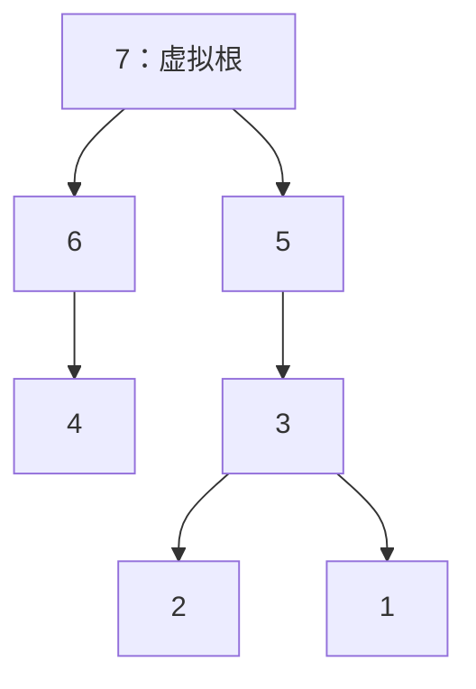

## USACO 2021–2022 赛季 January：

## 一、题目与知识点总览

| 组别 | 题目 | 主要知识点 | 课堂重点 |
| --- | --- | --- | --- |
| Gold 1 | Drought | 不变量、计数 DP、前缀和优化 | 为什么分奇偶；如何避免重复计数 |
| Gold 2 | Farm Updates | 离线倒序、图遍历、单调性 | 删除转添加；为什么逆序的 A 可以忽略 |
| Gold 3 | Tests for Haybales | 构造、树、DFS 顺序 | 把第一个越界位置变成父节点 |
| Silver 1 | Searching for Soulmates | 操作化简、逆向思维、二进制 | 将无限搜索变成两条短链的枚举 |
| Silver 2 | Cow Frisbee | 单调栈、最近更大元素 | 从较矮端点出发理解可传递条件 |
| Silver 3 | Cereal 2 | 图建模、生成树、环、构造 | 麦片是点，奶牛是边 |
| Bronze 1 | Herdle | 模拟、字符计数 | 先匹配位置，再匹配数量 |
| Bronze 2 | Non-Transitive Dice | 枚举、比较计数、函数封装 | 严格胜出不等于平均数更大 |
| Bronze 3 | Drought | 贪心、两次扫描 | 找出必须执行的操作 |

---

## 二、Gold 1：Drought

[题目](https://usaco.org/index.php?page=viewproblem2&cpid=1185) · [官方解析](https://usaco.org/current/data/sol_prob1_gold_jan22.html)

### 1. 题意与规模

有 N 头奶牛，每次选择相邻两头，让两头的饥饿值都减 1。饥饿值不能变成负数，目标是所有奶牛的饥饿值相等。

现在给出的不是具体饥饿值，而是每头牛的上界 H[i]。统计满足 `0 <= h[i] <= H[i]` 且能够完成目标的数组数量，对 `1000000007` 取模。

- `1 <= N <= 100`。
- `0 <= H[i] <= 1000`。
- 统计的是初始数组，不是操作顺序。

### 2. 先判断一个数组能否全部减到 0

假设当前第一头牛还剩 x，那么只能在第一、二头之间操作 x 次，把第一头清零。第二头因此减少 x。

继续向右，每一步都是被迫的：前面的牛已经清零，当前剩余值只能由当前牛与下一头牛共同消除。

因此，只需维护一个“尚未消除的剩余值”。所有中间剩余值非负，且最后剩余值为 0，恰好就是可行条件。

### 3. 为什么要区分 N 的奇偶

相邻两项同时减 1，不会改变交错和：

$$
S=h_1-h_2+h_3-h_4+\cdots.
$$

若最后每头都为 f：

- N 为偶数时，最后交错和为 0。一个数组可能对应多个可行 f。
- N 为奇数时，最后交错和就是 f，所以 f 唯一。

**偶数情况：只统计能减到 0 的数组。** 如果能减到 f，就继续在 `(1,2)、(3,4)、…` 上各操作 f 次，得到全 0。因此，“能减到某个非负相同值”等价于“能减到 0”。不能枚举 f 后直接累加，否则会重复统计。

**奇数情况：枚举唯一的最终值 f。** 对全部数和上界减去 f，就变成新的“减到 0”问题。枚举 `0 <= f <= min(H)` 并累加，没有重复。

### 4. 如何定义 DP

固定 f，令 `cap[i] = H[i] - f`。

`dp[i][j]`：选择了前 i 项，并把前 i−1 项清零后，第 i 项剩余 j 的数组数量。

假设上一项剩余 x，当前项原值必须为 `x+j`，才能在消除上一项后剩 j。上界要求：

$$
x+j\le cap[i].
$$

所以：

$$
dp[i][j]=\sum_{x=0}^{cap[i]-j}dp[i-1][x].
$$

初始化虚拟状态 `dp[0][0] = 1`，其余为 0。最终取 `dp[N][0]`。

右边是上一层的一段前缀和，预处理后每个状态可以 O(1) 转移。代码使用滚动数组，只保留上一层。

### 5. 小例子

若 N=2、H=[2,3]，可行数组只能是：

```text
[0,0]、[1,1]、[2,2]
```

答案为 3。比如 `[2,2]` 可以停在 2，也可以减到 1 或 0，但它仍然只算一个数组。

再看固定最终值 f=0、上界 `[1,1]` 的 DP：

| 阶段 | 剩余 0 的方案数 | 剩余 1 的方案数 |
| --- | --- | --- |
| 尚未选择 | 1 | 0 |
| 选择第一项 | 1 | 1 |
| 选择第二项 | 2 | 1 |

最后取剩余 0 的两种方案 `[0,0]、[1,1]`。

### 6. C++17 代码

```cpp
#include <bits/stdc++.h>
using namespace std;
const int MOD = 1000000007;

// 所有 h[i] 的上界减去 finalValue 后，统计能全部减到 0 的数组。
int countZero(const vector<int>& H, int finalValue) {
    int U = *max_element(H.begin(), H.end()) - finalValue;
    vector<int> dp(U + 1), next(U + 1), prefix(U + 1);
    dp[0] = 1;
    for (int upper : H) {
        int cap = upper - finalValue;
        prefix[0] = dp[0];
        for (int x = 1; x <= U; x++) {
            prefix[x] = prefix[x - 1] + dp[x];
            if (prefix[x] >= MOD) prefix[x] -= MOD;
        }
        fill(next.begin(), next.end(), 0);
        for (int j = 0; j <= cap; j++) {
            next[j] = prefix[cap - j];
        }
        dp.swap(next);
    }
    return dp[0];
}

int main() {
    ios::sync_with_stdio(false);
    cin.tie(nullptr);
    int N;
    cin >> N;
    vector<int> H(N);
    for (int& x : H) cin >> x;
    if (N % 2 == 0) {
        cout << countZero(H, 0) << '\n';
    } else {
        int answer = 0;
        int limit = *min_element(H.begin(), H.end());
        for (int f = 0; f <= limit; f++) {
            answer += countZero(H, f);
            if (answer >= MOD) answer -= MOD;
        }
        cout << answer << '\n';
    }
}
```

### 7. 复杂度与易错点

令 `U = max(H)`。

- N 为偶数：时间 O(NU)。
- N 为奇数：时间 O(NU(min(H)+1))，上界 O(NU²)。
- DP 辅助空间 O(U)，输入数组 O(N)。

注意：`dp` 中的 j 是消除前一项后的剩余值，不是当前项原始值；枚举 f 时需要重新初始化 DP。

课堂提问：为什么 N 为偶数时枚举所有 f 会重复，而 N 为奇数时不会？

---

## 三、Gold 2：Farm Updates

[题目](https://usaco.org/index.php?page=viewproblem2&cpid=1186) · [官方解析](https://usaco.org/current/data/sol_prob2_gold_jan22.html)

### 1. 题意与规模

最初 N 个农场全部活跃，没有道路。有三类操作：

| 操作 | 含义 |
| --- | --- |
| `D x` | 停用一个活跃农场 x |
| `A x y` | 在两个当时仍活跃的农场之间添加道路 |
| `R e` | 删除第 e 条被添加的道路 |

农场自身活跃，或者能通过道路到达活跃农场，就叫相关。输出每个农场最后一次相关的时刻，时刻取 `0..Q`，其中 0 表示尚未执行操作。

`N <= 100000，Q <= 200000`。停用不是删除节点，道路仍可经过该农场。

### 2. 正向做为什么麻烦

删除一条道路后，连通块可能分裂。若每次重新遍历所有农场，最坏时间达到 O(Q(N+Q))。

先找单调性：正向执行过程中，相关农场只可能减少。

- D 和 R 只会减少活跃来源或连接。
- A 的两个端点都活跃，原本就相关；它不会让一个不相关的连通块重新相关。

这里“只能在活跃端点之间加边”是题目给出的关键保证。

### 3. 倒序恢复

先建立所有操作结束后的图，从最终仍活跃的农场出发遍历，能到达的点答案为 Q。

之后从第 Q 次操作向前撤销：

1. 撤销 `D x`：x 恢复活跃。从 x 出发，给所有尚未确定答案的可达点标记 `i-1`。
2. 撤销 `R e`：恢复该道路。如果一端已相关，就向另一端传播相关状态。
3. 撤销 `A`：可以不做处理，理由见下一步。

倒序第一次相关，正好对应正向最后一次相关。所以每个点只需确定一次答案。

### 4. 为什么撤销 A 时可以不删边

在原本添加这条道路的时刻，两端都活跃。因此逆序回到这次添加之前时，两端也都已经相关。

继续保留这条边，只会连接两个已相关的点，不会额外激活不相关区域。逆序的相关集合只会扩大，所以后续也不会因此出错。

这使得维护的图只有加边，没有删边。实现中答案已确定的点不再重复展开；新加边若连接已确定与未确定的区域，就从未确定的一端开始遍历。

### 5. 手推示例

```text
3 4
A 1 2
D 1
R 1
D 2
```

| 时刻 | 状态变化 | 仍相关的农场 |
| --- | --- | --- |
| 0 | 所有农场活跃 | 1、2、3 |
| 1 | 添加 1—2 | 1、2、3 |
| 2 | 停用 1，但能到达活跃的 2 | 1、2、3 |
| 3 | 删除 1—2 | 2、3 |
| 4 | 停用 2 | 3 |

答案为 `2、3、4`。

倒序时先标记 3 的答案为 4；撤销 `D 2` 得到答案 3；撤销删边后，1 与 2 相连，得到答案 2。

### 6. C++17 代码

```cpp
#include <bits/stdc++.h>
using namespace std;
struct Operation {
    char type;
    int value;
};

int main() {
    ios::sync_with_stdio(false);
    cin.tie(nullptr);
    int N, Q;
    cin >> N >> Q;
    vector<Operation> ops(Q + 1);
    vector<pair<int, int>> edges(1); // 道路按添加次序从 1 编号
    vector<bool> active(N + 1, true), removed(Q + 1, false);
    for (int i = 1; i <= Q; i++) {
        char type;
        cin >> type;
        if (type == 'A') {
            int u, v;
            cin >> u >> v;
            edges.push_back({u, v});
            ops[i] = {type, static_cast<int>(edges.size()) - 1};
        } else {
            int x;
            cin >> x;
            ops[i] = {type, x};
            if (type == 'D') active[x] = false;
            else removed[x] = true;
        }
    }
    vector<vector<int>> adj(N + 1);
    for (int e = 1; e < static_cast<int>(edges.size()); e++) {
        if (removed[e]) continue;
        auto [u, v] = edges[e];
        adj[u].push_back(v);
        adj[v].push_back(u);
    }
    vector<int> answer(N + 1, -1);
    auto mark = [&](int start, int time) {
        if (answer[start] != -1) return;
        vector<int> st{start};
        answer[start] = time;
        while (!st.empty()) {
            int u = st.back();
            st.pop_back();
            for (int v : adj[u]) {
                if (answer[v] != -1) continue;
                answer[v] = time;
                st.push_back(v);
            }
        }
    };
    for (int u = 1; u <= N; u++) {
        if (active[u]) mark(u, Q);
    }
    for (int i = Q; i >= 1; i--) {
        auto [type, value] = ops[i];
        if (type == 'D') {
            mark(value, i - 1);
        } else if (type == 'R') {
            auto [u, v] = edges[value];
            adj[u].push_back(v);
            adj[v].push_back(u);
            if (answer[u] != -1) mark(v, i - 1);
            if (answer[v] != -1) mark(u, i - 1);
        }
        // 逆序遇到 A 时不删除道路：见正文中的单调性证明。
    }
    for (int u = 1; u <= N; u++) cout << answer[u] << '\n';
}
```

```

#include <bits/stdc++.h>
using namespace std;
struct Operation {
    char type;
    int x, y;   // D: x=farm
                // A: x=u, y=v
                // R: x=edge_id
};
int main() {
    ios::sync_with_stdio(false);
    cin.tie(nullptr);
  
    int N, Q;
    cin >> N >> Q;
    vector<Operation> ops(Q + 1); //离线处理需要存所有操作
    vector<pair<int, int>> edges(1); //使后续加入的边使从1开始
    vector<bool> removed(1); //删除的边也是从1开始
    vector<bool> active(N + 1, true);
    int edgeCount = 0;
    //1.读操作
    for (int i = 1; i <= Q; i++) {
        char type;
        cin >> type;
        if (type == 'D') {
            int x;
            cin >> x;
            ops[i] = {type, x, 0};
            // 最终状态下 x 已经 inactive
            active[x] = false;
        }
        else if (type == 'A') {
            int u, v;
            cin >> u >> v;
            edgeCount++; //统计是第几条边
            edges.push_back({u, v});
            removed.push_back(false);
            // 保存这次 A 对应的是哪条边
            ops[i] = {type, edgeCount, 0};
        }
        else if (type == 'R') {
            int edgeId;
            cin >> edgeId;
            ops[i] = {type, edgeId, 0};
            // 这条边在最终状态不存在
            removed[edgeId] = true;
        }
    }
    // 2. 建立Final的图
    vector<vector<int>> adj(N + 1); //领接表
    for (int id = 1; id <= edgeCount; id++) {
        if (!removed[id]) {
            auto [u, v] = edges[id];
            adj[u].push_back(v);
            adj[v].push_back(u);
        }
    }
    // ans[u] = farm u 最后 relevant 的时间
    vector<int> ans(N + 1, -1);
    // relevant[u] = 在当前倒序状态中，u 是否已经 relevant
    vector<bool> relevant(N + 1, false);

    // 用flood函数将整个连通块标记为 relevant
    auto flood = [&](int start, int time) {
        stack<int> st;
        st.push(start);
        while (!st.empty()) {
            int u = st.top();
            st.pop();
            if (relevant[u]) //如果节点 u 之前已经被标记为 relevant，就不要再处理它了。
                continue;
            relevant[u] = true;
            ans[u] = time;
            for (int v : adj[u]) {
                if (!relevant[v]) {
                    st.push(v);
                }
            }
        }
    };
    // 3. 最终时刻：
    //    所有仍 active 的 farm 所在连通块都 relevant
    for (int u = 1; u <= N; u++) {
        if (active[u] && !relevant[u]) {
            flood(u, Q);
        }
    }
    // 4. 倒序处理操作
    for (int i = Q; i >= 1; i--) {
        char type = ops[i].type;
        if (type == 'D') {
            int x = ops[i].x;
            if (!relevant[x]) {
                flood(x, i - 1);// 倒序：x 重新 activate，回到上一步time-1;
            }
        }
        else if (type == 'R') {
            int edgeId = ops[i].x;
            auto [u, v] = edges[edgeId];// 倒序：把边加回来
            adj[u].push_back(v);
            adj[v].push_back(u);
            // 如果一边已经 relevant，另一边整个 Graph component 都会变 relevant
            if (relevant[u] && !relevant[v]) {
                flood(v, i - 1);
            }
            else if (relevant[v] && !relevant[u]) {
                flood(u, i - 1);
            }
        }
        else if (type == 'A') {
            // do nothing
        }
    }
    // 5. 输出答案
    for (int u = 1; u <= N; u++) {
        cout << ans[u] << '\n';
    }
    return 0;
}
```


### 7. 复杂度与易错点

- 时间 O(N+Q)，空间 O(N+Q)。每个点只展开一次，每条道路只加入一次。
- `R e` 的 e 是道路添加编号，不是操作行号。
- 撤销第 i 次操作后，对应的时刻是 i−1。
- 0 是合法答案，使用 −1 表示未确定。
- 使用显式栈，避免长链图导致深递归。

课堂提问：如果允许 A 连接已经停用的农场，为什么这个单调性可能失效？

---

## 四、Gold 3：Tests for Haybales

[题目](https://usaco.org/index.php?page=viewproblem2&cpid=1187) · [官方解析](https://usaco.org/current/data/sol_prob3_gold_jan22.html)

### 1. 题意与规模

构造非递减数组 `x[1..N]` 和正整数 K，使每个给定的 j[i] 都是满足 `x[j] <= x[i]+K` 的最大下标。

已知：

$$
i\le j_i,\qquad j_1\le j_2\le\cdots\le j_N\le N.
$$

`N <= 100000`。输出值需要在题目允许的 `10^18` 范围内，题目保证存在解，任意合法构造都可以。

### 2. 从“最后一个能到达”改看“第一个不能到达”

对于 i，`j[i]+1` 是第一个必须超过 `x[i]+K` 的位置。因此定义：

$$
parent[i]=j[i]+1.
$$

添加虚拟节点 N+1 作为根。因为父节点编号始终大于孩子，沿父指针最终到达 N+1，形成一棵树。

这个转换的目的，是把数值边界变成一条明确的父子关系。

### 3. 用层级负责大范围，用偏移负责边界

设根的深度为 0，最大深度为 D，定义：

$$
height[i]=D-depth[i].
$$

这里的 height 是全树最大深度减去当前深度，不是普通的“子树高度”。父节点比孩子的 height 大 1。

由于 `parent[i]` 非递减，可以从大编号往小编号归纳得到 `depth[i] >= depth[i+1]`，所以 height 随编号非递减，且最深节点包含 1，可以取 `D=depth[1]`。

令：

$$
K=N+1,\qquad x_i=height[i]\cdot K+offset[i].
$$

其中 offset 是 `0..N` 的不同整数。这样，相差两层及以上的点很容易区分，关键只剩下一层以内的先后顺序。

### 4. offset 如何分配

从根开始做 DFS：

1. 根得到 offset=N。
2. 每次访问节点，给它当前剩余的最大 offset，然后减 1。
3. 孩子按照编号从大到小访问。

这个顺序让父节点的 offset 大于孩子；同层较小编号的节点，会在相应较大编号节点的子树之后访问，得到更小的 offset。

对 i 的父节点 p：

$$
x_p=(height[i]+1)K+offset[p]>x_i+K.
$$

而 p 之前、位于同一目标层的节点，会得到小于 `offset[i]` 的偏移，因此仍在 `x[i]+K` 范围内。更低层也都在范围内。

所以第一个越界位置恰好是 p，也就是 `j[i]+1`。同层节点的 offset 随编号递增，不同层由 K 分开，整个 x 数组也非递减。

### 5. 手推官方样例的另一种合法输出

输入：

```text
6
2 2 4 5 6 6
```

父节点为 `3、3、5、6、7、7`，根为 7。对应的树为：



DFS 顺序为 `7、6、4、5、3、2、1`，offset 从 6 依次减到 0。构造结果为：

| i | depth | height | offset | x[i] |
| --- | --- | --- | --- | --- |
| 1 | 3 | 0 | 0 | 0 |
| 2 | 3 | 0 | 1 | 1 |
| 3 | 2 | 1 | 2 | 9 |
| 4 | 2 | 1 | 4 | 11 |
| 5 | 1 | 2 | 3 | 17 |
| 6 | 1 | 2 | 5 | 19 |

此时 K=7。例如 i=4，`x[4]+K=18`，能包含 x[5]=17，但不能包含 x[6]=19，所以 j[4]=5。

### 6. C++17 代码

```cpp
#include <bits/stdc++.h>
using namespace std;
using ll = long long;

int main() {
    ios::sync_with_stdio(false);
    cin.tie(nullptr);
    int N;
    cin >> N;
    int root = N + 1;
    vector<vector<int>> children(N + 2);
    for (int i = 1; i <= N; i++) {
        int j;
        cin >> j;
        children[j + 1].push_back(i);
    }
    vector<int> depth(N + 2), offset(N + 2);
    vector<int> st{root};
    int counter = N;
    while (!st.empty()) {
        int u = st.back();
        st.pop_back();
        offset[u] = counter--;
        // 从小到大入栈，弹出时就会先访问编号大的孩子。
        for (int v : children[u]) {
            depth[v] = depth[u] + 1;
            st.push_back(v);
        }
    }
    ll K = N + 1;
    int maxDepth = depth[1];
    cout << K << '\n';
    for (int i = 1; i <= N; i++) {
        ll height = maxDepth - depth[i];
        ll value = height * K + offset[i];
        cout << value << '\n';
    }
}
```

### 7. 复杂度与易错点

- 时间 O(N)，空间 O(N)。输出数值为 O(N²)，使用 `long long`。
- 虚拟根只参与构造，不输出它的 x。
- DFS 访问孩子的顺序不能随便修改；栈中要从小到大压入，才能从大到小弹出。
- 构造题应检查条件，而不是把输出与样例逐行比较。

课堂提问：为什么只使用 height 不够，还需要 offset？

---

## 五、Silver 1：Searching for Soulmates

[题目](https://usaco.org/index.php?page=viewproblem2&cpid=1182) · [官方解析](https://usaco.org/current/data/sol_prob1_silver_jan22.html)

### 1. 题意与规模

将正整数 A 变成 B。一次操作可以：乘 2；偶数时除以 2；加 1。求最少操作数。

最多 10 组，`1 <= A,B <= 10^18`。

小范围可以 BFS，但全范围不能按每个数建立状态。需要先压缩可能的操作序列。

### 2. 化简最优操作的形状

**不会先乘 2、之后又除以 2。** 考虑一次乘法与后面紧接的下一次除法，中间只有加法。若加了 2t 次：

$$
x\to 2x\to 2x+2t\to x+t.
$$

直接加 t 次更省，因此这种乘除组合不可能出现在最优解中。

所以最优解可以写成三段：

1. 缩小段：若干次除 2，奇数时先加 1。
2. 中间段：只做加 1。
3. 放大段：若干次乘 2，夹杂必要的加 1。

除法前多加的两次，可以改到除法后只加一次；乘法后多加的两次，也可以改到乘法前只加一次。因此两侧只保留必要的奇偶调整。

### 3. 从两端分别生成短链

从 A 出发，反复执行：偶数直接除 2，奇数先加 1 再除 2。记录每个中间值和费用，直到 1。

从 B 逆向生成：偶数直接除 2，奇数先减 1 再除 2。这里逆向的减 1，对应正向的加 1；记录的费用等于从该中间值放大到 B 的费用。

每条链只有 O(log V) 个节点。枚举左链节点 x、右链节点 y：若 x≤y，中间用 `y-x` 次加 1 连接。

$$
answer=\min_{x\le y}\bigl(cost_A[x]+(y-x)+cost_B[y]\bigr).
$$

所有最优解都可以化成前述三段，因此枚举两段的交接位置不会遗漏。

### 4. 示例：31 变成 13

| A 侧中间值 | 31 | 16 | 8 | 4 | 2 | 1 |
| --- | --- | --- | --- | --- | --- | --- |
| 从 A 到这里的费用 | 0 | 2 | 3 | 4 | 5 | 6 |

| B 侧中间值 | 13 | 6 | 3 | 1 |
| --- | --- | --- | --- | --- |
| 从这里到 B 的费用 | 0 | 2 | 3 | 5 |

选择 x=8、y=13，费用 `3+(13-8)+0=8`：

```text
31 → 32 → 16 → 8 → 9 → 10 → 11 → 12 → 13
```

注意：不是强制经过 1，只是把所有可选交接位置都记录下来。

### 5. C++17 代码

```cpp
#include <bits/stdc++.h>
using namespace std;
using ll = long long;

ll solve(ll A, ll B) {
    vector<pair<ll, ll>> left, right; // {数值, 已经使用的操作数}
    ll value = A, cost = 0;
    left.push_back({value, cost});
    while (value > 1) {
        if (value % 2 == 1) {
            value++;
            cost++;
        }
        value /= 2;
        cost++;
        left.push_back({value, cost});
    }
    value = B;
    cost = 0;
    right.push_back({value, cost});
    while (value > 1) {
        // 逆向删去一个二进制末位：奇数先减 1，再除以 2。
        if (value % 2 == 1) {
            value--;
            cost++;
        }
        value /= 2;
        cost++;
        right.push_back({value, cost});
    }
    ll answer = LLONG_MAX;
    for (auto [x, costA] : left) {
        for (auto [y, costB] : right) {
            if (x <= y) answer = min(answer, costA + y - x + costB);
        }
    }
    return answer;
}

int main() {
    ios::sync_with_stdio(false);
    cin.tie(nullptr);
    int T;
    cin >> T;
    while (T--) {
        ll A, B;
        cin >> A >> B;
        cout << solve(A, B) << '\n';
    }
}
```

### 6. 复杂度与易错点

令 `V=max(A,B)`，每组时间 O(log²V)，空间 O(log V)。

- 正向没有减 1；只有从 B 逆推时使用减 1。
- 左链奇数是向上调整，右链奇数是向下调整。
- 不能看见偶数就盲目除 2；链上每个节点都要作为候选。
- 用 `long long` 保存数值、费用以及两数差。

课堂提问：为什么 `10 → 11 → 12 → 24` 会比先把 10 除到更小更好？

---

## 六、Silver 2：Cow Frisbee

[题目](https://usaco.org/index.php?page=viewproblem2&cpid=1183) · [官方解析](https://usaco.org/current/data/sol_prob2_silver_jan22.html)

### 1. 题意与规模

N 头牛排成一行，身高是 `1..N` 的一个排列，`N <= 300000`。

对于 i<j，当中间所有牛都比两端矮时，i、j 可以互相传飞盘。对所有这样的无序牛对，累加 `j-i+1`。

$$
\max_{i<k<j}h_k<\min(h_i,h_j).
$$

相邻两头总能传递；贡献是区间长度，不是下标差。

### 2. 从较矮的那头出发理解

若左端较矮，右端必须是它右侧第一头更高的牛。否则中间已经存在一头比左端高的牛，会挡住它。

若右端较矮，左端必须是它左侧第一头更高的牛。

因此问题转成寻找左右最近更大元素，可以用单调栈线性处理。

### 3. 一次扫描同时统计两类牛对

栈保存下标，从栈底到栈顶身高严格递减。扫描到 i：

1. 栈顶比当前矮：当前 i 就是栈顶右边第一头更高的牛，计入这对并弹栈。重复这一过程。
2. 弹栈后仍有栈顶：它是 i 左边第一头更高的牛，再计入这一对。
3. 把 i 入栈。

不继续统计更深的栈元素，因为新的栈顶已经挡住它们与当前牛之间的传递。

### 4. 手推示例

身高 `[4,2,3,1]`，下标从 1 开始。

| 当前下标 | 处理 | 新增贡献 | 处理后的栈下标 |
| --- | --- | --- | --- |
| 1 | 直接入栈 | 0 | [1] |
| 2 | 栈顶 1 更高，计 (1,2) | 2 | [1,2] |
| 3 | 弹出 2，计 (2,3)；栈顶 1 更高，计 (1,3) | 2+3 | [1,3] |
| 4 | 栈顶 3 更高，计 (3,4) | 2 | [1,3,4] |

总和为 9。比如 (1,4) 不合法，因为中间的牛比右端身高 1 更高。

### 5. C++17 代码

```cpp
#include <bits/stdc++.h>
using namespace std;
using ll = long long;

int main() {
    ios::sync_with_stdio(false);
    cin.tie(nullptr);
    int N;
    cin >> N;
    vector<int> h(N + 1), st;
    for (int i = 1; i <= N; i++) cin >> h[i];
    ll answer = 0;
    for (int i = 1; i <= N; i++) {
        while (!st.empty() && h[st.back()] < h[i]) {
            answer += i - st.back() + 1;
            st.pop_back();
        }
        if (!st.empty()) answer += i - st.back() + 1;
        st.push_back(i);
    }
    cout << answer << '\n';
}
```

### 6. 复杂度与易错点

时间 O(N)，空间 O(N)。虽然有 while，每个下标只入栈一次、出栈至多一次。

- 栈中存下标，才能计算距离。
- 答案用 `long long`。
- 身高互不相同，因此没有相等身高的分支。
- 先弹出较矮元素，再统计剩余栈顶；两部分不能漏。

课堂提问：为什么弹出的牛以后都不需要重新入栈？

---

## 七、Silver 3：Cereal 2

[题目](https://usaco.org/index.php?page=viewproblem2&cpid=1184) · [官方解析](https://usaco.org/current/data/sol_prob3_silver_jan22.html)

### 1. 题意与规模

有 N 头奶牛、M 盒不同种类的麦片，每种只有一盒。每头牛有不同的第一志愿 f、第二志愿 s。

按给定顺序依次吃：优先选第一志愿，若已被吃则选第二志愿，两个都没有就挨饿。

需要重排奶牛顺序，使挨饿数量最少，并输出一种顺序。

`N <= 100000，2 <= M <= 100000`。第一、第二志愿不能任意互换。

### 2. 建模：麦片当点，奶牛当边

每头牛对应连接 f、s 的一条边。求连通块时忽略方向，但仍保存哪个端点是第一志愿。

不同连通块使用的麦片互不相交，可以独立安排。

设一个连通块有 V 个麦片点、E 条奶牛边：最多喂饱 V 头，所以至少 `max(0,E-V)` 头挨饿。下面构造顺序达到这个下界。

### 3. 树和有环连通块分别安排

**树：E=V−1。** 任取根，按父边在前、子边在后的顺序安排奶牛。处理树边 u—v 时，v 是刚进入的新节点，其麦片不可能已被前面的牛吃掉，因此当前牛至少还有一盒可吃，所有牛都能吃饱。

**有环：E≥V。** 保留一棵生成树，再选一条非树边：

1. 把这条非树边对应的牛放第一，它吃掉自己的第一志愿。
2. 以被吃掉的麦片为树根，按父边在前的顺序安排全部树边。
3. 根麦片已被占用，之后每条树边的牛都会吃新孩子的麦片。最终 V 盒全部用完。
4. 剩余 E−V 条边放最后，对应的牛挨饿。

两种情况都达到下界，所以最少挨饿数为各连通块 `max(0,E-V)` 之和。

### 4. 代码怎样选生成树

读取每头牛时，用并查集尝试合并两个志愿：

- 合并成功：把这条边加入生成森林。
- 已经连通：记录为非树边。

全部读完后，对每个最终连通块选一条非树边，再用 BFS 输出树边顺序。这里 BFS 负责保证父边先于子边，不是在求最短路。

### 5. 手推示例

有 3 种麦片、4 头牛：

| 牛编号 | 第一志愿 | 第二志愿 |
| --- | --- | --- |
| 1 | 1 | 2 |
| 2 | 2 | 3 |
| 3 | 3 | 1 |
| 4 | 1 | 3 |

可取树边为牛 1、2，非树边先选牛 3。先让牛 3 吃麦片 3，再从麦片 3 沿树处理牛 2、1：

```text
顺序：3、2、1、4
牛3吃3；牛2吃2；牛1吃1；牛4挨饿。
```

这个块 E=4、V=3，至少挨饿 1 头，构造恰好达到。

### 6. C++17 代码

```cpp
#include <bits/stdc++.h>
using namespace std;
struct DSU {
    vector<int> parent;
    DSU(int n) : parent(n + 1, -1) {}
    int find(int x) {
        return parent[x] < 0 ? x : parent[x] = find(parent[x]);
    }
    bool unite(int a, int b) {
        a = find(a);
        b = find(b);
        if (a == b) return false;
        if (parent[a] > parent[b]) swap(a, b);
        parent[a] += parent[b];
        parent[b] = a;
        return true;
    }
};

int main() {
    ios::sync_with_stdio(false);
    cin.tie(nullptr);
    int N, M;
    cin >> N >> M;
    DSU dsu(M);
    vector<int> first(N + 1), second(N + 1), extra;
    vector<vector<pair<int, int>>> tree(M + 1);
    for (int cow = 1; cow <= N; cow++) {
        cin >> first[cow] >> second[cow];
        int a = first[cow], b = second[cow];
        if (dsu.unite(a, b)) {
            tree[a].push_back({b, cow});
            tree[b].push_back({a, cow});
        } else {
            extra.push_back(cow);
        }
    }
    vector<int> extraEdge(M + 1, -1);
    for (int cow : extra) {
        int root = dsu.find(first[cow]);
        if (extraEdge[root] == -1) extraEdge[root] = cow;
    }
    vector<bool> seen(M + 1, false), chosen(N + 1, false);
    vector<int> order;
    for (int root = 1; root <= M; root++) {
        if (dsu.find(root) != root) continue;
        int start = root;
        if (extraEdge[root] != -1) {
            int cow = extraEdge[root];
            order.push_back(cow);
            chosen[cow] = true;
            start = first[cow]; // 第一头牛会先吃第一志愿。
        }
        queue<int> q;
        q.push(start);
        seen[start] = true;
        while (!q.empty()) {
            int u = q.front();
            q.pop();
            for (auto [v, cow] : tree[u]) {
                if (seen[v]) continue;
                seen[v] = true;
                chosen[cow] = true;
                order.push_back(cow);
                q.push(v);
            }
        }
    }
    int hungry = N - static_cast<int>(order.size());
    for (int cow = 1; cow <= N; cow++) {
        if (!chosen[cow]) order.push_back(cow);
    }
    cout << hungry << '\n';
    for (int cow : order) cout << cow << '\n';
}
```

### 7. 复杂度与易错点

- 本实现时间 O((N+M)α(M))，空间 O(N+M)。α 是并查集摊还复杂度中的反阿克曼函数，增长极慢。
- 使用 DFS 找生成森林也可实现严格的 O(N+M)，本版用并查集简化选边。
- 节点是麦片，不是奶牛；最终输出的是边对应的奶牛编号。
- 两头牛可以有相同的两种志愿，这是不同的两条边，不能合并去重。
- 非树边先安排的牛会吃第一志愿，所以树根必须选其第一志愿。
- 仅计算最少挨饿数还不够，题目要求输出实际可用的顺序。

课堂提问：有多个环时，为什么只要一棵树加一条非树边，就能把这个连通块的所有麦片用完？

---

## 八、Bronze 1：Herdle

[题目](https://usaco.org/index.php?page=viewproblem2&cpid=1179) · [官方解析](https://usaco.org/current/data/sol_prob1_bronze_jan22.html)

### 1. 题意

输入正确答案和猜测结果，各为 3×3 的大写字母网格。

- 字母、位置都正确：绿色。
- 字母正确但位置不正确：黄色。
- 每个答案格子最多匹配一次，绿色先匹配。

输出绿色数量和黄色数量。

### 2. 为什么不能只判断“答案里有没有这个字母”

如果答案只剩一个 A，猜测里却剩三个 A，只能有一个黄色，不能算三个。

因此要比较剩余字母的数量，而不是存在性。

### 3. 正确思路

1. 逐位置比较，完全一致就统计绿色。
2. 只对未匹配的位置，分别统计答案和猜测的各字母频次。
3. 对字母 c，最多匹配 `min(countA[c],countB[c])` 个黄色；对 26 个字母求和。

不必真的维护二维数组，把三行拼成长度为 9 的字符串也可以。

### 4. 示例

```text
答案：       猜测：
AAA          AYY
BBB          AAA
CCC          ZZZ
```

左上角的 A 是绿色。去掉绿色后，答案还剩 2 个 A，猜测还剩 3 个 A，因此黄色只能贡献 2。最终输出绿色 1、黄色 2。

### 5. C++17 代码

```cpp
#include <bits/stdc++.h>
using namespace std;

int main() {
    string answer, guess, row;
    for (int i = 0; i < 3; i++) {
        cin >> row;
        answer += row;
    }
    for (int i = 0; i < 3; i++) {
        cin >> row;
        guess += row;
    }
    int green = 0, yellow = 0;
    int countA[26] = {}, countB[26] = {};
    for (int i = 0; i < 9; i++) {
        if (answer[i] == guess[i]) green++;
        else {
            countA[answer[i] - 'A']++;
            countB[guess[i] - 'A']++;
        }
    }
    for (int c = 0; c < 26; c++) yellow += min(countA[c], countB[c]);
    cout << green << '\n' << yellow << '\n';
}
```

### 6. 复杂度与易错点

固定大小下，时间与空间都是 O(1)。若推广到 L 个格子、字符集大小为 Σ，则时间 O(L+Σ)，辅助空间 O(Σ)。

绿色格子不能再加入黄色的频次统计。重复字母需要数量匹配，不能每次找到同一格就反复计数。

课堂提问：如果直接对全部字母频次取最小值，这个和代表什么？为什么再减绿色数量也能得到黄色数量？

---

## 九、Bronze 2：Non-Transitive Dice

[题目](https://usaco.org/index.php?page=viewproblem2&cpid=1180) · [官方解析](https://usaco.org/current/data/sol_prob2_bronze_jan22.html)

### 1. 题意与规模

给出两个四面骰子 A、B，每面点数在 1..10，允许重复。判断是否能构造同样范围的四面骰子 C，形成严格的胜负循环：

$$
A>B,\quad B>C,\quad C>A
$$

或相反方向。这里“胜”表示随机各掷一次时，获胜概率大于失败概率；平局重掷不会改变这个比较。最多 10 组数据。

### 2. 如何比较两个骰子

两个四面骰子共有 16 种等概率的面组合。枚举 x、y：

- x>y：wins 加 1。
- x<y：losses 加 1。
- 相等：不计入两者。

只有 `wins > losses` 才是严格胜出。不能直接比较骰子点数和，也不能固定要求 `wins > 8`，因为可能存在平局。

### 3. 枚举第三个骰子

C 的四个面各有 10 种选择，总共 `10^4` 个候选，直接四重循环枚举即可。

如果 A、B 互相都不严格胜出，就不可能形成严格循环。否则必要时交换 A、B，统一成 A>B；只需检查 `B>C` 且 `C>A`。

这里交换的是两个骰子的名字，不是修改它们的面。

### 4. 一个循环例子

```text
A = [4,5,6,7]
B = [2,4,5,10]
C = [1,4,8,9]
```

| 比较 | 左边胜 | 左边负 | 平局 | 结论 |
| --- | --- | --- | --- | --- |
| A 对 B | 9 | 5 | 2 | A 胜 B |
| B 对 C | 8 | 7 | 1 | B 胜 C |
| C 对 A | 8 | 7 | 1 | C 胜 A |

虽然点数可以比较大小，但“骰子之间更容易获胜”这个关系不一定具有传递性。

### 5. C++17 代码

```cpp
#include <bits/stdc++.h>
using namespace std;
using Die = array<int, 4>;

bool beats(const Die& a, const Die& b) {
    int wins = 0, losses = 0;
    for (int x : a) {
        for (int y : b) {
            if (x > y) wins++;
            if (x < y) losses++;
        }
    }
    return wins > losses;
}

bool solve(Die a, Die b) {
    if (!beats(a, b) && !beats(b, a)) return false;
    if (beats(b, a)) swap(a, b); // 统一为 a 胜 b
    for (int w = 1; w <= 10; w++) {
        for (int x = 1; x <= 10; x++) {
            for (int y = 1; y <= 10; y++) {
                for (int z = 1; z <= 10; z++) {
                    Die c{w, x, y, z};
                    if (beats(b, c) && beats(c, a)) return true;
                }
            }
        }
    }
    return false;
}

int main() {
    ios::sync_with_stdio(false);
    cin.tie(nullptr);
    int T;
    cin >> T;
    while (T--) {
        Die a, b;
        for (int& x : a) cin >> x;
        for (int& x : b) cin >> x;
        cout << (solve(a, b) ? "yes" : "no") << '\n';
    }
}
```

### 6. 复杂度与易错点

每组时间 O(10⁴×4²)，辅助空间 O(1)。枚举面顺序会出现相同骰子的不同排列，但本题只问是否存在，重复检查不影响正确性。

输出是小写 `yes` 或 `no`。注意第三个骰子的面可以重复，不需要互不相同。

课堂提问：为什么“平均点数更大”不足以保证一个骰子严格胜过另一个骰子？

---

## 十、Bronze 3：Drought

[题目](https://usaco.org/index.php?page=viewproblem2&cpid=1181) · [官方解析](https://usaco.org/current/data/sol_prob3_bronze_jan22.html)

### 1. 题意与规模

给出 N 头牛的具体饥饿值。每次给相邻两头各一袋玉米，两头饥饿值都减 1。求使全部饥饿值相等且非负的最少玉米袋数；不能完成则输出 −1。

- `1 <= N <= 100000`，每个饥饿值不超过 `10^9`。
- 多组测试，所有 N 之和不超过 `100000`。
- 每次操作消耗 **2 袋**，答案不是操作次数。

### 2. 部分解：枚举最终值

设最后每头饥饿值为 f，枚举 `0..min(h)`。从左向右，将当前牛多出的饥饿值和下一头一起减掉；如果途中低于 f 或最后不等于 f，就不可行。

对固定 f，每步被迫，因此能正确判断。但饥饿值达到 `10^9`，不能逐个枚举 f。

### 3. 全解：先找必须执行的操作

假设 `h[i] > h[i-1]`，差为 d。

为了让它们最后相等，必须至少在 `(i,i+1)` 上执行 d 次操作，因为：

- 在 `(i-1,i)` 上操作，会同时减少两者，不改变差距。
- 在 `(i-2,i-1)` 上操作，会使左边更小，差距更大。
- 只有 `(i,i+1)` 能减少这个正差。

因此可以立即批量执行这 d 次，而不是一袋一袋模拟。若右邻居不够减，便无解。

如果这样的上升发生在最后一头，就没有右邻居可以帮忙，也是无解。

### 4. 为什么只需要两次扫描

第一次从左向右，处理所有上升位置后，数组变成非递增。

反转数组，就得到非递减数组。再做同样的扫描，相邻值会被逐步拉平；若末尾仍然大于前一项则无解，否则全部相等。

每一次执行的操作都是任何可行方案都必须包含的操作，扣除这些操作后，问题等价地缩小。因此若最终得到相等数组，就没有做多余操作，袋数最少。

代码在发生负数之前提前判无解；与最后统一检查非负是等价的，因为数值只会减少，不可能再恢复。

### 5. 示例：h=[8,10,5]

第一次扫描，第二头比第一头多 2，因此对第二、三头操作 2 次：

```text
[8,10,5] → [8,8,3]，使用 4 袋。
```

反转后 `[3,8,8]`，第二头比第一头多 5，对第二、三头操作 5 次：

```text
[3,8,8] → [3,3,3]，再使用 10 袋。
```

答案为 14 袋。

反例 `[0,1,0]`：中间多出 1，必须与右边一起减，但右边已经为 0，所以无解。

### 6. C++17 代码

```cpp
#include <bits/stdc++.h>
using namespace std;
using ll = long long;

ll solve(vector<ll> h) {
    int N = h.size();
    if (N == 1) return 0;
    ll answer = 0;
    for (int pass = 0; pass < 2; pass++) {
        for (int i = 1; i + 1 < N; i++) {
            if (h[i] > h[i - 1]) {
                ll diff = h[i] - h[i - 1];
                if (h[i + 1] < diff) return -1;
                h[i] -= diff;
                h[i + 1] -= diff;
                answer += 2 * diff;
            }
        }
        if (h[N - 1] > h[N - 2]) return -1;
        reverse(h.begin(), h.end());
    }
    return answer;
}

int main() {
    ios::sync_with_stdio(false);
    cin.tie(nullptr);
    int T;
    cin >> T;
    while (T--) {
        int N;
        cin >> N;
        vector<ll> h(N);
        for (ll& x : h) cin >> x;
        cout << solve(h) << '\n';
    }
}
```

### 7. 复杂度与易错点

时间 O(N)，空间 O(N)。批量减少的数量很大，但每个下标只处理常数次。

- 饥饿值和答案都使用 `long long`。
- N=1 时已经全部相等，答案为 0。
- 两头牛值不相同时，同减无法改变差距，直接无解；代码中的端点判断已覆盖。
- 不要求最终全部为 0；为了最少袋数，可能停在正数。

课堂提问：为什么“每次都把最大的牛和旁边的牛减少”不是一个有充分依据的贪心，而这里的操作是被迫的？
