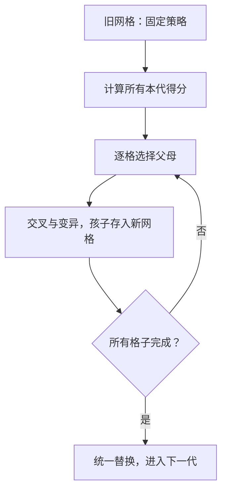

## 📚囚徒困境与遗传算法：

> 本课问题：一个细胞怎样根据邻居比赛的结果，产生下一代策略？  

## 1. 先明确：每个细胞保存什么？

每个细胞是一名玩家，保存一条固定策略，例如：

```python
strategy = "CDDC"
```

| 回合 | 1 | 2 | 3 | 4 |
|---|---|---|---|---|
| 选择 | C | D | D | C |

- C = cooperate，合作。
- D = defect，背叛。
- 一条长度为 L 的策略，与一个邻居比赛 L 回合。
- 本项目按预先写好的序列行动，不根据对方上一回合临时作出反应。

### 三个不同概念

| 概念 | 本课堂例子 | 决定什么 |
|---|---|---|
| 网格大小 | 3×3 | 有多少玩家：9 个 |
| 策略长度 | 4 | 与每个邻居比赛几回合 |
| 每格像素 | 如 24×24 | 屏幕上画多大，不是比赛规则 |

**一代不是一回合。**一代包含：与全部邻居完成多回合比赛、计算总分、产生全部新策略。

所有细胞始终存在。和 Game of Life 的区别是：不再改变生死，而是改变策略。

## 2. 计算适应度：一个细胞怎样得分？

### 2.1 单回合计分

| 自己 | 对方 | 自己得分 | 对方得分 |
|---|---|---:|---:|
| C | C | 2 | 2 |
| C | D | 0 | 3 |
| D | C | 3 | 0 |
| D | D | 1 | 1 |

### 2.2 一场与一代的区别

两名玩家使用 `CCCC` 和 `DDDD`：

- 全 C 玩家一场得 0 分。
- 全 D 玩家一场得 `4×3=12` 分。

但一个细胞每代要和八个邻居分别比赛，因此：

$$
\text{本代适应度}=\sum_{\text{八个邻居}}\text{与该邻居比赛时自己的得分}
$$
每代重新计算，不把上代分数一直累加。

### 2.3 本课贯穿例子：3×3 环绕网格

给九个细胞起名 A–I：

| | 第 0 列 | 第 1 列 | 第 2 列 |
|---|---|---|---|
| 第 0 行 | A：DDDD | B：CCCC | C：CCCC |
| 第 1 行 | D：CCCC | E：CCCC | F：CCCC |
| 第 2 行 | G：CCCC | H：CCCC | I：CCCC |

采用学校框架的环绕边界：上方越界回到最后一行，左侧越界回到最后一列。

**在这个特殊的 3×3 环绕网格里，每个细胞的八邻居正好是其余八个细胞。**较大网格不能把“其余全部格子”都当作邻居。

### 2.4 手算 A 的得分

A 是全 D，八个邻居都是全 C：

- 与一个邻居比赛：`4×3=12`。
- 与八个邻居比赛：`8×12=96`。

### 2.5 手算任意一个全 C 细胞的得分

以 B 为例：

- 与 A 比赛：`4×0=0`。
- 与另外七个全 C 玩家比赛：每场 `4×2=8`。
- 累计：`0+7×8=56`。

所以本代得分为：

| | 第 0 列 | 第 1 列 | 第 2 列 |
|---|---:|---:|---:|
| 第 0 行 | 96 | 56 | 56 |
| 第 1 行 | 56 | 56 | 56 |
| 第 2 行 | 56 | 56 | 56 |

### 2.6 计分时避免重复累加

可用任一种方式：

| 方式 | 规则 |
|---|---|
| 每格分别遍历八邻居 | 每次只给当前格子加自己的分数 |
| 每对邻居只处理一次 | 同时给双方加分 |

项目整合版采用第二种。不能遍历两次，还每次给双方都加分。

### 提问

1. 如果九个细胞全 C，每个细胞得几分？
2. 如果九个细胞全 D，每个细胞得几分？
3. 换成正式作业的 20 位全 C 策略，得分是多少？

## 3. 选择：哪些细胞要与邻居交叉？

题目规则：**只要有邻居总分严格高于自己，就用自己和一个更优秀邻居作为父母。没有则不交叉，仍可变异。**

本版进一步约定：选最高分邻居；最高分并列时随机选一个。最高分选择是实现约定，不是题目唯一允许的选择方法。

回到 A–I 的例子：

| 细胞 | 自己得分 | 邻居最高分 | 是否交叉 | 另一方父母 |
|---|---:|---:|---|---|
| A | 96 | 56 | 否 | 无 |
| B–I | 56 | 96 | 是 | A |

“更优秀”比较的是各自与八邻居比赛后的总分，不是某一场比赛是否击败自己。

### 代码的判断结构

下面是说明流程的伪代码，不是独立程序：

```text
如果 最高邻居得分 > 自己得分：
    与该邻居交叉，得到孩子
否则：
    复制自己的策略，得到孩子
对孩子做可能的变异
```

###  提问

自己 100 分，最高邻居也是 100 分，要不要交叉？如果不交叉，是否保证策略完全不变？

## 4. 交叉与变异：孩子怎样产生？

### 4.1 交叉：重组两个父母的片段

B 的策略是 CCCC，A 的策略是 DDDD。假设切点为 2：

| 角色 | 前 2 位 | 后 2 位 | 完整策略 |
|---|---|---|---|
| B | CC | CC | CCCC |
| A | DD | DD | DDDD |
| 孩子 1 | CC | DD | CCDD |
| 孩子 2 | DD | CC | DDCC |

```python
parent1 = "CCCC"
parent2 = "DDDD"
cut = 2
child1 = parent1[:cut] + parent2[cut:]
child2 = parent2[:cut] + parent1[cut:]
print(child1)  # CCDD
print(child2)  # DDCC
```

项目中随机选择切点，生成两个孩子，再随机保留一个放在 B 原来的位置。父母 A 不会因为被选中就消失，也不会立即改变。

### 4.2 变异：随机翻转一个位置

例如孩子为 CCDD，随机选到下标 1：

```python
child = "CCDD"
index = 1
moves = list(child)
moves[index] = "D" if moves[index] == "C" else "C"
mutated = "".join(moves)
print(mutated)  # CDDD
print(child)    # CCDD：原字符串不变
```

### 4.3 本版变异率的准确含义

`mutRate=0.03`：每个孩子有 3% 概率发生一次单点翻转。

不是每个字符都有 3% 概率翻转。直接调用 `mutate()` 则一定翻转一位，是否调用由 GA 的概率判断决定。

A 虽然不交叉，也可能因为变异改变策略。

### 4.4 不保证变好

- 交叉可以重组片段，不保证比父母得分高。
- 变异可以探索新策略，也可能使表现下降。
- 新策略在原父母的邻居环境中得分高，不意味着换一个位置仍然高。

### 任务

1. 将切点改成 1、3，分别写出两个孩子。
2. 不看示例，写一个函数，翻转输入 C/D 字符串指定位置的一位。

## 5. 同步更新：本课最关键的一步

**所有细胞都要使用同一代的策略与得分决定下一代。**

### 5.1 为什么不能算完一个就直接覆盖？

假设先处理 B，把它从 CCCC 改成 CCDD。处理 C 时如果读取已改变的 B，就会混用：

- A、C 等仍是旧一代策略。
- B 已经是新一代策略。
- B 保存的分数又可能还是旧策略的分数。

这样不再是题目需要的统一代际更新，还会受遍历顺序影响。

### 5.2 正确做法

1. 固定旧种群。
2. 计算所有旧细胞的得分。
3. 依据旧数据逐个生成孩子，放入新网格。
4. 所有孩子都生成后，统一替换旧网格。
5. 重算新网格的当前得分，供下一代判断和界面显示。



关键结构是：

```text
newPop = []
对旧网格每一行：
    newRow = []
    对该行每个细胞：
        使用旧种群生成一个孩子
        newRow.append(孩子)
    newPop.append(newRow)
self.pop = newPop
```

不交叉时也要注意新对象的创建，避免之后修改孩子属性时影响旧父母。

### 5.3 手工完成一代（关闭变异）

假设 B–I 的交叉点都固定为 2，并都保留 CCDD。这只是指定随机结果的课堂演示，不是实际运行必然结果。

旧一代与下一代对应：

| | 旧策略 | 本代得分 | 交叉对象 | 下一代策略 |
|---|---|---:|---|---|
| A | DDDD | 96 | 无 | DDDD |
| B–I | CCCC | 56 | A | CCDD |

下一代网格：

| | 第 0 列 | 第 1 列 | 第 2 列 |
|---|---|---|---|
| 第 0 行 | DDDD | CCDD | CCDD |
| 第 1 行 | CCDD | CCDD | CCDD |
| 第 2 行 | CCDD | CCDD | CCDD |

**现在必须重新计分：**

- A 对每个 CCDD 得 `3+3+1+1=8` 分，总分 `8×8=64`。
- 每个 CCDD 对 A 得 `0+0+1+1=2` 分。
- 每个 CCDD 对另外七个 CCDD，每场得 `2+2+1+1=6` 分。
- 因而每个 CCDD 当前总分为 `2+7×6=44`。

旧得分 96、56 不能直接沿用到新一代。

### 提问

1. 为什么要先保存全部新策略，再替换？
2. 不交叉时，能否直接复用旧对象后修改它？
3. 上面下一代 A 的得分还是 96 吗？

## 6. 最后讲显示：颜色代表什么？

颜色依据整条策略中 C 的比例，不是当前回合的动作，也不是得分：

| 策略 | C 比例 | 本版显示 |
|---|---:|---|
| CCCC | 100% | 绿色 |
| CCDD | 50% | 中间颜色 |
| DDDD | 0% | 偏红 |

全局合作比例：

$$
\frac{\text{全部细胞策略中 C 的总数}}{\text{全部策略字符总数}}
$$
本课旧网格有八条 CCCC，一条 DDDD：

$$
\text{旧合作比例}=\frac{8\times4}{9\times4}=\frac89\approx88.9\%
$$
手工构造的新网格有八条 CCDD、一条 DDDD：

$$
\text{新合作比例}=\frac{8\times2}{9\times4}=\frac49\approx44.4\%
$$
合作比例下降并不自动说明程序错误。**选择依据是个人累计得分，颜色只是记录合作程度；程序不是在直接最大化合作比例。**

Tkinter 在本课只需理解三点：按钮触发操作，算法更新数据，画布将数据变成颜色。布局和保存图片可留到后续。

## 7. 对应到项目代码：只抓核心方法

| 方法 | 对应本课步骤 |
|---|---|
| `PrisonerDilemma.payoff()` | 单回合计分 |
| `PrisonerDilemma.play_game()` | 两条策略的多回合计分 |
| `GA.neighbors()` | 获取八邻居坐标 |
| `GA.calculateFitness()` | 计算本代累计总分 |
| `GA.selectParents()` | 选择严格更优秀的邻居 |
| `Chromosome.makeChildren()` | 单点交叉 |
| `Chromosome.mutate()` | 单点 C/D 翻转 |
| `GA.createNewPop()` | 组织选择、交叉、变异及同步更新 |
| `CellMap._render()` | 将合作比例显示为颜色 |

先讲行为和手算，再打开相应方法看实现，不要求学生按文件顺序阅读所有行。

### 可选：用已有模型核对手算

把下面代码单独保存到项目文件夹中运行。需要整合版 GA.py、Chromosome.py、PrisonerDilemma.py。

```python
from GA import GA

ga = GA(rows=3, cols=3, length=4, mutRate=0, seed=42)
ga.initialize("CCCC")
ga.pop[0][0].setCode("DDDD")
ga.calculateFitness()

for row in ga.pop:
    print([cell.getFitness() for cell in row])
# [96, 56, 56]
# [56, 56, 56]
# [56, 56, 56]

# 手工设定第 5.3 节的下一代，检查它的分数。
# 此处是构造验证数据，不是在演示实际 GA 的原地更新写法。
for row in ga.pop:
    for cell in row:
        cell.setCode("CCDD")
ga.pop[0][0].setCode("DDDD")
ga.calculateFitness()
for row in ga.pop:
    print([cell.getFitness() for cell in row])
# [64, 44, 44]
# [44, 44, 44]
# [44, 44, 44]

print(f"合作比例：{ga.cooperation():.1%}")  # 44.4%
```

4 位策略是教学缩小例子；模型允许这样验证，正式界面的策略长度设置为 20 或 50。

## 8. 提问与答案

| 问题 | 答案要点 |
|---|---|
| 策略长度 20 是否表示网格 20×20？ | 否，分别是回合数与种群布局 |
| 4 位策略、全 C 网格，每格得分？ | `8×4×2=64` |
| 4 位策略、全 D 网格，每格得分？ | `8×4×1=32` |
| 20 位全 C 网格，每格得分？ | `8×20×2=320` |
| 自己 100、邻居最高 100，交叉吗？ | 不交叉；严格更高才触发 |
| 不交叉就保证不变化吗？ | 否，仍可变异 |
| CCCC 与 DDDD 在 cut=1 的孩子？ | CDDD、DCCC |
| cut=3 的孩子？ | CCCD、DDDC |
| 交叉和变异是否保证更优秀？ | 都不保证，需要重新评价 |
| 上一代最高分是否永远最高？ | 不保证，策略与邻居环境会变化 |
| 为什么不能直接覆盖旧网格？ | 防止同一轮混入新旧策略与不一致得分 |
| 绿色是否代表适应度最高？ | 否，绿色表示 C 比例高 |
