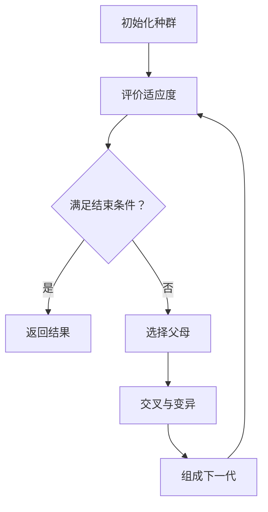
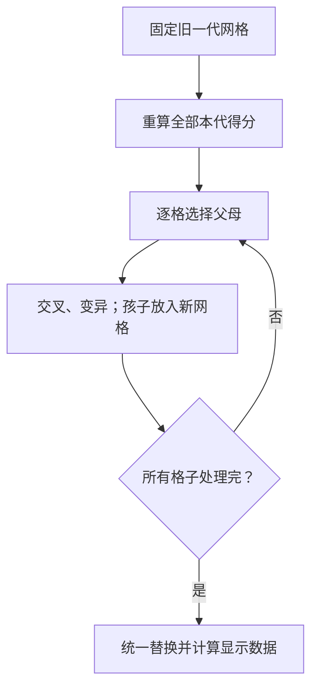

## 📚遗传算法与 Tkinter 基础：

## 1. GA 到底是什么？

GA = Genetic Algorithm，遗传算法。

它是一类借鉴遗传与自然选择思想的随机搜索方法：同时保存多个候选答案，评价它们的表现，再经过选择、交叉、变异，产生新的候选答案。

**先记住：GA 不知道一个答案怎样修改才一定更好。它依靠评价和随机生成候选解，反复搜索。**

### 1.1 为什么不只随机猜一次？

如果随机生成一条字符串，差就扔掉，重新生成，与已有结果几乎没有联系。

GA 则希望：

- 让表现较好的候选解更容易影响下一代。
- 通过交叉重新组合已有片段。
- 通过变异引入新的变化。

这不是说每次重组都有效，也不是说每一代都进步。对于很小、可精确求解的问题，直接枚举或专门算法往往更合适；GA 不是万能的最优解算法。

### 1.2 关键术语

| 术语 | 含义 | 囚徒困境项目中的对应 |
|---|---|---|
| 个体 individual | 一个候选解或参与者 | 一个格子里的玩家 |
| 染色体 chromosome | 个体的编码表示 | 一条 C/D 字符串 |
| 基因 gene | 编码中的一个位置 | 第 i 回合的 C 或 D |
| 种群 population | 所有个体的集合 | 整张二维网格 |
| 适应度 fitness | 评价个体表现的指标 | 与八邻居比赛的累计总分 |
| 选择 selection | 决定哪些个体参与繁殖 | 找严格更高分的邻居 |
| 交叉 crossover | 组合两个父母的编码 | 拼接两条字符串的片段 |
| 变异 mutation | 对编码作随机小改动 | 翻转一个 C/D |
| 一代 generation | 一轮种群更新 | 所有格子同步换成新策略 |

这些是算法术语，不要求完全模拟真实生物遗传过程。

## 2. 一般遗传算法的完整流程



### 2.1 编码与初始化

先决定“一个候选答案怎样存储”。例如：

- 文本匹配：长度固定的可打印字符字符串。
- 本项目：长度为 20 或 50 的 C/D 字符串。
- 教学小实验：长度为 8 的 0/1 列表。

编码决定了后续交叉和变异能做什么。不能把任意问题都用普通字符串拼接解决：比如排列问题的直接交叉可能产生重复元素，需要专门操作。

### 2.2 适应度：必须先定义好坏

| 例子 | 评价指标 | 优秀方向 |
|---|---|---|
| Hello, world! | 与目标字符编码差距之和 | 越小越好 |
| 0/1 小实验 | 1 的数量 | 越大越好 |
| 囚徒困境 | 本代与邻居比赛的总分 | 越大越好 |

不要看到变量名叫 `fitness` 就直接写 `max`。先确认比较方向。

### 2.3 结束条件

普通优化任务可选择：达到目标、运行到指定代数、长时间没有改进等。

本项目是持续演化模拟：可以手动暂停，也可指定模拟多少代。没有“找到 Hello, world! 就结束”的固定字符串目标。

## 3. 选择：谁参与繁殖？

### 3.1 锦标赛选择：学校原例的思路

例如随机抽到三个候选个体：

| 候选 | 与目标文本的差距 |
|---|---:|
| A | 80 |
| B | 20 |
| C | 45 |

差距越小越好，所以选择 B。这只是在抽到的候选中比较，不一定选到全种群最优者。

学校原代码先随机选一个，再尝试 `numTries` 次挑战。因此 `NUM_TRIES=3` 实际上比较初选者加上三次挑战，随机抽取还可能重复。这里的重点是“随机候选之间竞争”。

### 3.2 本项目：局部选择

本项目的一方父母固定是当前细胞，另一方只能来自八邻居。

假设自己 100 分，八邻居总分为：

```text
80、110、95、140、100、90、120、70
```

我们的实现选择 140 分邻居。

- 若最高邻居也是 100 分：没有严格更高，不交叉。
- 若最高分并列：在并列邻居中随机选一个。
- 不会从全网格随意选配偶。

原题只说选择更优秀邻居；选最高分是我们明确采用的实现约定，不是所有 GA 必须这样做。

### 3.3 选择压力与多样性（理解即可）

总是强烈偏向少数高分者，可能使种群很快变得相似，减少探索。选择太弱则难以利用已有好解。

暂不需要学习复杂公式，但要能说明：**“快速变得一致”不等于“已找到全局最优”。**

## 4. 交叉、变异与精英保留

### 4.1 单点交叉

长度为 8 的父母：

| 角色 | 前 3 位 | 后 5 位 | 完整编码 |
|---|---|---|---|
| 父母 A | CCC | CCCCC | CCCCCCCC |
| 父母 B | DDD | DDDDD | DDDDDDDD |
| 孩子 1 | CCC | DDDDD | CCCDDDDD |
| 孩子 2 | DDD | CCCCC | DDDCCCCC |

先固定交叉点理解，再引入随机：

```python
parent1 = "CCCCCCCC"
parent2 = "DDDDDDDD"
cut = 3
child1 = parent1[:cut] + parent2[cut:]
child2 = parent2[:cut] + parent1[cut:]
print(child1)  # CCCDDDDD
print(child2)  # DDDCCCCC
```

交叉点通常选在 `1` 到 `length - 1`，确保切分后两段都非空。交叉不保证改进；若父母完全一样，交叉也不会产生新编码。

### 4.2 变异

```python
strategy = "CCCCCCCC"
index = 3
moves = list(strategy)
moves[index] = "D" if moves[index] == "C" else "C"
mutated = "".join(moves)
print(mutated)   # CCCDCCCC
print(strategy)  # CCCCCCCC：原字符串未被改变
```

本项目字符只有 C/D，所以翻转一位保证编码改变。学校原文本例子则是随机替换可打印字符，可能碰巧换回原字符。

### 4.3 两种变异率不要混淆

| 定义 | 20 位策略，p=0.03 时的含义 |
|---|---|
| 每个孩子以 p 概率变异一位 | 3% 的孩子翻转一位，97% 不变异 |
| 每位分别以 p 概率变异 | 每位独立判断，一个孩子可能翻转多位 |

第一种每个孩子的期望翻转位数是 0.03；第二种是 `20 × 0.03 = 0.6`。

**当前学校框架整合版采用第一种，默认 0.03。**而且直接调用 `Chromosome.mutate()` 时一定翻转一位；概率判断发生在 `GA.createNewPop()` 中。

### 4.4 精英保留 elitism

精英保留是把一部分最优个体不加改动地带入下一代。它可以防止当前最好解因繁殖被全部丢失，但仍不保证找到全局最优。

学校原 Hello, world! 示例没有专门的精英保留。当前项目也没有强制全局精英保留：即使当前最高分格子不交叉，仍可能变异。

不要额外加上“每代一定保留全局最好者”的规则再声称是原题要求。

## 5. 独立控制台实验：进化出全 1 编码

> 完整可运行。保存成 `ga_basics_demo.py`。不依赖项目文件，不需要 Tkinter 或第三方库。

这个实验有明确目标：8 位编码中 1 越多越好。它只用于理解 GA，不是囚徒困境的目标函数。

```python
import random

rng = random.Random(42)
LENGTH = 8
POP_SIZE = 20
MUTATION_RATE = 0.1  # 每个孩子有 10% 概率翻转一位
MAX_GENERATIONS = 100

def fitness(code):
    return sum(code)

def select_parent(population):
    candidates = [rng.choice(population) for _ in range(3)]
    return max(candidates, key=fitness)


def crossover(a, b):
    cut = rng.randrange(1, LENGTH)
    return a[:cut] + b[cut:]

def mutate(code):
    result = code.copy()
    if rng.random() < MUTATION_RATE:
        index = rng.randrange(LENGTH)
        result[index] = 1 - result[index]
    return result

population = [
    [rng.randrange(2) for _ in range(LENGTH)]
    for _ in range(POP_SIZE)
]

for generation in range(MAX_GENERATIONS + 1):
    best = max(population, key=fitness)
    print(generation, "best:", best, "score:", fitness(best))
    if fitness(best) == LENGTH:
        print("达到目标")
        break
    if generation == MAX_GENERATIONS:
        print("达到代数上限，停止")
        break

    # 本教学实验刻意加入一个精英副本，便于观察；项目版没有这一步。
    new_population = [best.copy()]
    while len(new_population) < POP_SIZE:
        parent1 = select_parent(population)
        parent2 = select_parent(population)
        child = mutate(crossover(parent1, parent2))
        new_population.append(child)
    population = new_population
```

### 动手检查

1. 把 `MUTATION_RATE` 改为 0，会发生什么？不必保证一次运行能说明普遍结论。
2. 若初始全是 0，且没有变异，交叉能创造 1 吗？不能。
3. `new_population = [best.copy()]` 为什么是复制？为了不共享可变列表。
4. 删除精英保留后，最好分数是否仍保证不下降？不保证。
5. 固定其他条件，多换几个种子观察，不要只报告最好的一次结果。

## 6. 把 GA 对应到囚徒困境项目

### 6.1 本项目的编码

每格是一条固定行动序列，而不是根据历史作出响应的规则。例如：

```python
strategy = "CDDC"
```

表示第一回合 C、第二回合 D、第三回合 D、第四回合 C。这里用 4 位方便手算，正式作业使用 20 或 50 位。

### 6.2 计分规则

| 自己 | 邻居 | 自己得分 | 邻居得分 |
|---|---|---:|---:|
| C | C | 2 | 2 |
| C | D | 0 | 3 |
| D | C | 3 | 0 |
| D | D | 1 | 1 |

单回合最高 3 分，不等于一代最高 3 分。

策略长度 L、八个邻居时，单格本代总分范围是 `0` 到 `8 × L × 3`。L=20 时最高为 480。

### 6.3 手算完整的小环境

用环绕的 3×3 网格，每格 4 回合。八格全 C，左上角一格全 D：

| | 第 0 列 | 第 1 列 | 第 2 列 |
|---|---|---|---|
| 第 0 行 | DDDD | CCCC | CCCC |
| 第 1 行 | CCCC | CCCC | CCCC |
| 第 2 行 | CCCC | CCCC | CCCC |

在环绕 3×3 中，每格其余八格都是邻居。

- 全 D 格：与八个全 C 邻居比赛，得到 `8 × 4 × 3 = 96`。
- 每个全 C 格：与七个全 C 格比赛得 `7 × 4 × 2 = 56`；与全 D 格比赛得 0，总分 56。
- 全 D 格没有严格更高分邻居，不交叉。
- 八个全 C 格都有 96 分邻居，因此与它交叉。

若切点为 2，CCCC 与 DDDD 可以产生 CCDD、DDCC；孩子不是必然变成 DDDD。

交叉完成后再做可能的变异，然后统一替换全部策略。新一代的分数还要在新环境中重新算。

### 6.4 这里没有固定“完美答案”

Hello, world! 的目标字符串固定，某个编码的差距不会因周围个体改变。

本项目的适应度依赖邻居。同一策略换一组对手，分数可能不同。更高分邻居也不保证它的后代在本格位置得分更高。

**颜色只是记录合作程度，不是算法在最大化合作程度。**我们选择父母依据的是个人比赛得分。

在这组收益下，同一回合固定对手动作时，选择 D 比 C 都多 1 分。因此不能预设算法一定促进合作；空间邻居、交叉和变异共同影响实际演化。

## 7. 网格与同步更新：最容易错的地方

### 7.1 八邻居偏移

| 相对位置 | 行偏移 dr | 列偏移 dc |
|---|---:|---:|
| 左上 | -1 | -1 |
| 上 | -1 | 0 |
| 右上 | -1 | 1 |
| 左 | 0 | -1 |
| 右 | 0 | 1 |
| 左下 | 1 | -1 |
| 下 | 1 | 0 |
| 右下 | 1 | 1 |

排除 `(0, 0)`，因为那是自己。

```python
rows, cols = 3, 3
row, col = 0, 0
neighbors = []
for dr in (-1, 0, 1):
    for dc in (-1, 0, 1):
        if dr != 0 or dc != 0:
            nr = (row + dr) % rows
            nc = (col + dc) % cols
            neighbors.append((nr, nc))
print(neighbors)
```

`(-1) % 3 == 2`，所以越过上边界会到最后一行。当前项目要求至少 3 行 3 列，确保八个邻居不同。

### 7.2 防止重复计分

两种正确写法二选一：

| 方式 | 如何累加 |
|---|---|
| 每格遍历全部邻居 | 只给当前格子累加自己的分数 |
| 每对邻居只处理一次 | 同时给双方累加分数 |

不能遍历双方两次，还每次都给双方加分，否则分数翻倍。

整合版 `GA.calculateFitness()` 使用第二种，借助坐标元组比较：

```python
print((0, 1) > (0, 0))  # True
print((1, 0) > (0, 2))  # True：先比较行，再比较列
```

只有邻居坐标大于当前坐标才处理这一对。每次完整重算前先把各格分数归零，不能跨代一直累加。

### 7.3 同步更新

如果处理 A 后立即覆盖 A，再处理邻居 B，B 看到的就可能是下一代 A，而其他邻居还是上一代。

正确做法是：所有选择和交叉都读取旧一代；孩子放进新列表；最后统一替换。



不要为下一代复用旧对象后再直接修改其 `.code`；应该创建新孩子。Python 字符串本身不可变，但对象属性仍然可以重新赋值。

## 8. 先在终端验证项目，不打开窗口

> 在 `School_PrisonerDilemma` 文件夹内新建 `model_demo.py`；下面需要项目的 `GA.py` 等文件在同目录。

```python
from GA import GA

# 4 位策略仅用于手算演示；GUI 默认允许 20 或 50 位。
ga = GA(rows=3, cols=3, length=4, mutRate=0, seed=42)
ga.initialize("CCCC")
print("全 C 得分：", ga.findBest().getFitness())  # 64

# 修改左上角，再重算所有细胞得分
ga.pop[0][0].setCode("DDDD")
ga.calculateFitness()
for row in ga.pop:
    print([cell.getFitness() for cell in row])
# [96, 56, 56]
# [56, 56, 56]
# [56, 56, 56]

print("更新前 C 比例：", ga.cooperation())  # 8/9

ga.createNewPop()
print("当前代数：", ga.generation)  # 1
for row in ga.pop:
    print([cell.getCode() for cell in row])
```

不要强记随机输出。先验证固定事实：网格仍为 3×3、每条策略仍为 4 位、只有 C/D、父母选择依据旧一代、没有非法得分。

### 学习到这里，应该能解释

- 适应度为什么不能仅由字符串计算？
- 为什么选择严格更高分，而不是大于等于？
- 不交叉的格子为什么也可能发生变化？
- 颜色变绿是否一定意味着个人得分更高？

## 9. Tkinter：把程序结果显示出来

Tkinter 是 Python 对 Tcl/Tk 的接口，用于桌面图形界面。它和遗传算法是两层：

| 层 | 负责什么 | 文件 |
|---|---|---|
| 模型 | 计分、选择、交叉、变异 | GA、Chromosome、PrisonerDilemma |
| 界面 | 窗口、控件、鼠标、颜色 | CAWrapper、CellMap |

因此不打开窗口也能运行模型，而按钮只是请求模型做下一步。

检查本地环境：

```bash
python3 -m tkinter
```

应打开测试窗口。Tkinter 的可用性取决于当前 Python 的 Tk 安装；它不是通过 `pip install tkinter` 安装的普通第三方库。无桌面的服务器通常不能直接显示窗口。

### 9.1 最小窗口：完整程序

保存为 `tk_window_demo.py`，独立运行：

```python
import tkinter as tk

root = tk.Tk()
root.title("Tkinter demo")
label = tk.Label(root, text="Hello, GUI!")
label.pack(padx=20, pady=20)
root.mainloop()
```

- `Tk()` 创建主窗口。
- `Label(root, ...)` 的第一个参数指定父容器。
- `pack()` 将控件放进父容器。
- `mainloop()` 开始事件循环，等待并处理操作。

创建对象不等于已经参与布局。控件通常还需要 `pack()`、`grid()` 等几何管理器。

### 9.2 控件速查

| 对象或方法 | 用途 | 项目里的例子 |
|---|---|---|
| `Tk` | 主窗口 | CAWrapper |
| `Frame` | 组织一组控件 | CellMap |
| `Canvas` | 绘图区域 | 彩色方格 |
| `Button` | 点击执行动作 | Start、Stop |
| `Label` | 显示信息 | 代数、合作比例 |
| `Entry` | 文本输入框 | 变异率、策略长度 |
| `StringVar` | 与控件关联的文本变量 | 输入框、动态状态 |
| `bind` | 注册鼠标/键盘事件 | 点击、拖动 |
| `after` | 安排稍后的回调 | 下一次刷新 |
| `after_cancel` | 取消已安排回调 | 关闭窗口 |
| `destroy` | 销毁窗口或组件 | 退出 |

## 10. 按钮与回调：事件驱动的第一步

### 10.1 一个计数器：完整程序

```python
import tkinter as tk

root = tk.Tk()
root.title("Counter")
count = 0
status = tk.StringVar(value="Count: 0")


def add_one():
    global count
    count += 1 
    status.set(f"Count: {count}")


tk.Label(root, textvariable=status).pack(padx=20, pady=10)
tk.Button(root, text="Add one", command=add_one).pack(pady=10)
root.mainloop()
```

`command=add_one` 是把函数交给按钮，等待点击时执行。

**不要写 `command=add_one()`**：那会在创建按钮时就执行函数，并把返回值当作 command。

### 10.2 传参数

局部写法，假设已经有窗口和 `set_rate` 函数：

```text
tk.Button(root, text="Use 3%", command=lambda: set_rate(0.03))
```

`lambda` 包装成一个尚未执行、无需参数的回调。这里用 text 代码块表示片段，不能单独运行。

### 10.3 Entry 与 StringVar：完整程序

```python
import tkinter as tk
from tkinter import messagebox

root = tk.Tk()
rate_text = tk.StringVar(value="0.03")


def apply_rate():
    try:
        rate = float(rate_text.get())
        if not 0 <= rate <= 1:
            raise ValueError
    except ValueError:
        messagebox.showerror("Invalid input", "Enter a number between 0 and 1")
        return
    messagebox.showinfo("Applied", f"Mutation probability: {rate:.1%}")


tk.Entry(root, textvariable=rate_text).pack(padx=20, pady=10)
tk.Button(root, text="Apply", command=apply_rate).pack(pady=10)
root.mainloop()
```

输入框保存的是文本，即使看起来像数字也需要转换。只改输入框文字不代表模型参数自动更新；需要读取、校验并赋值。

## 11. 布局、画布与鼠标事件

### 11.1 pack 与 grid

- `pack`：按上、下、左、右等方式放置组件。
- `grid`：按行列放置组件。

**同一个父容器中的普通子控件不要混用 pack 和 grid。**不同父容器可以分别采用不同布局。当前项目在窗口中 `pack` 整个 CellMap，而 CellMap 内部用 `grid` 放置按钮与画布，这是合法的。

`anchor="nw"` 表示放在分配区域内的左上方向；`nw` 是 northwest。

### 11.2 Canvas 方格与点击：完整程序

```python
import tkinter as tk

root = tk.Tk()
CELL_SIZE = 30
ROWS, COLS = 3, 4
canvas = tk.Canvas(root, width=COLS * CELL_SIZE, height=ROWS * CELL_SIZE,
                   highlightthickness=0)
canvas.pack()
rectangles = []

for row in range(ROWS):
    ids = []
    for col in range(COLS):
        item = canvas.create_rectangle(
            col * CELL_SIZE, row * CELL_SIZE,
            (col + 1) * CELL_SIZE, (row + 1) * CELL_SIZE,
            fill="green", outline="white")
        ids.append(item)
    rectangles.append(ids)


def on_click(event):
    col = event.x // CELL_SIZE
    row = event.y // CELL_SIZE
    if 0 <= row < ROWS and 0 <= col < COLS:
        canvas.itemconfigure(rectangles[row][col], fill="red")
        print("Clicked:", row, col)

canvas.bind("<Button-1>", on_click)
root.mainloop()
```

Canvas 坐标中，x 向右增加、y 向下增加；数据网格常写 `grid[row][col]`，所以画图时是 `x = col * size`、`y = row * size`。

`create_rectangle` 返回画布图形的 ID，之后可以修改颜色。这个示例复用图形 ID；学校版每次删除重画也能工作，几百格时先保持简单即可。

### 11.3 command 与 bind 回调的区别

| 注册方式 | 回调常见签名 |
|---|---|
| `Button(..., command=start)` | `def start():` |
| `canvas.bind('<Button-1>', on_click)` | `def on_click(event):` |

`bind` 会传入事件对象，其中 `event.x`、`event.y` 为鼠标在组件中的坐标。把两种回调的参数形式混用，容易报缺少参数或参数过多。

### 11.4 三种“大小”

| 参数 | 决定什么 |
|---|---|
| `length=20` | 策略字符数／与每个邻居的回合数 |
| `rows=20, cols=20` | 个体数量：400 |
| `cell_size=24` | 每个方格的显示像素大小 |

三者概念独立。学校窗口通过 `FRAMESIZE // CELLSIZE` 推导行列数，所以它的显示参数又间接影响网格数量；不要把这种代码写法当作题目概念上的绑定。

## 12. mainloop、after 与动画

### 12.1 事件循环是什么？

普通终端程序常按顺序执行后结束。图形程序初始化后进入事件循环，不断处理点击、鼠标、窗口重绘以及到期回调。

`mainloop()` 不会自动调用遗传算法；必须注册按钮或定时回调来调用模型。

### 12.2 为什么不要在按钮里写长 while 循环？

错误思路：在 Start 回调里不断计算下一代，直到 running 为假。

如果该回调一直不返回，事件循环就没机会处理 Stop 点击和重绘。`time.sleep()` 同样会阻塞当前界面线程。

### 12.3 after 的正确含义

```text
after_id = root.after(200, tick)
```

表示安排 `tick` 不早于约 200 毫秒后、在事件循环有机会时执行一次。不是精确实时定时器；`after` 本身也不是新建一个后台线程。

- `after(200, tick)`：安排稍后调用。
- `after(200, tick())`：立即执行 tick，再把其结果作为回调，通常是错误。
- 要持续刷新，tick 执行完后需要再次安排下一次。
- 若单次计算很慢，界面仍会卡；使用 after 并不能自动解决重计算问题。

### 12.4 当前学校框架的两层控制

在项目的 `CellMap` 中：

1. `_tick()` 会周期性被调用。
2. `is_running` 决定本次是否推进算法。
3. Stop 只是把 `is_running` 设为 False，定时回调仍用于更新信息。
4. 关闭窗口时，取消已安排的回调，再销毁窗口。

因此“暂停模拟”不一定等于“取消全部定时任务”。两种设计都可以，只要状态和任务管理一致。

## 13. 合作比例如何变成颜色？

每格颜色依据整条策略中 C 的比例：

```python
strategy = "CCCD"
ratio = strategy.count("C") / len(strategy)
print(ratio)  # 0.75
```

项目采用红绿插值：

```python
strategy = "CCCD"
ratio = strategy.count("C") / len(strategy)
red = round(230 * (1 - ratio) + 35 * ratio)
green = round(55 * (1 - ratio) + 190 * ratio)
color = f"#{red:02x}{green:02x}46"
print(color)
```

| C 比例 | RGB 大致含义 | 颜色 |
|---|---|---|
| 0 | 红 230、绿 55、蓝 70 | 偏红 |
| 0.5 | 红绿居中 | 中间色 |
| 1 | 红 35、绿 190、蓝 70 | 偏绿 |

`#RRGGBB` 每两位十六进制表示一个通道；`:02x` 是至少两位的十六进制格式。

全局合作比例 = 所有策略中 C 的总数 / 所有策略字符总数。不能用“含有 C 的细胞数 / 细胞数”代替。

## 14. 将现有 GA 接到最小动画窗口

> 完整示例，保存为项目同目录的 `mini_ga_gui.py`，再运行。这个示例用于学习连接方式，不替换学校的正式 CellMap。需要项目的 GA、Chromosome、PrisonerDilemma 三个模块。

```python
import tkinter as tk
from GA import GA


class Demo(tk.Tk):
    def __init__(self):
        super().__init__()
        self.title("GA animation demo")
        self.model = GA(rows=10, cols=10, length=20, mutRate=0.03, seed=42)
        self.size = 24
        self.running = False
        self.after_id = None

        controls = tk.Frame(self)
        controls.pack()
        tk.Button(controls, text="Start", command=self.start).pack(side="left")
        tk.Button(controls, text="Stop", command=self.stop).pack(side="left")
        tk.Button(controls, text="Step", command=self.step).pack(side="left")
        self.status = tk.StringVar()
        tk.Label(self, textvariable=self.status).pack()
        self.canvas = tk.Canvas(self, width=240, height=240, highlightthickness=0)
        self.canvas.pack()
        self.protocol("WM_DELETE_WINDOW", self.close)
        self.draw()

    def draw(self):
        self.canvas.delete("all")
        for row in range(self.model.rows):
            for col in range(self.model.cols):
                code = self.model.pop[row][col].getCode()
                ratio = code.count("C") / len(code)
                red = round(230 * (1 - ratio) + 35 * ratio)
                green = round(55 * (1 - ratio) + 190 * ratio)
                color = f"#{red:02x}{green:02x}46"
                x, y = col * self.size, row * self.size
                self.canvas.create_rectangle(
                    x, y, x + self.size, y + self.size,
                    fill=color, outline="white")
        self.status.set(
            f"Generation: {self.model.generation} | C: {self.model.cooperation():.1%}")

    def step(self):
        # 演示约定：单步先暂停，再推进一次。
        self.stop()
        self.model.createNewPop()
        self.draw()

    def start(self):
        if self.running:
            return  # 防止重复 Start 建立多条刷新链
        self.running = True
        self.tick()

    def tick(self):
        self.after_id = None
        if not self.running:
            return
        self.model.createNewPop()
        self.draw()
        self.after_id = self.after(200, self.tick)

    def stop(self):
        self.running = False
        if self.after_id is not None:
            self.after_cancel(self.after_id)
            self.after_id = None

    def close(self):
        self.stop()
        self.destroy()


if __name__ == "__main__":
    app = Demo()
    app.mainloop()
```

### 按运行顺序解释

1. 创建 Demo，初始化算法模型和界面。
2. `draw()` 显示第 0 代，`mainloop()` 开始等待事件。
3. 用户点击 Start，`start()` 直接调用一次 `tick()`。
4. `tick()` 推进一代、画图，安排下一次 tick，然后返回。
5. 返回后，事件循环能处理其他点击和重绘。
6. Stop 取消下一次回调；重复点击 Start 不会多建一条循环。
7. 关闭时先取消任务，再销毁窗口。

Tkinter 默认应保持每次回调尽量短。本例没有引入线程；当前几百格的小项目可先理解单线程事件驱动，后续遇到性能问题再处理。

## 15. 回到学校项目：怎样读文件最省力？

| 文件 | 第一遍重点看 | 暂时可后看 |
|---|---|---|
| PrisonerDilemma.py | payoff、play_game | 输入校验细节 |
| Chromosome.py | makeChildren、mutate、fitness 的含义 | 比较操作辅助方法 |
| GA.py | calculateFitness、selectParents、createNewPop | 随机种子、辅助查询 |
| CellMap.py | update_cells、_render、_tick、start/stop | 图片导出、布局微调 |
| CAWrapper.py | 创建 CellMap、mainloop、close | 居中公式 |

### 一次刷新背后的调用

| 谁调用 | 调用什么 | 目的 |
|---|---|---|
| Tkinter 事件循环 | CellMap._tick | 触发一次界面更新周期 |
| _tick，在运行状态下 | update_cells | 根据 Skip 推进若干代 |
| update_cells | GA.createNewPop | 完成一代策略演化 |
| GA | play_game、makeChildren、mutate | 计分与繁殖 |
| _tick | _render、_update_labels | 把当前模型显示出来 |

`GAWrapper.py` 在整合版只是备用入口，可以不读；`test_model.py` 是自动测试，不是运行模拟的必需文件。

## 16 练习与答案要点

1. **手算交叉**：`CCCCDDDD` 与 `DDDDCCCC` 在 cut=4 时产生什么？  
   答：`CCCCCCCC` 与 `DDDDDDDD`。
2. **手算全合作**：20 回合、八个全 C 邻居，当前也是全 C，得分多少？  
   答：320。
3. **平局处理**：自己 100，邻居最高 100，交叉吗？  
   答：当前约定不交叉，仍可能变异。
4. **颜色检查**：20 位有 15 个 C，C 比例是多少？  
   答：75%，偏绿，不代表单场胜率 75%。
5. **事件驱动**：连续点三次 Start 为什么不能安排三条 tick 链？  
   答：会让更新频率超出预期，暂停也难管理；用运行状态阻止重复启动。
6. **实验设计**：如何比较不同变异率？  
   答：固定其他参数，用相同的一组种子和相同代数，多次运行并记录合作比例；不保证它随变异率单调变化。
