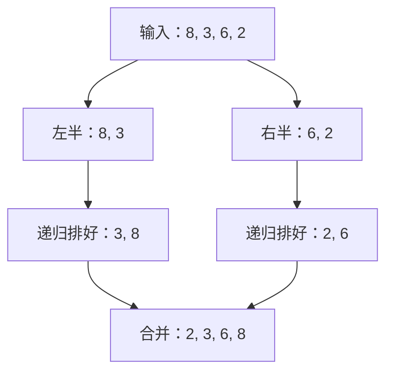

## APCSA 第二轮复习 10：递归追踪、递归查找与归并排序

## 📚 1. 本轮定位与教学安排

### 1.1 读懂递归是主线，编写递归是拓展

| 用途 | 本章安排 |
| --- | --- |
| AP 主线 | 阅读给定递归代码；追踪参数、返回值、输出、二分区间与归并状态；MCQ 1—18 |
| AP 编程迁移 | 用迭代实现相同任务，训练 String、数组、方法契约；FRQ 1—2 |
| 递归编程拓展 | 独立写递归与 helper，检验理解；FRQ 3—4、参考算法实现 |

不要把“必须递归实现”的原创题标成当前 AP 官方 FRQ 必考形式；也不要因为不要求写递归，就跳过递归阅读和归并排序。

## 2. 核心知识与易错点

### 2.1 递归的三个检查点

```java
public static int fact(int n) {
    if (n <= 1) return 1;
    return n * fact(n - 1);
}
```

本例前置条件为 **0 <= n <= 12**，保证 int 阶乘结果安全；0! = 1。不能因为 n <= 1 就返回 1，而声称它正确处理负数阶乘。

| 检查点 | 要问的问题 | 本例 |
| --- | --- | --- |
| 基准情形 base case | 什么时候直接给出答案？ | n <= 1 |
| 规模推进 | 每个递归分支是否朝基准情形推进？ | n 每次减 1 |
| 结果组合 | 子问题返回后，当前层还要做什么？ | 乘当前层自己的 n |

有 base case 不代表一定终止。参数可能永远碰不到它，或某一条分支没有推进。即使数学上会终止，输入过大仍可能超出实际调用栈容量。

### 2.2 每层有自己的参数和局部变量

fact(4) 的追踪：

| 当前层 | 暂停等待的计算 | 子调用返回后 |
| --- | --- | --- |
| fact(4) | 4 × fact(3) | 4 × 6 = 24 |
| fact(3) | 3 × fact(2) | 3 × 2 = 6 |
| fact(2) | 2 × fact(1) | 2 × 1 = 2 |
| fact(1) | 无子调用 | 直接返回 1 |

读入方向是 4→3→2→1，返回方向是 1→2→6→24。fact(3) 的 n 变成 3，不会把 fact(4) 那一层保存的 n 也改成 3。

“返回”不是自动重新执行整个方法；控制流回到调用点，继续完成当时暂停的表达式/后续语句。不要混淆“输出了什么”和“返回了什么”。

### 2.3 输出在递归前、递归后，顺序不同

```java
public static void show(int n) {
    if (n == 0) return;
    System.out.print(n + " ");
    show(n - 1);
    System.out.print(n + " ");
}
```

前置条件：n 为较小非负整数。show(3) 的输出为 `3 2 1 1 2 3 `。

| 事件 | 新产生的输出 |
| --- | --- |
| 进入 n=3、2、1 各层，执行递归前打印 | 3、2、1 |
| n=0 直接返回 | 无 |
| 回到 n=1、2、3，执行递归后打印 | 1、2、3 |

如果打印语句位于 if/else 之外，即使进入 base case、没有继续递归，也可能仍然打印。必须按给出的代码判断，不能套“最底层不输出”的口诀。

### 2.4 字符串递归：空串、单字符与代价

```java
public static String reverse(String s) {
    if (s.length() <= 1) return s;
    return reverse(s.substring(1)) + s.substring(0, 1);
}
```

s 不为 null。reverse("APCSA") 返回 `"ASCPA"`；reverse("") 返回空串。为贴近 AP 常用 String 方法，本章主线阅读使用 substring、equals；原稿 charAt 版本的反转逻辑也成立。

回文判断应先处理长度 <= 1，再访问首尾；否则空串会越界。大小写规则必须写进契约：`"Racecar"` 在区分大小写时不是回文，忽略大小写时才是。

原稿 substring 递归适合讲语义，不代表高效实现。按常见现代 Java 的字符串复制/拼接成本分析，反复复制长后缀或构造长结果可有 O(n²) 时间/累计复制量。虽然递归深度只有 O(n)，**不能据此认定包含字符串对象的总辅助内存一定为 O(n)**。用双下标可以避免每层复制子串，但独立编写该递归属于拓展。

### 2.5 数组 helper 与分支递归

数组求和：

```java
public static int sum(int[] a) {
    return sumFrom(a, 0);
}

private static int sumFrom(int[] a, int i) {
    if (i == a.length) return 0;
    return a[i] + sumFrom(a, i + 1);
}
```

a 不为 null；累计和保证在 int 范围。空数组直接返回 0。helper 的 i 表示“接下来处理的起始位置”，不创建新子数组。

求最大值不能照搬“空数组返回 0”：全负数会错，而且空集最大值需要另定语义。本章 max 方法要求数组非空，以最后一个实际元素作为基准值。

Fibonacci 的双分支会重复求相同子问题：

```java
public static int fibNaive(int n) {
    if (n == 0) return 0;
    if (n == 1) return 1;
    return fibNaive(n - 1) + fibNaive(n - 2);
}
```

阅读练习限定 n 为较小非负整数；实际运行本稿建议 n <= 30。fibNaive(4) 返回 3，却发生 **9 次方法调用**，包括最初调用和各个 base case 调用。返回值、叶子数、总调用数、最大深度是不同指标。

线性 helper 可以避免重复子问题；尾递归形式也不能假定 JVM 自动消除调用栈。本章按每层调用占用栈帧分析，线性尾递归仍有 O(n) 栈深。数值优化不等于消除了 int 溢出风险。

### 2.6 递归二分：先有序，后缩小闭区间

```java
public static int binSearch(int[] a, int target) {
    return binSearch(a, target, 0, a.length - 1);
}

private static int binSearch(int[] a, int target, int lo, int hi) {
    if (lo > hi) return -1;
    int mid = lo + (hi - lo) / 2;
    if (a[mid] == target) return mid;
    if (target < a[mid]) return binSearch(a, target, lo, mid - 1);
    return binSearch(a, target, mid + 1, hi);
}
```

前置条件：a 非递减有序、不为 null。重复值存在时返回某个匹配位置，不承诺最左匹配；未找到返回 -1。

| 情形 | 当前层行为 |
| --- | --- |
| lo > hi | 搜索区间为空，返回 -1 |
| a[mid] == target | 直接返回 mid |
| target 更小 | 排除 mid 和右侧，搜索 [lo,mid-1] |
| target 更大 | 排除 mid 和左侧，搜索 [mid+1,hi] |

空数组首次 hi = -1，在访问元素之前就返回。注意递归调用前的 return：如果调用子问题后丢弃返回结果，方法不会自动把该结果传回上一层。

对 `[1,4,7,10,13,16,19]` 查找 4：

| 调用 | lo | hi | mid | 读取值 | 结果 |
| --- | --- | --- | --- | --- | --- |
| 1 | 0 | 6 | 3 | 10 | 转到左半 |
| 2 | 0 | 2 | 1 | 4 | 返回 1，并逐层传回 |

### 2.7 归并排序：先分别有序，再合并



这是“分成两半 → 各自递归排序 → 合并”的关系图；每个两元素半区内部还会分成单元素。长度 0 或 1 已有序，直接结束。

合并过程不是把两段接起来后再选择排序。两个指针分别指向左右尚未使用的最小候选，每次取较小者。一边耗尽后，依次追加另一边剩余元素。

合并 `[1,5]` 与 `[2,4]`：

| 输出位置 | 左指针候选 | 右指针候选 | 本次取值 |
| --- | --- | --- | --- |
| 0 | 1 | 2 | 左 1 |
| 1 | 5 | 2 | 右 2 |
| 2 | 5 | 4 | 右 4 |
| 3 | 5 | 已耗尽 | 左 5 |

相等时先取左侧值，有助于保持相等元素原始先后顺序；对带身份标记的对象尤其重要。这里 int 例子中无法仅凭相等数值直接看出身份顺序。

### 2.8 原稿 merge 的短路顺序错误

原条件：

```java
if ((i1 < left.length && left[i1] <= right[i2]) || i2 >= right.length) {
    // take left
}
```

`||` 的右侧保护写得太晚。left 为 `{2}`、right 为 `{1}` 时：第一次取右侧 1，i2 变为 1；下一次 i1 < left.length 为 true，接着访问 right[1]，在检查“右侧已耗尽”之前就越界。

如果保留原 for 循环结构，可改成：

```java
if (i2 >= right.length || (i1 < left.length && left[i1] <= right[i2])) {
    // take left
}
```

前提仍是结果长度恰好为两侧长度之和，左右有序，并且 result 不与输入别名。为了便于学生验证边界，参考实现采用“两边都未耗尽时比较 + 两段追加剩余项”的三个 while。

原稿相对路径图片依赖仓库目录，独立发给学生可能丢图；本稿已改用内嵌关系图和追踪表。

### 2.9 成本辨析（理解用，不要求背递推式）

| 实现 | 时间 | 最大递归栈深 |
| --- | --- | --- |
| 阶乘、线性数组求和 | O(n) | O(n) |
| 数位和/数位计数 | O(d)，d 为十进制位数 | O(d) |
| 原始 Fibonacci | O(2ⁿ) 是可用上界，重复子问题很多 | O(n) |
| 线性 Fibonacci helper | O(n) | 本课模型为 O(n) |
| 递归二分查找 | 最坏 O(log n) | 最坏 O(log n) |
| 合并两个有序数组 | O(p+q) | 无递归，O(1) 临时变量 |
| 本章归并排序 | O(n log n)，n >= 2 | O(log n) |

归并排序每一层总处理量约为 n，有约 log₂n 层；不是“递归一次就是 log n”。参考复制半区版本的峰值附加数组空间是 O(n)，累计分配/复制量可达 O(n log n)，两者不是同一个指标。以上按常见单位成本模型分析；字符串算法见 2.4 的单独说明。

## 🎯 3. MCQ 训练（原创）

每题只有一个正确选项。递归代码已给出，训练目标为阅读与分析。数组、字符串非 null；除故意错误题外，输入满足代码说明的前置条件。代码片段处于合法类或方法中，每题独立。

### MCQ 1：阶乘返回值

调用 2.1 中的 fact(4)，返回什么？

A. 10  
B. 24  
C. 16  
D. 4

### MCQ 2：递归前后各打印一次

调用 2.3 中的 show(3)，忽略末尾空格，输出什么？

A. `1 2 3`  
B. `3 2 1`  
C. `3 2 1 1 2 3`  
D. `3 2 1 0 1 2 3`

### MCQ 3：跨过 0 的基准情形

```java
public static void trace(int n) {
    if (n <= 0) {
        System.out.print("X");
    } else {
        System.out.print(n + " ");
        trace(n - 2);
        System.out.print(n + " ");
    }
}
```

调用 trace(5)，输出什么？

A. `5 3 1 X1 3 5 `  
B. `5 3 1 X`  
C. `X1 3 5 `  
D. `5 3 1 -1 X`

### MCQ 4：每层的局部变量

```java
public static void localTrace(int n) {
    if (n == 0) return;
    int saved = n;
    localTrace(n - 1);
    System.out.print(saved);
}
```

localTrace(3) 输出什么？

A. 321  
B. 000  
C. 111  
D. 123

### MCQ 5：整数除法递归

```java
public static int mystery(int n) {
    if (n == 0) return 0;
    return n % 2 + mystery(n / 2);
}
```

mystery(13) 返回什么？

A. 13  
B. 3  
C. 4  
D. 6

### MCQ 6：递归求幂

```java
public static int power(int a, int b) {
    if (b == 0) return 1;
    return a * power(a, b - 1);
}
```

power(2,5) 返回什么？

A. 32  
B. 10  
C. 25  
D. 16

### MCQ 7：字符串反转

调用 2.4 的 reverse("APCSA")，返回哪个字符串？

A. APCSA  
B. ACSAP  
C. ASCPA  
D. ASPCA

### MCQ 8：大小写与回文契约

```java
public static boolean palindrome(String s) {
    if (s.length() <= 1) return true;
    String first = s.substring(0, 1);
    String last = s.substring(s.length() - 1);
    if (!first.equals(last)) return false;
    return palindrome(s.substring(1, s.length() - 1));
}
```

palindrome("Racecar") 的结果是什么？

A. true，因为忽略大小写  
B. 编译错误  
C. 运行时越界  
D. false，因为给定方法区分大小写

### MCQ 9：helper 的起点

调用 2.5 的 sumFrom，a 为 `{2,4,6}`，i 为 1，结果是什么？

A. 12  
B. 10  
C. 6  
D. 4

### MCQ 10：递归最大值

```java
public static int maxFrom(int[] a, int i) {
    if (i == a.length - 1) return a[i];
    return Math.max(a[i], maxFrom(a, i + 1));
}
```

a 为 `{-8,-2,-5}`，maxFrom(a,0) 返回什么？

A. 0  
B. -8  
C. -2  
D. -5

### MCQ 11：返回值与调用次数

使用 2.5 的 fibNaive。fibNaive(4) 的“返回值、总调用次数”分别是什么？总次数包括最初调用和 base case 调用。

A. 3、9  
B. 3、4  
C. 5、9  
D. 3、5

### MCQ 12：两次相同子调用

```java
public static int tree(int n) {
    if (n <= 1) return 1;
    return tree(n - 1) + tree(n - 1);
}
```

调用 tree(3) 时，包括最初调用在内，tree 总共执行多少次？

A. 4  
B. 7  
C. 3  
D. 6

### MCQ 13：有基准情形但到达不了

```java
public static void bad(int n) {
    if (n == 0) return;
    bad(n - 2);
}
```

对 bad(3)，哪项正确？

A. 3→1→0，正常结束  
B. 编译错误  
C. 没有到达 n==0，通常最终抛 StackOverflowError  
D. 参数变负后自动返回

### MCQ 14：递归二分的 mid

使用 2.6 的 binSearch，a 为 `{1,4,7,10,13,16,19}`，target 为 4。依次访问的 mid 是什么？

A. 3、1  
B. 3、2、1  
C. 3、5、4  
D. 0、1

### MCQ 15：重复值不保证最左

使用同一 binSearch，a 为 `{2,4,4,4,8}`，target 为 4，返回什么？

A. 1  
B. 3  
C. -1  
D. 2

### MCQ 16：合并有序半区

正确合并 left=`{1,5}`、right=`{2,4}`，结果是什么？

A. `{1,5,2,4}`  
B. `{1,2,5,4}`  
C. `{1,2,4,5}`  
D. `{2,4,1,5}`

### MCQ 17：原稿 merge 的错误

result 长度 2，left=`{2}`，right=`{1}`，执行原稿以下循环：

```java
int i1 = 0;
int i2 = 0;
for (int i = 0; i < result.length; i++) {
    if ((i1 < left.length && left[i1] <= right[i2]) || i2 >= right.length) {
        result[i] = left[i1];
        i1++;
    } else {
        result[i] = right[i2];
        i2++;
    }
}
```

哪项正确？

A. 正常得到 `{1,2}`  
B. 编译错误  
C. 正常得到 `{2,1}`  
D. 先写入 1，随后访问 right[1] 时越界

### MCQ 18：归并排序最终合并之前

对 `{8,3,7,1,6,2,5,4}` 使用“按中点分半、左半递归、右半递归、再合并”的归并排序。在最外层最后一次合并开始前，左右半区分别是什么？

A. `{8,3,7,1}` 和 `{6,2,5,4}`  
B. `{1,3,7,8}` 和 `{2,4,5,6}`  
C. `{1,2,3,4}` 和 `{5,6,7,8}`  
D. `{3,8,1,7}` 和 `{2,6,4,5}`

## 4. FRQ 训练（原创/原稿重编）

以下参数不为 null。FRQ 1—2 用迭代完成，属于编程迁移；FRQ 3—4 要求递归，明确作为拓展。所有题均为方法任务，无须 Scanner 或 main。

### FRQ 1：StringAnalysis【AP 编程迁移】

**(a)** `public static int countChar(String s, String target)`

target 长度恰为 1，返回它在 s 中出现次数；区分大小写，空串返回 0。使用循环及 substring/equals，不调用递归。

示例：`countChar("banana","a")` 返回 3。

**(b)** `public static boolean isPalindrome(String s)`

用双下标和循环判断是否回文，区分大小写；空串、单字符返回 true。使用 substring/equals，不改变输入，不调用递归。

示例：`"level"` → true，`"Racecar"` → false。

### FRQ 2：ArrayAlgorithms【AP 编程迁移】

**(a)** `public static int[] mergeSorted(int[] left, int[] right)`

两数组分别非递减有序，总长度不超过 1000，允许任一或两者为空。返回新的有序结果，保留重复值，输入不变；不得调用排序库。使用双指针和循环，总时间 O(left.length+right.length)。

**(b)** `public static int binaryIndex(int[] a, int target)`

a 非递减有序，用迭代二分返回某个匹配索引；没有匹配或空数组返回 -1。不要求最左匹配，不改变输入。

示例：`mergeSorted({1,4,4},{2,4})` → `{1,2,4,4,4}`；对结果查找 4，返回任何合法的匹配索引均可。

### FRQ 3：DigitRecursion【递归编程拓展】

以下两个方法必须递归，不用循环或字符串转换。n 为 0 到 Integer.MAX_VALUE 的整数。

**(a)** `public static int sumDigits(int n)`：返回各位数之和，0 返回 0。

**(b)** `public static int count7(int n)`：返回十进制表示中 7 的个数，0 返回 0。

示例：sumDigits(5029) → 16；count7(77027) → 3。

请解释：为什么用 n/10 推进，n%10 表示哪一位，为什么无需处理负数的取绝对值溢出问题？

### FRQ 4：RecursiveChecks【递归编程拓展】

a 长度 0..100，元素 -1000..1000。不得修改数组，不用循环；应编写 public 包装方法和 private helper。

**(a)** `public static int sum(int[] a)`：返回全部元素和，空数组为 0。

**(b)** `public static boolean isSorted(int[] a)`：判断是否非递减，允许相等；空数组或单元素为 true。helper 遇到第一对逆序就返回 false。

示例：sum({2,-1,4}) → 5；isSorted({1,1,3}) → true；isSorted({1,3,2}) → false。

重点：isSorted 的基准情形必须在读取 a[i]、a[i+1] 之前处理；不能只写 i == a.length-1 而忽略空数组。

## 5. 官方样题与历年题迁移

### 5.1 最贴合本章的官方递归样题

[当前 CED 的 MCQ 第 20 题](https://apcentral.collegeboard.org/media/pdf/ap-computer-science-a-course-and-exam-description.pdf#page=167)，PDF 第 167 页、印刷页码 160。它是**官方样题，不是某年已考真题**，主题是双参数递归与返回后输出。

建议先打开原题独立作答。本题的调用从 (10,0) 开始，每次向 (j-2,k+2) 推进，直到不再满足 j>k。追踪时把每层保留的 j 写出来，再按返回方向输出。

<details>
<summary>官方样题订正提示（做完再展开）</summary>

依次进入 (10,0)、(8,2)、(6,4)、(4,6)。最深层不再递归，但仍执行递归判断之后的打印；输出顺序为 4、6、8、10，对应 D。重点是“没有继续递归”不等于“这一层不打印”。

</details>

### 5.2 历年 FRQ：训练同一字符串/集合能力，不要求递归

[2024 Q3 WordChecker](https://apcentral.collegeboard.org/media/pdf/ap24-frq-comp-sci-a.pdf#page=10)，PDF 第 10—12 页；[官方评分](https://apcentral.collegeboard.org/media/pdf/ap24-sg-computer-science-a.pdf)。可在 FRQ 1 后作为 String 与 ArrayList 的综合迁移。

它练习相邻字符串的包含关系，以及按前缀筛选后构造新的字符串列表；保持原列表不变，注意前缀与任意位置匹配不同。请按原题前置条件作答。这是相关能力迁移，**不是“往年递归编程 FRQ”**。

本稿不为凑数量，把普通循环题标为递归真题，也不要求学生为了本章主题把官方 FRQ 强行改写成递归。

## 6. MCQ 答案与解析

| 题号 | 答案 | 关键理由 |
| --- | --- | --- |
| 1 | B | 4×3×2×1 = 24 |
| 2 | C | 进入时打印 3、2、1，返回时打印 1、2、3 |
| 3 | A | n 到 -1 时输出 X，返回到 1、3、5 各层继续打印 |
| 4 | D | saved 属于各自栈帧，返回顺序为 1、2、3 |
| 5 | B | 13→6→3→1→0，余数相加为 1+0+1+1 |
| 6 | A | 五次乘 2，最底层返回乘法单位元 1 |
| 7 | C | 后缀先反转，再将当前首字符放到末尾 |
| 8 | D | R 与 r 内容不同，首轮直接返回 false |
| 9 | B | 从索引 1 起，只加 4+6 |
| 10 | C | 以实际末项 -5 为基准，向上得到 -2 |
| 11 | A | 值为 3；调用数 C(4)=1+C(3)+C(2)=1+5+3 |
| 12 | B | 三层调用数 1+2+4=7；返回值为 4，别混淆 |
| 13 | C | 始终为奇数，无法碰到 0，负数不会自动返回 |
| 14 | A | 初次 mid=3，进入 [0,2] 后 mid=1 |
| 15 | D | 初次 mid=2 就匹配，未继续寻找最左位置 |
| 16 | C | 依次取左 1、右 2、右 4，再追加左 5 |
| 17 | D | 越界发生在右侧耗尽检查之前 |
| 18 | B | 两半各自有序，但跨半区的全局位置尚未合并 |

订正要求：输出题写事件顺序，返回值题写递推展开，二分题写 lo/hi/mid，归并题写指针与耗尽状态。复杂度拓展题不能只数源码中出现几次递归调用。

## 7. FRQ 参考代码与课堂评分

public 类分别保存为同名 .java 文件。方法实现不含 main，需要驱动程序调用才会产生可观察的测试结果。

### FRQ 1：StringAnalysis

```java
public class StringAnalysis {
    public static int countChar(String s, String target) {
        int count = 0;
        for (int i = 0; i < s.length(); i++) {
            if (s.substring(i, i + 1).equals(target)) count++;
        }
        return count;
    }

    public static boolean isPalindrome(String s) {
        int left = 0;
        int right = s.length() - 1;
        while (left < right) {
            if (!s.substring(left, left + 1).equals(s.substring(right, right + 1))) {
                return false;
            }
            left++;
            right--;
        }
        return true;
    }
}
```

总计 9 分。两个方法最坏 O(n) 时间；单字符比较的临时对象不随 n 累积保存。

### FRQ 2：ArrayAlgorithms

```java
public class ArrayAlgorithms {
    public static int[] mergeSorted(int[] left, int[] right) {
        int[] result = new int[left.length + right.length];
        int i = 0;
        int j = 0;
        int k = 0;
        while (i < left.length && j < right.length) {
            if (left[i] <= right[j]) result[k++] = left[i++];
            else result[k++] = right[j++];
        }
        while (i < left.length) result[k++] = left[i++];
        while (j < right.length) result[k++] = right[j++];
        return result;
    }

    public static int binaryIndex(int[] a, int target) {
        int lo = 0;
        int hi = a.length - 1;
        while (lo <= hi) {
            int mid = lo + (hi - lo) / 2;
            if (a[mid] == target) return mid;
            if (target < a[mid]) hi = mid - 1;
            else lo = mid + 1;
        }
        return -1;
    }
}
```

总计 9 分。merge 时间 O(p+q)，结果空间 O(p+q)；迭代二分最坏 O(log n) 时间、O(1) 空间。

### FRQ 3：DigitRecursion（拓展）

```java
public class DigitRecursion {
    public static int sumDigits(int n) {
        if (n < 10) return n;
        return n % 10 + sumDigits(n / 10);
    }

    public static int count7(int n) {
        if (n == 0) return 0;
        int add = (n % 10 == 7) ? 1 : 0;
        return add + count7(n / 10);
    }
}
```

总计 9 分，仅用于拓展。n%10 取个位，n/10 删除个位；契约已排除负数，因此不需要 Math.abs(Integer.MIN_VALUE) 等额外处理。

### FRQ 4：RecursiveChecks（拓展）

```java
public class RecursiveChecks {
    public static int sum(int[] a) {
        return sumFrom(a, 0);
    }

    private static int sumFrom(int[] a, int i) {
        if (i == a.length) return 0;
        return a[i] + sumFrom(a, i + 1);
    }

    public static boolean isSorted(int[] a) {
        return isSortedFrom(a, 0);
    }

    private static boolean isSortedFrom(int[] a, int i) {
        if (i >= a.length - 1) return true;
        if (a[i] > a[i + 1]) return false;
        return isSortedFrom(a, i + 1);
    }
}
```

总计 9 分，仅用于拓展。求和最坏 O(n) 时间与栈深；isSorted 可提前结束，最坏仍为 O(n)。

## 8. Case

### 8.1 RecursionExamples.java

```java
public class RecursionExamples {
    // 0 <= n <= 12
    public static int fact(int n) {
        if (n <= 1) return 1;
        return n * fact(n - 1);
    }

    // 阅读/运行小输入；建议 0 <= n <= 30
    public static int fibNaive(int n) {
        if (n == 0) return 0;
        if (n == 1) return 1;
        return fibNaive(n - 1) + fibNaive(n - 2);
    }

    // 0 <= n <= 46；避免末次额外计算 F(47)
    public static int fibLinear(int n) {
        return fibHelper(n, 0, 1);
    }

    private static int fibHelper(int n, int a, int b) {
        if (n == 0) return a;
        if (n == 1) return b;
        return fibHelper(n - 1, b, a + b);
    }

    // b >= 0；所有中间乘积和结果都在 int 范围
    // 本方法规定 b==0 时返回 1，也包括 a==0 的调用
    public static int power(int a, int b) {
        if (b == 0) return 1;
        return a * power(a, b - 1);
    }

    public static String reverse(String s) {
        if (s.length() <= 1) return s;
        return reverse(s.substring(1)) + s.substring(0, 1);
    }

    public static boolean palindrome(String s) {
        if (s.length() <= 1) return true;
        if (!s.substring(0, 1).equals(s.substring(s.length() - 1))) return false;
        return palindrome(s.substring(1, s.length() - 1));
    }

    // target 的长度为 1
    public static int countChar(String s, String target) {
        if (s.length() == 0) return 0;
        int add = s.substring(0, 1).equals(target) ? 1 : 0;
        return add + countChar(s.substring(1), target);
    }

    // 大小写拓展：仅限定 ASCII 字母，保留空格/标点
    public static boolean palindromeIgnoreCase(String s) {
        return palindromeRange(s, 0, s.length() - 1);
    }

    private static boolean palindromeRange(String s, int lo, int hi) {
        if (lo >= hi) return true;
        if (!s.substring(lo, lo + 1).equalsIgnoreCase(s.substring(hi, hi + 1))) return false;
        return palindromeRange(s, lo + 1, hi - 1);
    }

    // a 非空
    public static int max(int[] a) {
        return maxFrom(a, 0);
    }

    private static int maxFrom(int[] a, int i) {
        if (i == a.length - 1) return a[i];
        return Math.max(a[i], maxFrom(a, i + 1));
    }

    // a 非递减有序
    public static int binSearch(int[] a, int target) {
        return binSearch(a, target, 0, a.length - 1);
    }

    private static int binSearch(int[] a, int target, int lo, int hi) {
        if (lo > hi) return -1;
        int mid = lo + (hi - lo) / 2;
        if (a[mid] == target) return mid;
        if (target < a[mid]) return binSearch(a, target, lo, mid - 1);
        return binSearch(a, target, mid + 1, hi);
    }
}
```

字符串/数组递归示例的课堂输入建议长度不超过 100，以便手推并避免把调用栈容量当作算法正确性本身。Fibonacci int 的 F(46)=1836311903，F(47) 超出 int；原尾递归版本在最后一步仍会算多余下一项，本稿增加 n==1 的返回以避免这一步。

### 8.2 MergeSortVersion.java（修复版）

```java
import java.util.Arrays;

public class MergeSortVersion {
    // left/right 已有序；result 长度等于两侧长度之和
    // result 不与 left/right 引用同一个数组
    public static void merge(int[] result, int[] left, int[] right) {
        int i1 = 0;
        int i2 = 0;
        int out = 0;
        while (i1 < left.length && i2 < right.length) {
            if (left[i1] <= right[i2]) result[out++] = left[i1++];
            else result[out++] = right[i2++];
        }
        while (i1 < left.length) result[out++] = left[i1++];
        while (i2 < right.length) result[out++] = right[i2++];
    }

    public static void mergeSort(int[] a) {
        if (a.length < 2) return;
        int mid = a.length / 2;
        int[] left = Arrays.copyOfRange(a, 0, mid);
        int[] right = Arrays.copyOfRange(a, mid, a.length);
        mergeSort(left);
        mergeSort(right);
        merge(a, left, right);
    }
}
```

本实现最终修改传入的 a 内容，但内部建立半区临时数组；“原地修改输入结果”不等于“只用 O(1) 辅助空间”。空数组、单元素、重复值、任一半区先耗尽都应正确。

