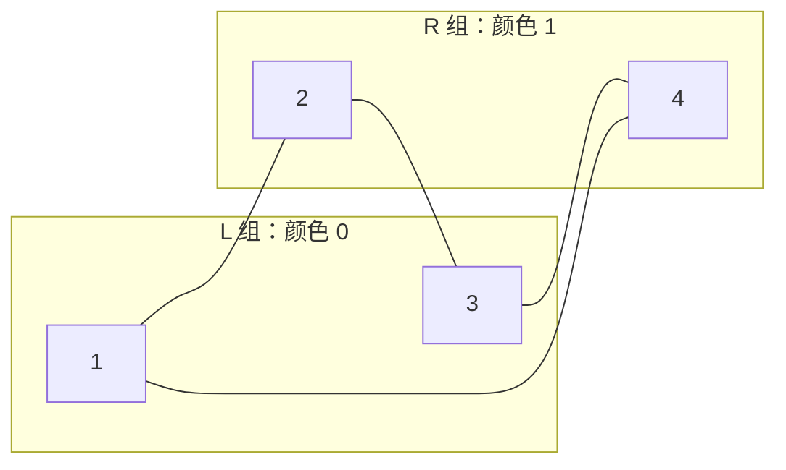

## 二分图与染色：从两类分组到树上 DP

## 一、先分清三个概念

| 概念 | 解决的问题 | 例子 |
| --- | --- | --- |
| 二分图 | 能否把节点分成两组，使每条边连接不同组 | 把有冲突的人分进两个队伍 |
| 二染色 | 用 0、1 给节点赋值，使每条边两端颜色不同 | BFS/DFS 检查是否出现冲突 |
| 一般图染色 | 用若干种颜色，满足题目规定的颜色关系 | 三种颜色的树上方案计数 |

**无向图是二分图，当且仅当它能被合法二染色。**

但是，题目中出现“两类对象”或“颜色”时，还要判断到底要求什么：

- 已知两类对象，可能直接得到二分图结构，不需要再运行染色判定。
- 同色/异色关系是二元约束系统，不一定是原图的普通二染色。
- 三种颜色的方案计数，需要进一步考虑 DP，不能直接套二染色模板。

## 二、二分图是什么

对于无向图 $G=(V,E)$，如果可以把节点集合划分为 $L,R$ 两部分，使每条边 $(u,v)$ 都有一端在 L、另一端在 R，那么 G 是二分图。

$$
L\cap R=\varnothing,\qquad L\cup R=V
$$

同一组内部没有边。

注意：**两组人数不一定相等，也不要求图连通。** 孤立点也可以被分到任意一组。

### 1. 一个合法例子

下面是一个四边形：L 组为 `{1,3}`，R 组为 `{2,4}`。



边只跨越两组，所以是二分图。

### 2. 一个不合法例子

三角形的边为 `(1,2)`、`(2,3)`、`(3,1)`。

| 节点 | 推出的颜色 | 原因 |
| --- | --- | --- |
| 1 | 0 | 任意指定起点 |
| 2 | 1 | 必须与 1 不同 |
| 3 | 0 | 必须与 2 不同 |

但是 `(3,1)` 两端都是 0，发生矛盾，无法合法二染色。

## 三、核心定理：二分图当且仅当没有奇环

奇环：边数为奇数的简单环，例如三角形、五边形。

偶环：边数为偶数的简单环，例如四边形。

### 1. 为什么存在奇环就不行

沿环走一条边，颜色就切换一次。

走奇数条边回到起点时，要求起点与自己的颜色不同，矛盾。

因此：

$$
\text{二分图}\Longrightarrow\text{不存在奇环}
$$

### 2. 为什么没有奇环就一定可以

对每个连通块任选一个根，用 BFS 按到根的最短距离奇偶染色：

$$
\operatorname{color}[u]=\operatorname{dist}[u]\bmod 2
$$

如果有一条边连接了相同颜色的两个点，那么它们在 BFS 树中的深度同奇偶。

将两个点到最近公共祖先的树路径，加上这条边，会形成一个奇数长度的环，与“没有奇环”矛盾。

所以每条边都会跨越两种颜色，染色合法。

### 3. 树为什么一定是二分图

树没有环，自然没有奇环，因此一定是二分图。

任选一个根：

- 深度为偶数的节点放入一组。
- 深度为奇数的节点放入另一组。

森林同理，每棵树分别处理即可。

自环要求同一节点与自己异色，所以有自环的图不是二分图；重复加入一条无向边则不会改变二染色是否可行。

## 四、BFS 二染色

### 1. 数组含义

```cpp
color[u] == -1; // 尚未访问、尚未染色
color[u] == 0;  // 第一组
color[u] == 1;  // 第二组
```

不能把 0 同时当作“未访问”和一种合法颜色。

### 2. 转移规则

对于每条边 `(u,v)`：

- 若 v 未染色，就令 `color[v] = color[u] ^ 1`。
- 若 v 已染色，就检查它是否与 u 颜色不同。
- 如果颜色相同，立即判定失败。

`^` 是按位异或，对 0、1 有：

```cpp
0 ^ 1 == 1;
1 ^ 1 == 0;
```

所以 `color[u] ^ 1` 表示切换颜色，也可以写成 `1 - color[u]`。

### 3. 为什么要枚举全部起点

图可能不连通。只从节点 1 搜索，会漏掉其他连通块中的奇环。

```cpp
for (int start = 1; start <= n; start++) {
    if (color[start] != -1) continue;
    // 从 start 开始染这个连通块
}
```

### 4. 完整模板

输入 n、m 和 m 条无向边；若不是二分图输出 `NO`，否则输出 `YES` 与一种 0/1 染色。

```cpp
#include <bits/stdc++.h>
using namespace std;

int main() {
    ios::sync_with_stdio(false);
    cin.tie(nullptr);
    int n, m;
    cin >> n >> m;
    vector<vector<int>> adj(n + 1);
    for (int i = 0; i < m; i++) {
        int u, v;
        cin >> u >> v;
        adj[u].push_back(v);
        adj[v].push_back(u);
    }
    vector<int> color(n + 1, -1);
    queue<int> q;
    for (int start = 1; start <= n; start++) {
        if (color[start] != -1) continue;
        color[start] = 0;
        q.push(start);
        while (!q.empty()) {
            int u = q.front();
            q.pop();
            for (int v : adj[u]) {
                if (color[v] == -1) {
                    color[v] = color[u] ^ 1;
                    q.push(v);
                } else if (color[v] == color[u]) {
                    cout << "NO\n";
                    return 0;
                }
            }
        }
    }
    cout << "YES\n";
    for (int u = 1; u <= n; u++) {
        cout << color[u] << (u == n ? '\n' : ' ');
    }
}
```

时间复杂度 $O(N+M)$，空间复杂度 $O(N+M)$。

**节点第一次入队时就染色，避免被多个邻居重复加入队列。**

## 五、DFS 也可以染色

### 1. 递归版本的核心函数

下面函数假设 `adj`、`color` 已经在外部定义，且 `color` 初始为 -1。

```cpp
bool dfs(int u, int c) {
    color[u] = c;
    for (int v : adj[u]) {
        if (color[v] == -1) {
            if (!dfs(v, c ^ 1)) return false;
        } else if (color[v] == c) {
            return false;
        }
    }
    return true;
}
```

每个未染色的连通块调用一次 `dfs(start,0)`；任何一次返回 false，就存在矛盾。

### 2. BFS 与 DFS 如何选择

| 方法 | 优点 | 注意事项 |
| --- | --- | --- |
| BFS 队列 | 写法清楚，适合按层理解奇偶 | 首次入队时标记 |
| 递归 DFS | 代码短，容易对应递归思路 | 长链可能导致递归栈溢出 |
| 显式栈 DFS | 避免递归深度问题 | 同样在首次入栈时染色 |

二分图判定不要求最短路，因此 DFS、BFS 都能正确完成。深度可能达到 $10^5$ 时，本课完整程序优先使用非递归实现。

## 六、每个连通块有多少种二染色

对一个连通且无矛盾的非空图，指定根的颜色后，其余节点的颜色全部确定。

因此恰好有两种合法的 0/1 染色：一种染法，以及把所有 0、1 整体交换后的染法。孤立点也有两种选择。

若图有 C 个连通块，且每个连通块都能二染色：

$$
\text{方案数}=2^C
$$

这里两种颜色有区别，交换颜色视为不同方案。如果题目把两组交换视为同一个结果，计数就需要重新分析。

### 例子

边为 `(1,2)`、`(2,3)`，另有孤立点 4。

- 连通块 `{1,2,3}` 有两种染法。
- 连通块 `{4}` 有两种染法。
- 总计 $2\times 2=4$ 种。

若题目已经固定某些节点颜色，每个连通块不再一定有两种选择，必须检查固定条件是否冲突。

## 七、练习：每个连通块选较小的一组

[洛谷 P1330：封锁阳光大学](https://www.luogu.com.cn/problem/P1330)

### 1. 条件转化

每条边要求：

1. 至少一端被封锁，否则这条道路没有被封锁。
2. 不能两端都被封锁，否则相邻河蟹冲突。

合起来就是：**每条边恰好有一个端点被选。**

因此可以把“选”与“不选”作为两种颜色，先判定二分图。

### 2. 如何求最少数量

每个连通块中，两种颜色可以整体交换，所以取人数较少的一组。

$$
\text{答案}=\sum_{\text{连通块 }C}\min(\operatorname{cnt}_0(C),\operatorname{cnt}_1(C))
$$

孤立点没有道路需要封锁，可以选 0 个，对应 $\min(1,0)=0$。

**这是“每条边恰好选一端”的结论，不是一般二分图最小点覆盖的通用算法。** 如果只要求至少选一端、允许两端都选，不能直接照搬。

### 3. 完整代码

```cpp
#include <bits/stdc++.h>
using namespace std;

int main() {
    ios::sync_with_stdio(false);
    cin.tie(nullptr);
    int n, m;
    cin >> n >> m;
    vector<vector<int>> adj(n + 1);
    for (int i = 0; i < m; i++) {
        int u, v;
        cin >> u >> v;
        adj[u].push_back(v);
        adj[v].push_back(u);
    }
    vector<int> color(n + 1, -1);
    int answer = 0;
    queue<int> q;
    for (int start = 1; start <= n; start++) {
        if (color[start] != -1) continue;
        int cnt[2] = {1, 0};
        color[start] = 0;
        q.push(start);
        while (!q.empty()) {
            int u = q.front();
            q.pop();
            for (int v : adj[u]) {
                if (color[v] == -1) {
                    color[v] = color[u] ^ 1;
                    cnt[color[v]]++;
                    q.push(v);
                } else if (color[v] == color[u]) {
                    cout << "Impossible\n";
                    return 0;
                }
            }
        }
        answer += min(cnt[0], cnt[1]);
    }
    cout << answer << '\n';
}
```

时间与空间均为 $O(N+M)$。

## 八、银组与金组真题路线

| 组别与年份 | 题目 | 本章对应内容 | 需要额外掌握 |
| --- | --- | --- | --- |
| 2019 February Silver | [The Great Revegetation](https://usaco.org/index.php?page=viewproblem2&cpid=920) | 同色/异色约束、连通块方案计数 | 异或关系 |
| 2020 February Silver | [Clock Tree](https://usaco.org/index.php?page=viewproblem2&cpid=1016) | 树的二分染色、交替和 | 模 12 不变量 |
| 2019 January Silver | [Grass Planting](https://usaco.org/index.php?page=viewproblem2&cpid=894) | 距离 1、2 的节点必须异色 | 树的最大度数、构造证明 |
| 2026 First Contest | [Mooclear Reacto](https://usaco.org/index.php?page=viewproblem2&cpid=1543&utm_source=chatgpt.com) | / | / |
| 2017 December Gold | [Barn Painting](https://usaco.org/index.php?page=viewproblem2&cpid=766) | 相邻异色的三染色方案计数 | 树形 DP |
| 2017 December Gold | [A Pie for a Pie](https://usaco.org/index.php?page=viewproblem2&cpid=765) | 两类节点间的交替转移 | 反图、多源 BFS、有序集合 |

本章不是把这些题全部归为“二分图判定”：前两题直接运用两类分组；Grass Planting、Barn Painting 是染色拓展；A Pie for a Pie 是已知两类节点的有向图建模。

## 九、银组真题一：The Great Revegetation

### 1. 题意与建模

每块草地选择两种草中的一种。关系有两类：

- `S u v`：u、v 的草必须相同。
- `D u v`：u、v 的草必须不同。

求合法方案数，以二进制输出。注意这是银组版本，不是同名铜组题。

### 2. 把关系统一成异或

用 `color[u]` 表示草的类型：

$$
\operatorname{color}[u]\oplus\operatorname{color}[v]=w
$$

其中：

| 关系 | w | 推出的 v 颜色 |
| --- | --- | --- |
| S：相同 | 0 | `color[u] ^ 0` |
| D：不同 | 1 | `color[u] ^ 1` |

统一转移：

```cpp
int expected = color[u] ^ different;
```

若 v 没有颜色，赋值为 expected；若已有颜色但不等于 expected，说明无解。

### 3. 原图有奇环也可能有解

普通二分图的每条边都要求异色。本题允许同色边，判断标准不同。

例如三角形的三条边都是 S，所有节点都染 0 或都染 1，都合法。

更一般地，任意一个环上的 w 异或起来必须为 0：

$$
w_1\oplus w_2\oplus\cdots\oplus w_k=0
$$

也就是一个环中 D 边的数量必须为偶数。沿环推颜色一圈，应回到原来的颜色。

### 4. 为什么答案是 2 的幂

若没有矛盾，每个连通块任选一个节点颜色后，其他节点颜色都确定；整个连通块可以整体翻转，因此每块有两种方案。

设连通块数为 C：

$$
\text{方案数}=2^C
$$

二进制表示为一个 `1` 后接 C 个 `0`。

```cpp
cout << '1' << string(components, '0') << '\n';
```

不需要计算 `1 << C`，否则 C 很大时会发生非法移位或溢出。

### 5. 样例推演

```text
3 2
S 1 2
D 3 2
```

指定 `color[1]=0`，推出 `color[2]=0`、`color[3]=1`。整体翻转得到另一种方案。

只有一个连通块，方案数为 2，二进制输出 `10`。

### 6. 完整代码

```cpp
#include <bits/stdc++.h>
using namespace std;

int main() {
    ios::sync_with_stdio(false);
    cin.tie(nullptr);
    int n, m;
    cin >> n >> m;
    // pair 的两个元素：邻居编号、颜色是否不同（0 同，1 异）
    vector<vector<pair<int, int>>> adj(n + 1);
    for (int i = 0; i < m; i++) {
        char relation;
        int u, v;
        cin >> relation >> u >> v;
        int different = (relation == 'D');
        adj[u].push_back({v, different});
        adj[v].push_back({u, different});
    }
    vector<int> color(n + 1, -1);
    queue<int> q;
    int components = 0;
    for (int start = 1; start <= n; start++) {
        if (color[start] != -1) continue;
        components++;
        color[start] = 0;
        q.push(start);
        while (!q.empty()) {
            int u = q.front();
            q.pop();
            for (auto [v, different] : adj[u]) {
                int expected = color[u] ^ different;
                if (color[v] == -1) {
                    color[v] = expected;
                    q.push(v);
                } else if (color[v] != expected) {
                    cout << "0\n";
                    return 0;
                }
            }
        }
    }
    cout << '1' << string(components, '0') << '\n';
}
```

时间与空间复杂度均为 $O(N+M)$，输出本身需要 $O(C)$ 时间。

## 十、从染色衔接到并查集

静态给出全部关系时，DFS/BFS 染色已经足够，且能直接得到每个节点的颜色。

如果关系逐条加入，需要不断检查是否矛盾，可以考虑维护“同组与对立组”的并查集。

### 1. 扩展域思路

用 $2N$ 个元素：

- `x` 表示 x 对应的一侧。
- `x+n` 表示与 x 对立的一侧。

引入上一课的 DSU 模板，建立 `DSU dsu(2*n)`，则：

```cpp
// S：相同
if (relation == 'S') {
    dsu.unite(u, v);
    dsu.unite(u + n, v + n);
}
// D：不同
else {
    dsu.unite(u, v + n);
    dsu.unite(u + n, v);
}

// 插入这条关系前若整个系统无矛盾，插入后检查其端点即可发现新矛盾。
if (dsu.same(u, u + n) || dsu.same(v, v + n)) {
    // 无解：同一元素与它的对立面被判成同一组
}
```

### 2. 如何选择方法

| 场景 | 优先考虑 |
| --- | --- |
| 静态图判定二染色 | BFS/DFS |
| 需要直接输出每个节点颜色 | BFS/DFS |
| 逐条加入同/异关系，随时判矛盾 | 扩展域并查集或带权并查集 |
| 删除关系 | 普通并查集不能直接撤销，需要进一步分析 |

本节了解联系即可，不要求第一次学习就掌握带权并查集或 2-SAT。一般布尔约束也不一定都能简化成同色/异色关系。

## 十一、银组真题二：Clock Tree

### 1. 染色的作用

给树上的房间分成 A、B 两组，相邻房间组别不同。走廊每走一步，就会从一组进入另一组。

因此每次行走对两组时钟和的影响有固定的奇偶规律。

### 2. 统计两个组

设：

$$
S_A=\sum_{u\in A}a_u,\qquad S_B=\sum_{u\in B}a_u
$$

并统计组大小 $|A|,|B|$。时钟读数 12 等价于模 12 的 0。

定义：

$$
\Delta=(S_A-S_B)\bmod 12
$$

实现时把余数规范到 0 至 11。

### 3. 判定表

| 差值 | 哪些起点可行 | 答案 |
| --- | --- | --- |
| 0 | 两组所有节点 | N |
| 1 | A 组节点 | $|A|$ |
| 11，也就是 -1 | B 组节点 | $|B|$ |
| 其他 | 都不可行 | 0 |

### 4. 为什么出现 0 与 1

假设起点在 A。出发前不增加起点读数；第一步进入 B，第二步进入 A，之后交替。

- 走偶数步：两组增加次数相同，差值不变。
- 走奇数步：B 比 A 多增加一次，差值减 1。

最终所有读数都是 12，差值必须为 0，因此初始差值只能为 0 或 1。起点在 B 时同理，条件为 0 或 -1。

### 5. 充分性为什么也成立

这里不能只证明必要性就直接宣布全解。可以利用树的叶子结构归纳：

1. 始终以当前位置作为参考起点，定义到当前点距离偶数的节点取正号、奇数的取负号，得到交替和 q。
2. 每移动一步，所有正负号翻转，且新进入节点加 1，所以 $q'\equiv1-q\pmod{12}$；因此 q 属于 `{0,1}` 的条件会保持。
3. 选一个非当前位置的叶子 x，先走到它的父节点 p。途中每一步的增加已经由上式计入。
4. 反复执行 `p→x→p`，直到 x 读数为 12，然后不再进入 x。往返让两个异色端点各加一，不改变以 p 为参考的交替和；删除 x 后条件仍保持。
5. 逐步归约到两个节点。设当前点读数 a，另一点 b；当 $a-b\equiv0$ 时可用偶数步归零，当 $a-b\equiv1$ 时可用奇数步归零。

因此条件也是充分的。这个证明可以作为数学拓展；课堂主线先理解二分组与判定表。

### 6. 完整代码

```cpp
#include <bits/stdc++.h>
using namespace std;

int main() {
    ios::sync_with_stdio(false);
    cin.tie(nullptr);
    int n;
    cin >> n;
    vector<int> a(n + 1);
    for (int u = 1; u <= n; u++) cin >> a[u];
    vector<vector<int>> adj(n + 1);
    for (int i = 1; i < n; i++) {
        int u, v;
        cin >> u >> v;
        adj[u].push_back(v);
        adj[v].push_back(u);
    }
    vector<int> color(n + 1, -1);
    int cnt[2] = {0, 0}, sum[2] = {0, 0};
    queue<int> q;
    color[1] = 0;
    q.push(1);
    while (!q.empty()) {
        int u = q.front();
        q.pop();
        cnt[color[u]]++;
        sum[color[u]] += a[u];
        for (int v : adj[u]) {
            if (color[v] != -1) continue;
            color[v] = color[u] ^ 1;
            q.push(v);
        }
    }
    int difference = ((sum[0] - sum[1]) % 12 + 12) % 12;
    int answer = 0;
    if (difference == 0) answer = n;
    else if (difference == 1) answer = cnt[0];
    else if (difference == 11) answer = cnt[1];
    cout << answer << '\n';
}
```

时间 $O(N)$，空间 $O(N)$。本题树连通，从 1 出发就能访问所有节点。

样例中 A=`{1,3,4}`，和为 33；B=`{2}`，和为 10。差值为 23 模 12，即 11，所以只有 B 中的节点 2 可以作为起点。

## 十二、银组染色拓展：Grass Planting

### 1. 为什么不是两种颜色

题目不仅要求相邻节点颜色不同，还要求距离为 2 的节点颜色不同。

例如三节点链 `1—2—3`：普通二染色为 `0,1,0`，但 1 与 3 距离为 2，不符合本题条件。

所以“树是二分图”不代表本题只需要两种颜色。

### 2. 下界

对于一个度数为 d 的节点，它自己和所有 d 个邻居必须两两异色：

- 它与邻居距离为 1。
- 任意两个邻居距离为 2。

因此至少需要 $d+1$ 种颜色。

设最大度数为 $D_{\max}$，至少需要 $D_{\max}+1$ 种颜色。

### 3. 为什么足够

任选一个根：

1. 根的孩子使用互不相同且不同于根的颜色，最多需要 $D_{\max}$ 种。
2. 对非根节点 u，它的孩子必须避开 u 与 u 父节点的颜色，还要彼此不同。
3. u 最多有 $D_{\max}-1$ 个孩子；总共 $D_{\max}+1$ 种颜色，避开两种后，恰好还有 $D_{\max}-1$ 种可用。
4. 不同子树之间，除已经处理的兄弟关系外，不会新增距离不超过 2 的冲突。

所以答案就是：

$$
D_{\max}+1
$$

### 4. 完整代码

```cpp
#include <bits/stdc++.h>
using namespace std;

int main() {
    ios::sync_with_stdio(false);
    cin.tie(nullptr);
    int n;
    cin >> n;
    vector<int> degree(n + 1, 0);
    for (int i = 1; i < n; i++) {
        int u, v;
        cin >> u >> v;
        degree[u]++;
        degree[v]++;
    }
    int maxDegree = 0;
    for (int u = 1; u <= n; u++) maxDegree = max(maxDegree, degree[u]);
    cout << maxDegree + 1 << '\n';
}
```

时间 $O(N)$、空间 $O(N)$。本题只需输出最少颜色数，不要求真的构造染色。

## 十三、金组真题一：Barn Painting

### 1. 从二染色转向三染色计数

给一棵树，用三种颜色染色，部分节点颜色已经固定，相邻节点不能同色，求方案数模 $10^9+7$。

普通二染色中，父节点确定后，孩子只能用另一种颜色；三染色中，孩子有两种候选颜色，并且固定节点会限制其子树。

因此需要统计“每种根颜色对应多少种子树方案”。

### 2. 状态定义

$$
dp[u][c]=\text{以 u 为根的子树中，u 染为 c 的合法方案数}
$$

其中 $c\in\{1,2,3\}$。

### 3. 状态转移

若 u 的某个孩子是 v，则 v 只能使用不同于 c 的颜色：

$$
\operatorname{childWays}(v,c)=\sum_{t\ne c}dp[v][t]
$$

不同孩子的子树，在 u 颜色固定后互不影响，所以相乘：

$$
dp[u][c]=\prod_{v\text{ 是 u 的孩子}}\left(\sum_{t\ne c}dp[v][t]\right)
\pmod{10^9+7}
$$

**一个孩子的不同颜色选择相加；不同孩子的方案组合相乘。**

### 4. 初始化与固定颜色

- 叶子未固定颜色：三种颜色各有 1 种方案。
- 若 u 被固定为颜色 f，则 `dp[u][c]=0` 对所有 `c != f` 成立。
- 计算 `dp[u][c]` 时先设为 1，再乘上每个孩子的贡献；没有孩子时保留 1。

答案：

$$
dp[root][1]+dp[root][2]+dp[root][3]\pmod{10^9+7}
$$

### 5. 样例推演

树的边是 `(1,2)`、`(1,3)`、`(1,4)`，节点 4 固定为颜色 3。

| 节点 1 颜色 | 节点 2 选择数 | 节点 3 选择数 | 节点 4 选择数 | 贡献 |
| --- | --- | --- | --- | --- |
| 1 | 2 | 2 | 1 | 4 |
| 2 | 2 | 2 | 1 | 4 |
| 3 | 2 | 2 | 0 | 0 |

总计 8。

### 6. 为什么逆序处理 order

先遍历一次树，让 `order` 中父节点先于孩子；然后逆序枚举，保证算 u 时，所有孩子的 DP 已经完成。

`order` 只是辅助安排计算顺序，不需要 LCA，也不是保存当前根到节点的路径。

### 7. 完整代码

```cpp
#include <bits/stdc++.h>
using namespace std;

using ll = long long;
const ll MOD = 1000000007;

int main() {
    ios::sync_with_stdio(false);
    cin.tie(nullptr);
    int n, k;
    cin >> n >> k;
    vector<vector<int>> adj(n + 1);
    for (int i = 1; i < n; i++) {
        int u, v;
        cin >> u >> v;
        adj[u].push_back(v);
        adj[v].push_back(u);
    }
    vector<int> fixedColor(n + 1, 0); // 0 表示未固定，否则是 1、2、3
    for (int i = 0; i < k; i++) {
        int u, c;
        cin >> u >> c;
        fixedColor[u] = c;
    }
    // order 保证父节点先于子节点；倒序后可计算子树 DP。
    vector<int> parent(n + 1, 0), order;
    order.push_back(1);
    for (int i = 0; i < (int)order.size(); i++) {
        int u = order[i];
        for (int v : adj[u]) {
            if (v == parent[u]) continue;
            parent[v] = u;
            order.push_back(v);
        }
    }
    vector<array<ll, 4>> dp(n + 1);
    for (int i = n - 1; i >= 0; i--) {
        int u = order[i];
        for (int c = 1; c <= 3; c++) {
            if (fixedColor[u] != 0 && fixedColor[u] != c) {
                dp[u][c] = 0;
                continue;
            }
            dp[u][c] = 1;
            for (int v : adj[u]) {
                if (parent[v] != u) continue;
                ll ways = 0;
                for (int nextColor = 1; nextColor <= 3; nextColor++) {
                    if (nextColor != c) ways = (ways + dp[v][nextColor]) % MOD;
                }
                dp[u][c] = dp[u][c] * ways % MOD;
            }
        }
    }
    cout << (dp[1][1] + dp[1][2] + dp[1][3]) % MOD << '\n';
}
```

颜色数固定为 3，时间 $O(N)$，空间 $O(N)$。程序使用非递归顺序，避免长链导致递归栈过深。

若完全没有固定颜色，可以用 $3\cdot2^{N-1}$ 自检：根有 3 种，其他每个节点有 2 种。

## 十四、金组真题二：A Pie for a Pie

> 这是二分结构的建模应用，重点不是判定二染色。建议作为第二课或拓展阅读。

### 1. 两类节点天然存在

把每块派作为一个节点：

- L 组：Bessie 的 N 块派。
- R 组：Elsie 的 N 块派。

赠送时双方交替，所以合法转移只会跨越两组。转移有方向；忽略方向后，其底层无向图是二分图。

这并不意味着它是匹配问题：本题要求到终止状态的最短赠送次数。

### 2. 边怎样定义

设 `bValue[x]`、`eValue[x]` 分别是 Bessie、Elsie 对派 x 的评分。

- Bessie 的派 i 送给 Elsie 后，Elsie 可以回赠自己的派 j，当且仅当：

$$
eValue[i]\le eValue[j]\le eValue[i]+D
$$

- Elsie 的派 j 送给 Bessie 后，Bessie 可以回赠自己的派 i，当且仅当：

$$
bValue[j]\le bValue[i]\le bValue[j]+D
$$

接收者对收到的派评分为 0 时，立即结束，不必再回赠。

### 3. 为什么反向搜索

每个起点都单独搜索，会重复计算。终点集合却很明确：

- Bessie 的派满足 `eValue[i]==0`。
- Elsie 的派满足 `bValue[j]==0`。

将所有终点加入队列，在反图上做多源 BFS，就能同时求出所有起点到最近终点的距离。

### 4. 反向区间

从 Bessie 的派 i 反向找 Elsie 的派 j：

$$
bValue[j]\in[bValue[i]-D,\ bValue[i]]
$$

从 Elsie 的派 j 反向找 Bessie 的派 i：

$$
eValue[i]\in[eValue[j]-D,\ eValue[j]]
$$

不要把反向区间仍写成 `[当前评分,当前评分+D]`。

### 5. 如何避免枚举所有边

可能的转移有 $O(N^2)$ 条，不显式存边。

维护两个有序集合，只存尚未访问的派：

- Bessie 的派按 `eValue` 排序。
- Elsie 的派按 `bValue` 排序。

每次用 `lower_bound` 找区间左端，依次取出区间内节点，赋距离后立即删除。

每个节点最多入队一次、从集合删除一次，总时间 $O(N\log N)$。

使用 `set<pair<int,int>>` 存 `{评分,编号}`，评分相同的派仍能作为不同节点保存。

### 6. 距离初始化

本代码的 `dist[u]` 表示**从 u 作为第一块派开始，最少赠送多少块派才会结束**。

所以终点初始化为 1，而不是 0；不可达为 -1。

题目不允许同一块派被赠送两次，但最短路径可以选择不重复节点的简单路径，因此 BFS 模型无需额外记录“用过哪些派”的子集。

### 7. 完整代码

```cpp
#include <bits/stdc++.h>
using namespace std;

int main() {
    ios::sync_with_stdio(false);
    cin.tie(nullptr);
    int n, d;
    cin >> n >> d;
    vector<int> bValue(2 * n), eValue(2 * n);
    vector<int> dist(2 * n, -1);
    // 0..n-1 是 Bessie 的派，n..2n-1 是 Elsie 的派。
    // pendingB 按 Elsie 评分排序；pendingE 按 Bessie 评分排序。
    set<pair<int, int>> pendingB, pendingE;
    queue<int> q;
    for (int i = 0; i < 2 * n; i++) {
        cin >> bValue[i] >> eValue[i];
        bool terminal = (i < n ? eValue[i] == 0 : bValue[i] == 0);
        if (terminal) {
            dist[i] = 1; // 这块派本身也算一次赠送
            q.push(i);
        } else if (i < n) {
            pendingB.insert({eValue[i], i});
        } else {
            pendingE.insert({bValue[i], i});
        }
    }
    while (!q.empty()) {
        int u = q.front();
        q.pop();
        if (u < n) {
            // 反向找能够在当前 Bessie 派之前赠送的 Elsie 派。
            int low = bValue[u] - d, high = bValue[u];
            auto it = pendingE.lower_bound({low, -1});
            while (it != pendingE.end() && it->first <= high) {
                int v = it->second;
                dist[v] = dist[u] + 1;
                q.push(v);
                it = pendingE.erase(it);
            }
        } else {
            int low = eValue[u] - d, high = eValue[u];
            auto it = pendingB.lower_bound({low, -1});
            while (it != pendingB.end() && it->first <= high) {
                int v = it->second;
                dist[v] = dist[u] + 1;
                q.push(v);
                it = pendingB.erase(it);
            }
        }
    }
    for (int i = 0; i < n; i++) cout << dist[i] << '\n';
}
```

时间 $O(N\log N)$，空间 $O(N)$。

样例输出为 3、1：第二块 Bessie 的派对 Elsie 评分为 0，因此一送出就结束，答案为 1。

## 十五、网格中的黑白染色

只允许上下左右移动的网格，可以按坐标奇偶划分：

$$
\operatorname{color}(r,c)=(r+c)\bmod 2
$$

每走一步，r 或 c 恰有一个改变 1，因此颜色必定切换。

常见用途：

1. 判断路径长度的奇偶：同色两点之间只能有偶数步路径，异色只能有奇数步路径；是否存在路径还取决于障碍等条件。
2. 把相邻格子的冲突、配对关系转成二分图结构。
3. 观察走若干步后能到达哪一种颜色。

注意：

- 加入障碍、删除部分上下左右边，不破坏这一染色的合法性。
- 如果允许对角线、原地等待或额外传送，就必须重新检查每种移动是否改变颜色。
- 有方向的移动需要另外考虑可达性，颜色本身不能判断是否有路。

## 进阶练习：二分答案 + 二染色

[洛谷 P1525：关押罪犯](https://www.luogu.com.cn/problem/P1525)

### 1. 把最优化变成判定

假设允许同一监狱内的最大怨气值不超过 X。

那么所有怨气值 `w > X` 的两个人，必须分到不同监狱。

只保留这些边，问题变成：图能否二染色？

### 2. 二分方向

- X 越大，需要强制分开的边越少，越容易满足。
- 若 X 可行，更大的 X 也可行。
- 找到最小可行 X。

判定时只遍历 `w > X` 的边，注意不是 `w >= X`：等于 X 的冲突已经被允许。

每次检查 $O(N+M)$，二分共 $O(\log(W_{\max}+1))$ 次。也可从大到小排序怨气值，用扩展域并查集逐步加入异色约束，首次矛盾时得到答案。

本题可作为连接上一课并查集与本课染色的综合练习；它不是 USACO 真题。

## 课后练习表

| 年份               | 真题                                                         | 对应知识点                                                   |
| ------------------ | ------------------------------------------------------------ | ------------------------------------------------------------ |
| 2026 First Contest | [Mooclear Reactor](https://usaco.org/index.php?page=viewproblem2&cpid=1543) | 沿边传播正负号，将节点值表示为 \(s_i x+b_i\)；检查环上的约束；结合区间扫描 |
| 2022 February      | [Redistributing Gifts](https://usaco.org/index.php?page=viewproblem2&cpid=1206) | 可以把“奶牛—可接受礼物”看作二分图，理解合法分配与交换环；常用解法为有向图可达性 |
| 2022 February      | [Redistributing Gifts](https://usaco.org/index.php?page=viewproblem2&cpid=1209) | 合法分配可以理解为完美匹配计数；全解结合置换环与状态压缩 DP  |

| 层次 | 题目 | 本题要练会什么 |
| --- | --- | --- |
| 基础 | 自定义二分图判定模板 | 独立写 BFS/DFS 染色与冲突判断 |
| 基础 | [P1330 封锁阳光大学](https://www.luogu.com.cn/problem/P1330) | 连通块两侧计数、最小选择 |
| 银组核心 | [The Great Revegetation](https://usaco.org/index.php?page=viewproblem2&cpid=920) | 同色/异色约束、$2^C$ 方案数 |
| 银组应用 | [Clock Tree](https://usaco.org/index.php?page=viewproblem2&cpid=1016) | 树的二分组与不变量 |
| 银组拓展 | [Grass Planting](https://usaco.org/index.php?page=viewproblem2&cpid=894) | 从限制推导颜色下界，再证明可达 |
| 综合 | [P1525 关押罪犯](https://www.luogu.com.cn/problem/P1525) | 二分答案 + 染色，或并查集维护异色约束 |
| 金组核心 | [Barn Painting](https://usaco.org/index.php?page=viewproblem2&cpid=766) | 树上多颜色方案计数、树形 DP |
| 金组拓展 | [A Pie for a Pie](https://usaco.org/index.php?page=viewproblem2&cpid=765) | 两类节点建模、反向多源 BFS 与区间检索 |

