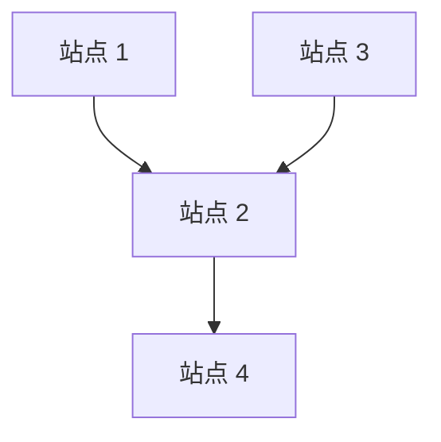

## USACO 铜组专题：字符串、矩形几何与简单图论

## 1.字符与字符串

`char` 保存一个字符，`string` 保存一串字符。

```cpp
char c = 'A';
string s = "USACO";
```

| 写法 | 含义 |
|---|---|
| `'A'` | 字符，使用单引号 |
| `"A"` | 字符串，使用双引号 |
| `s.size()` | 字符串长度 |
| `s[i]` | 下标为 `i` 的字符 |
| `s.substr(i, k)` | 从 `i` 开始，截取长度为 `k` 的子串 |
| `s += t` | 将 `t` 拼接到末尾 |
| `s == t` | 内容是否相同 |
| `s < t` | 按字典序比较 |

字符串下标从 `0` 开始。

| 字符 | U | S | A | C | O |
|---|---|---|---|---|---|
| 下标 | 0 | 1 | 2 | 3 | 4 |

```cpp
string s = "USACO";
for (int i = 0; i < (int)s.size(); i++) {
    cout << i << ' ' << s[i] << '\n';
}
```

只读取字符，不需要下标时：

```cpp
for (char c : s) {
    cout << c << '\n';
}
```

### 输入：`cin` 与 `getline`

```cpp
string word;
cin >> word;       // 读取到空白字符之前

string line;
getline(cin, line); // 读取整行，可以包含空格
```

如果先用 `cin >> n`，再读取下一整行，要处理留下的换行：

```cpp
cin >> n;
cin.ignore(numeric_limits<streamsize>::max(), '\n');
getline(cin, line);
```

上例需要 `<limits>`。不能在不看输入格式的情况下随意添加 `ignore()`，否则可能跳过有效数据。

### 字典序

在本讲义的大写字母或小写字母范围内，可按字母顺序理解。逐个比较对应字符；第一次不同决定大小。一个字符串是另一个的前缀时，短的更小。

```cpp
// "ABC" < "ABD"
// "ABC" < "ABCD"
```

不要混淆 `"10" < "2"` 与数值 `10 < 2`：前者按字符比较，为真。

### 1.2 字符计数：把字母映射为数组下标

如果题目保证所有字符都是小写英文字母：

```cpp
int cnt[26] = {};
for (char c : s) {
    cnt[c - 'a']++;
}
```

- `'a' - 'a' = 0`。
- `'b' - 'a' = 1`。
- `'z' - 'a' = 25`。

大写字母使用 `c - 'A'`。大小写或其他字符混用时，不能直接套用同一段代码。

**课堂小练习：**`ABACA` 中，A、B、C 各出现几次？

**答案：**3、1、1。时间复杂度为 `O(n)`，计数数组空间为 `O(26)`。

### 1.3 真题 1：Bovine Genomics——按列比较字符集合

- 比赛：2017 US Open，Bronze，Problem 2。
- [官方题目](https://usaco.org/index.php?page=viewproblem2&cpid=736)

### 题意与知识点

两组各有 `N` 个长度为 `M` 的基因字符串。求有多少个位置，能仅凭该位置的字符区分两组。

本题练习：`vector<string>`、按列遍历、出现标记。

### 手算示例

| 组别 | 字符串 1 | 字符串 2 |
|---|---|---|
| 斑点组 | `ACG` | `ATG` |
| 普通组 | `CCA` | `CTA` |

逐列比较：

- 第 1 列：`{A}` 与 `{C}`，可以区分。
- 第 2 列：`{C,T}` 与 `{C,T}`，不能区分。
- 第 3 列：`{G}` 与 `{A}`，可以区分。

答案为 `2`。

### 思路

枚举列 `j`，记录第一组在该列出现的所有字符，再检查第二组是否出现相同字符。

**正确性：**两组字符集合有交集时，同一个字符可能来自任意一组；没有交集时，字符即可确定组别。

### 参考代码

```cpp
#include <iostream>
#include <string>
#include <vector>
using namespace std;

int main() {
    int n, m;
    cin >> n >> m;
    vector<string> spotty(n), plain(n);
    for (string& s : spotty) cin >> s;
    for (string& s : plain) cin >> s;

    int answer = 0;
    for (int col = 0; col < m; col++) {
        bool seen[26] = {}; // 每换一列，必须重新清空
        for (int row = 0; row < n; row++) {
            seen[spotty[row][col] - 'A'] = true;
        }
        bool good = true;
        for (int row = 0; row < n; row++) {
            if (seen[plain[row][col] - 'A']) {
                good = false;
                break;
            }
        }
        if (good) answer++;
    }
    cout << answer << '\n';
}
```

复杂度：时间 `O(NM)`；存储输入 `O(NM)`，额外标记空间 `O(26)`。

**易错点：**不是只比较“对应编号的两头牛”，而是比较两组在这一列的全部可能字符。

### 1.4 子串、子序列与连续片段

- **子串**必须连续。
- **子序列**保持原顺序，可以跳过部分字符。

例如在 `ABCDE` 中，`BCD` 是子串；`ACE` 是子序列，但不是子串。

### 枚举长度为 `k` 的所有子串

```cpp
int n = (int)s.size();
for (int i = 0; i + k <= n; i++) {
    string sub = s.substr(i, k);
}
```

合法起点为 `0` 到 `n-k`，共 `n-k+1` 个。只有在 `1 <= k <= n` 时才使用这个计数。

### 用 `set` 检查重复

```cpp
set<string> seen;
for (int i = 0; i + k <= (int)s.size(); i++) {
    string sub = s.substr(i, k);
    if (!seen.insert(sub).second) {
        // 当前 sub 之前出现过
    }
}
```

`insert()` 返回一个 pair：

- `.first`：集合中对应元素的迭代器。
- `.second`：本次是否成功插入；新元素为 `true`，已有元素为 `false`。

### 1.5 真题 2：Where Am I?——枚举长度，检查重复子串

- 比赛：2019 December，Bronze，Problem 2。
- [官方题目](https://usaco.org/index.php?page=viewproblem2&cpid=964)
- [官方题解](https://usaco.org/current/data/sol_whereami_bronze_dec19.html)

### 题意

找最小的 `K`，使所有长度为 `K` 的连续子串互不相同。

自编示例：`ABABA`。

| K | 所有长度为 K 的子串 | 是否可行 |
|---|---|---|
| 1 | A、B、A、B、A | 否 |
| 2 | AB、BA、AB、BA | 否 |
| 3 | ABA、BAB、ABA | 否 |
| 4 | ABAB、BABA | 是 |

### 思路与正确性

从 `K=1` 到 `N` 依次检查；若有重复子串，该长度不合法。第一个合法长度就是最小答案，且 `K=N` 一定合法。

### 参考代码

```cpp
#include <iostream>
#include <set>
#include <string>
using namespace std;

int main() {
    int n;
    string s;
    cin >> n >> s;
    for (int k = 1; k <= n; k++) {
        set<string> seen;
        bool good = true;
        for (int i = 0; i + k <= n; i++) {
            if (!seen.insert(s.substr(i, k)).second) {
                good = false;
                break;
            }
        }
        if (good) {
            cout << k << '\n';
            return 0;
        }
    }
}
```

复杂度：考虑字符串构造及比较，一次检查保守估计为 `O(NK log N)`，全部长度合计 `O(N^3 log N)`；每次集合最多存储 `O(NK)` 个字符。题中 `N <= 100`，足够使用。

**易错点：**`substr(i, k)` 的第二个参数是长度；集合必须在每个新 `K` 开始时清空。

## 1.6 真题 3：Moo Operations——先分析操作，再枚举

- 比赛：2023 January，Bronze，Problem 3。
- [官方题目](https://usaco.org/index.php?page=viewproblem2&cpid=1277)
- [官方题解](https://usaco.org/current/data/sol_prob3_bronze_jan23.html)

### 题意

字符串只包含 M、O。每次可以删除首尾字符，或把首尾字符 M、O 互换；求变成 `MOO` 的最少操作数。

### 关键观察

1. 删除两端后，留下的是原串的一个连续子串。
2. 最后必然保留三个字符，因此删除次数固定为 `n-3`。
3. 保留下来的中间字符永远无法成为端点，必须原本就是 O。
4. 左右两个字符可以在删除后分别修改。

因此枚举长度为 3、中心为 O 的片段 `XYZ`，代价为：
$$
(n-3)+[X\ne M]+[Z\ne O]
$$
`[条件]` 表示条件成立为 1，否则为 0。没有合法片段则输出 `-1`。

**正确性：**每个方案都必须承担删除费用和必要的端点修改费用；反过来，删除到选中片段再修改两端，就能达到这个代价。

### 参考代码

```cpp
#include <algorithm>
#include <iostream>
#include <string>
using namespace std;

int main() {
    int q;
    cin >> q;
    while (q--) {
        string s;
        cin >> s;
        int n = (int)s.size();
        int answer = n + 1;
        for (int i = 0; i + 2 < n; i++) {
            if (s[i + 1] != 'O') continue;
            int cost = n - 3;
            cost += (s[i] != 'M');
            cost += (s[i + 2] != 'O');
            answer = min(answer, cost);
        }
        cout << (answer == n + 1 ? -1 : answer) << '\n';
    }
}
```

复杂度：每个字符串时间 `O(n)`，除输入外额外空间 `O(1)`。

**手算：**`OMOM` 可保留 `OMO`，中心是 M，不合法；但也可保留 `MOM`，中心是 O，删除 1 次、修改末尾 1 次，答案为 `2`。

## 1.7 连续段与局部影响

### 将字符串分成连续相同字符段

```cpp
for (int l = 0; l < (int)s.size(); ) {
    int r = l;
    while (r < (int)s.size() && s[r] == s[l]) r++;
    // 当前段为 [l, r)，长度为 r-l
    cout << s[l] << ' ' << r - l << '\n';
    l = r;
}
```

例如 `AAABBCCCC` 被分成 `A×3、B×2、C×4`。

### 提高真题：It's Mooin' Time

- 比赛：2024 December，Bronze，Problem 3。
- [官方题目](https://usaco.org/index.php?page=viewproblem2&cpid=1445)

题目要找可能达到频率门槛的 `abb` 型子串，其中 `a != b`；允许原字符串至多有一个字符错误。

**课堂重点：**修改位置 `p` 时，只有起点为 `p-2、p-1、p` 的长度为 3 子串可能改变。

只保留满足 `0 <= start` 且 `start+2 < n` 的起点。可以：

1. 统计原串所有合法子串的频率。
2. 枚举修改位置及替换字母。
3. 移除旧的局部贡献，加入新的局部贡献。
4. 记录达到门槛的模式。
5. 恢复字符与计数，再尝试下一个修改。

初始串也要检查，因为题目允许“不修改”。只更新常数个模式，可达到 `O(26N)` 级别；不要每尝试一次修改都重扫整个字符串。

## 2：矩形几何

## 2.1 用坐标描述矩形

本部分矩形的边都平行于坐标轴。

设左下角 `(x1,y1)`，右上角 `(x2,y2)`，且 `x1<x2、y1<y2`：

$$
width=x_2-x_1,\quad height=y_2-y_1
$$

$$
area=width\times height
$$

```cpp
struct Rect {
    long long x1, y1, x2, y2;
};
long long area(const Rect& r) {
    return (r.x2 - r.x1) * (r.y2 - r.y1);
}
```

如果输入是任意两个对角顶点，应先用 `min/max` 规范化；如果题目已经保证左下、右上顺序，不需要额外交换。

### 长度、格子数、格点数

| 问题 | 横坐标从 2 到 5 的结果 |
|---|---|
| 连续线段长度 | `5-2=3` |
| 单位小格的列数 | 3 列 |
| 包含两端的整数坐标点数量 | `5-2+1=4` |

**面积题通常不加 1。**

### 点是否在矩形内

```cpp
// 内部或边界
bool inside = r.x1 <= x && x <= r.x2 &&
              r.y1 <= y && y <= r.y2;
```

若严格要求内部，改为严格不等号。

### 2.2 真题 4：Square Pasture——最小外接正方形

- 比赛：2016 December，Bronze，Problem 1。
- [官方题目](https://usaco.org/index.php?page=viewproblem2&cpid=663)

### 题意

用一个边平行坐标轴的正方形盖住两个矩形，求最小面积。

### 推导

先求所有区域的边界：

$$
L=\min(a_{x1},b_{x1}),\quad R=\max(a_{x2},b_{x2})
$$

$$
B=\min(a_{y1},b_{y1}),\quad T=\max(a_{y2},b_{y2})
$$

正方形必须同时容纳宽 `R-L` 和高 `T-B`：

$$
side=\max(R-L,T-B),\quad answer=side^2
$$
**正确性：**更小的边长至少有一个方向放不下；取上述边长，在外接矩形基础上向较短方向扩展即可覆盖。

### 参考代码

```cpp
#include <algorithm>
#include <iostream>
using namespace std;

int main() {
    long long ax1, ay1, ax2, ay2;
    long long bx1, by1, bx2, by2;
    cin >> ax1 >> ay1 >> ax2 >> ay2;
    cin >> bx1 >> by1 >> bx2 >> by2;
    long long width = max(ax2, bx2) - min(ax1, bx1);
    long long height = max(ay2, by2) - min(ay1, by1);
    long long side = max(width, height);
    cout << side * side << '\n';
}
```

时间、额外空间均为 `O(1)`。

**自编练习：**矩形 `(0,0)-(2,1)`、`(4,2)-(5,4)`，外接矩形宽 5、高 4，最小正方形面积为 `25`。

## 2.3 两个矩形的交集

先把二维问题拆成横向与纵向的区间相交。

横向重叠区间左端取较大值，右端取较小值：

$$
L=\max(a_{x1},b_{x1}),\quad R=\min(a_{x2},b_{x2})
$$

$$
B=\max(a_{y1},b_{y1}),\quad T=\min(a_{y2},b_{y2})
$$

$$
w=\max(0,R-L),\quad h=\max(0,T-B),\quad S=w h
$$

```cpp
long long overlap(const Rect& a, const Rect& b) {
    long long w = max(0LL, min(a.x2, b.x2) - max(a.x1, b.x1));
    long long h = max(0LL, min(a.y2, b.y2) - max(a.y1, b.y1));
    return w * h;
}
```

**必须先分别把宽、高截断为 0。**如果两个方向都不重叠，负宽乘负高也可能得到正数，不能最后才对面积取 `max(0,...)`。

| 情况 | 重叠宽 | 重叠高 | 相交面积 |
|---|---|---|---|
| 部分重叠 | 正 | 正 | 正 |
| 完全包含 | 正 | 正 | 较小矩形面积 |
| 仅边接触 | 一个为 0 | 另一个非负 | 0 |
| 仅角接触 | 0 | 0 | 0 |
| 分离 | 至少一个被截为 0 | — | 0 |

### 手算示例（自编）

A：`(1,1)-(5,4)`，B：`(3,2)-(7,6)`。

- 重叠横向为 `[3,5]`，宽为 2。
- 重叠纵向为 `[2,4]`，高为 2。
- 交集面积为 4。
- A 可见面积为 `12-4=8`。
- 两矩形并集面积为 `12+16-4=24`。

## 2.4 真题 5：Blocked Billboard——可见面积

- 比赛：2017 December，Bronze，Problem 1。
- [官方题目](https://usaco.org/index.php?page=viewproblem2&cpid=759)

### 题意与模型

两个广告牌被一个矩形卡车遮挡，求总可见面积。题目保证两个广告牌本身没有正面积的重叠。

分别计算两个牌子的剩余面积：

$$
answer=S_A+S_B-S_{A\cap C}-S_{B\cap C}
$$
**正确性：**每块广告牌被遮挡的部分正是它与卡车的交集；两块广告牌没有重复面积，因此可以相加。

### 参考代码

```cpp
#include <algorithm>
#include <iostream>
using namespace std;

struct Rect {
    long long x1, y1, x2, y2;
};
long long area(const Rect& r) {
    return (r.x2 - r.x1) * (r.y2 - r.y1);
}
long long overlap(const Rect& a, const Rect& b) {
    long long w = max(0LL, min(a.x2, b.x2) - max(a.x1, b.x1));
    long long h = max(0LL, min(a.y2, b.y2) - max(a.y1, b.y1));
    return w * h;
}
int main() {
    Rect a, b, truck;
    cin >> a.x1 >> a.y1 >> a.x2 >> a.y2;
    cin >> b.x1 >> b.y1 >> b.x2 >> b.y2;
    cin >> truck.x1 >> truck.y1 >> truck.x2 >> truck.y2;
    cout << area(a) + area(b)
            - overlap(a, truck) - overlap(b, truck) << '\n';
}
```

时间、额外空间均为 `O(1)`。

## 2.5 真题 6：Blocked Billboard II——可见面积不等于所需遮盖面积

- 比赛：2018 January，Bronze，Problem 1。
- [官方题目](https://usaco.org/index.php?page=viewproblem2&cpid=783)

### 题意

A 被 B 挡住一部分，要再用一块轴对齐的矩形布盖住 A 的全部剩余部分，求布的最小面积。

### 反例（自编）

A 为 `(0,0)-(10,4)`，B 为 `(4,0)-(6,4)`。

- 可见部分是左右两块，总面积 `40-8=32`。
- 一块矩形布要同时盖住左右两块，仍需跨越整个 A，面积为 `40`。

因此不能直接输出 `area(A)-overlap(A,B)`。

### 分类

1. B 完全盖住 A：答案 0。
2. B 贯穿 A 的整个高度，并盖住左边或右边：可缩短布的宽度。
3. B 贯穿 A 的整个宽度，并盖住下边或上边：可缩短布的高度。
4. 其他情况：仍需要 A 的完整外接范围。

**正确性：**一个方向的外接范围只有在该侧整条带状区域都被遮住时才能缩短；中间遮挡或仅遮一角，不会同时消除该方向的全部极端位置。

### 参考代码

```cpp
#include <algorithm>
#include <iostream>
using namespace std;

struct Rect {
    long long x1, y1, x2, y2;
};
int main() {
    Rect a, b;
    cin >> a.x1 >> a.y1 >> a.x2 >> a.y2;
    cin >> b.x1 >> b.y1 >> b.x2 >> b.y2;
    long long left = a.x1, right = a.x2;
    long long bottom = a.y1, top = a.y2;

    if (b.x1 <= a.x1 && b.x2 >= a.x2 &&
        b.y1 <= a.y1 && b.y2 >= a.y2) {
        cout << 0 << '\n';
        return 0;
    }
    // B 贯穿 A 的整个高度，检查能否去掉左侧或右侧。
    if (b.y1 <= a.y1 && b.y2 >= a.y2) {
        if (b.x1 <= a.x1 && b.x2 > a.x1) left = min(a.x2, b.x2);
        if (b.x2 >= a.x2 && b.x1 < a.x2) right = max(a.x1, b.x1);
    }
    // B 贯穿 A 的整个宽度，检查能否去掉下侧或上侧。
    if (b.x1 <= a.x1 && b.x2 >= a.x2) {
        if (b.y1 <= a.y1 && b.y2 > a.y1) bottom = min(a.y2, b.y2);
        if (b.y2 >= a.y2 && b.y1 < a.y2) top = max(a.y1, b.y1);
    }
    cout << max(0LL, right - left) * max(0LL, top - bottom) << '\n';
}
```

时间、额外空间均为 `O(1)`。

**画图检查：**完全分离、边接触、完全覆盖、左侧整条遮住、中间整条遮住、只遮一个角。

## 2.6 小坐标范围：用网格验证几何关系

把数组 `covered[x][y]` 解释为单位小格 `[x,x+1) × [y,y+1)` 是否覆盖，而不是坐标点是否覆盖。

```cpp
for (int x = x1; x < x2; x++) {
    for (int y = y1; y < y2; y++) {
        covered[x][y] = true;
    }
}
```

- 使用 `< x2` 与 `< y2`，不多标记边界外的小格。
- 若坐标可能为负，可统一加偏移量，但数组大小也要覆盖平移后的所有下标。
- 坐标范围巨大时，不能直接开数组模拟全部格子。
- 二维数组只是存储方式，不代表一定要用二维前缀和或 BFS。

**课堂练习（自编）：**A 为 `(0,0)-(3,2)`，B 为 `(2,1)-(4,3)`。用格子标记或公式都应得到交集 1、并集 9。

## 3：简单图论

## 3.1 图：把对象和关系画出来

图由点和边组成，常写成 `G=(V,E)`。

| 题目中的对象 | 建模为点 | 建模为边 |
|---|---|---|
| 牧场种草 | 每块牧场 | 两块牧场不能种同种草 |
| 工厂传送带 | 每个站点 | 一条单向传送带 |
| 奶牛排队 | 每头奶牛 | 两头奶牛必须相邻 |

### 无向图与有向图

- 无向边 `{u,v}`：关系是双向的，例如“必须相邻”。
- 有向边 `u→v`：只允许从 u 到 v，例如传送带。



上图中，1 能沿有向路径到达 4，但 4 不能沿图中的边返回 1。

### 基本术语

| 术语 | 含义 |
|---|---|
| 相邻 | 两点之间有直接的边 |
| 路径 | 沿边从一个点走到另一个点的一串步骤 |
| 可达 | 存在符合方向要求的路径，不一定直接相邻 |
| 无向图的度数 | 与该点相连的边数 |
| 入度 | 指向该点的边数 |
| 出度 | 从该点指出去的边数 |
| 连通 | 无向图中任意两点之间都有路径 |
| 树 | 连通且无环的无向图；N 个点有 N-1 条边 |

**注意：**仅有 `N-1` 条边不足以断定是树，还需要连通等条件。

## 3.2 存储图

### 邻接矩阵

```cpp
vector<vector<bool>> edge(n + 1, vector<bool>(n + 1, false));
edge[u][v] = true;
edge[v][u] = true; // 无向图；有向图不能自动补这一条
```

适合点数小、经常判断是否有直接边的情况。空间 `O(N²)`，遍历一个点所有可能邻居为 `O(N)`。

### 邻接表

```cpp
vector<vector<int>> graph(n + 1);
graph[u].push_back(v);
graph[v].push_back(u); // 无向图
```

`graph[u]` 保存 u 的所有邻居：

```cpp
for (int v : graph[u]) {
    // 处理邻居 v
}
```

空间 `O(N+M)`。无向边保存两次，有向边只保存规定的方向。

### 只需要度数时

```cpp
vector<int> indegree(n + 1), outdegree(n + 1);
// 读到有向边 u -> v
outdegree[u]++;
indegree[v]++;
```

不必为了“用了图论”而总是存下全部边；根据解法需要决定存什么。

## 3.3 真题 7：The Great Revegetation——无向图与贪心染色

- 比赛：2019 February，Bronze，Problem 2。
- [官方题目](https://usaco.org/index.php?page=viewproblem2&cpid=916)
- [官方题解](https://usaco.org/current/data/sol_revegetate_bronze_feb19.html)

### 题意与模型

每块牧场选择 1 至 4 号草种；指定的两块牧场必须不同。每块牧场参与至多 3 条约束。输出字典序最小的方案。

牧场是点，约束是无向边，草种是颜色。

### 贪心

按编号 `1..N`，标记已染色邻居使用的颜色，然后选择最小可用颜色。

**为什么总能继续？**一个点最多 3 个邻居，即使都已染色，也最多禁用 3 种颜色，4 种中至少剩 1 种。这个保证对后面的点同样成立。

**为什么字典序最小？**在前面选择不变时，当前点取最小合法颜色，而且任何这样的选择都能继续完成后续染色。

### 参考代码

```cpp
#include <iostream>
#include <vector>
using namespace std;

int main() {
    int n, m;
    cin >> n >> m;
    vector<vector<int>> graph(n + 1);
    for (int i = 0; i < m; i++) {
        int u, v;
        cin >> u >> v;
        graph[u].push_back(v);
        graph[v].push_back(u);
    }
    vector<int> color(n + 1, 0); // 0 表示尚未染色
    for (int u = 1; u <= n; u++) {
        bool used[5] = {};
        for (int v : graph[u]) {
            if (color[v] != 0) used[color[v]] = true;
        }
        for (int c = 1; c <= 4; c++) {
            if (!used[c]) {
                color[u] = c;
                break;
            }
        }
    }
    for (int u = 1; u <= n; u++) cout << color[u];
    cout << '\n';
}
```

时间 `O(N+M)`，空间 `O(N+M)`。

**易错点：**这是利用最大度数限制的贪心，不是“所有图都能这样用 4 种颜色染色”，也不是套用四色定理。

## 3.4 真题 8：Milk Factory——有向树与出度

- 比赛：2019 US Open，Bronze，Problem 2。
- [官方题目](https://usaco.org/index.php?page=viewproblem2&cpid=940)
- [官方题解](https://usaco.org/current/data/sol_factory_bronze_open19.html)

### 题意与条件

原本连通的 `N` 个站点用 `N-1` 条通道连接；每条通道设为单向。找一个其他所有站点都能到达的站点。

忽略方向后是树，所以沿有向边不可能绕圈。

### 关键结论

**恰有一个出度为 0 的点时，它就是答案。**

- 必要性：一个出度为 0 的点无法离开，因此它只能到达自己；若有两个，答案不可能存在。目标点本身也不能有出边，否则该出边另一端无法在树上绕路回来。
- 充分性：从任意点沿出边走，无环且点数有限，最终会停在某个出度为 0 的点；若这样的点唯一，所有出发点都会到达它。

### 参考代码

```cpp
#include <iostream>
#include <vector>
using namespace std;

int main() {
    int n;
    cin >> n;
    vector<int> outdegree(n + 1, 0);
    for (int i = 0; i < n - 1; i++) {
        int u, v;
        cin >> u >> v;
        outdegree[u]++; // 边是 u -> v
    }
    int answer = -1;
    for (int u = 1; u <= n; u++) {
        if (outdegree[u] == 0) {
            if (answer != -1) {
                cout << -1 << '\n';
                return 0;
            }
            answer = u;
        }
    }
    cout << answer << '\n';
}
```

时间 `O(N)`，空间 `O(N)`。`N=1` 时答案为 1。

**限制：**该结论依赖题目的树结构。一般有向图可能存在一个无法离开的环，即使另有唯一零出度点，环内也未必能到达它。

## 3.5 DFS 作为可达性工具：

如果没有 Milk Factory 的特殊性质，可以枚举候选终点，检查所有点能否到达它。一个常见技巧是**反向建图**：把 `u→v` 改成 `v→u`，再从候选终点出发。

```cpp
void dfs(int u, const vector<vector<int>>& graph,
         vector<bool>& visited) {
    visited[u] = true;
    for (int v : graph[u]) {
        if (!visited[v]) dfs(v, graph, visited);
    }
}
```

- 一次 DFS 的时间为 `O(N+M)`。
- 每次更换起点，要重置 `visited`。
- 标记访问状态，防止在一般图上沿环重复递归。
- 递归过深可能耗尽调用栈，本节只讨论小规模图。

若反图上从候选点能到所有点，就说明原图所有点能到该候选点。枚举所有候选点的上界为 `O(N(N+M))`。

**本讲义不要求学生先学最短路。**BFS 和系统的图搜索可以在后续章节继续学习。

## 3.6 真题 9：Livestock Lineup——邻接约束与全排列

- 比赛：2019 December，Bronze，Problem 3。
- [官方题目](https://usaco.org/index.php?page=viewproblem2&cpid=965)
- [官方题解](https://usaco.org/current/data/sol_lineup_bronze_dec19.html)

### 题意与模型

8 头指定名字的牛排成一列，若干对牛必须相邻，输出字典序最小的合法排列。

“必须相邻”可以画成无向边；但解题不一定需要图搜索。

### 铜组做法

只有 `8!=40320` 种排列，可以全部尝试。先按名字排序，再用 `next_permutation` 依字典序生成排列。

用 `pos[name]` 记录位置，每条约束 `(a,b)` 都应满足：

$$
|pos[a]-pos[b]|=1
$$
**正确性：**检查所有约束就能确定排列是否合法；依字典序生成时，第一个合法排列就是最小答案。

### 参考代码

```cpp
#include <algorithm>
#include <cstdlib>
#include <iostream>
#include <map>
#include <string>
#include <utility>
#include <vector>
using namespace std;

int main() {
    int m;
    cin >> m;
    vector<pair<string, string>> rules;
    for (int i = 0; i < m; i++) {
        string a, b, word;
        cin >> a;
        for (int j = 0; j < 4; j++) cin >> word; // must be milked beside
        cin >> b;
        rules.push_back({a, b});
    }
    vector<string> cows = {
        "Bessie", "Buttercup", "Belinda", "Beatrice",
        "Bella", "Blue", "Betsy", "Sue"
    };
    sort(cows.begin(), cows.end());
    do {
        map<string, int> pos;
        for (int i = 0; i < 8; i++) pos[cows[i]] = i;
        bool good = true;
        for (const auto& rule : rules) {
            if (abs(pos[rule.first] - pos[rule.second]) != 1) {
                good = false;
                break;
            }
        }
        if (good) {
            for (const string& name : cows) cout << name << '\n';
            return 0;
        }
    } while (next_permutation(cows.begin(), cows.end()));
}
```

推广到 `K` 个名字，使用本代码的 map，时间约为 `O(K! (K+M) log K)`，额外空间 `O(K+M)`；本题固定 `K=8`，完全可行。

**易错点：**只要求有边的两头牛必须相邻；没有边的两头牛也可以相邻。图中的边是“必须满足的约束”，并非排列中所有相邻关系的完整清单。

### 图结构拓展

可行排列中，每头牛最多有左右两个邻居。因此约束图中的有效结构可以视为若干条链及孤立点。也可以按链组织答案，但要小心不同链及方向的字典序。

初学者先写对全排列解法，再尝试结构优化。

## 4.1 基础练习

### 练习 A：子串去重

字符串 `ABAB`，最小的 K 是多少，才能使所有长度为 K 的子串互不相同？

### 练习 B：矩形交集

A 为 `(0,0)-(4,3)`，B 为 `(2,-1)-(5,2)`。求相交面积、并集面积。

### 练习 C：遮挡后最小矩形

A 为 `(0,0)-(10,6)`，分别考虑：

1. B 为 `(0,-1)-(3,7)`。
2. B 为 `(3,-1)-(7,7)`。
3. B 为 `(-1,-1)-(11,7)`。

求盖住 A 剩余部分的一块轴对齐矩形的最小面积。

### 练习 D：入度与出度

有向边为 `1→2、3→2、2→4`。列出每个点的入度、出度，并找出所有点都能到达的点。

### 练习 E：贪心染色

无向边为 `{1,2}、{1,3}、{2,3}、{3,4}`。按编号从小到大，用颜色 1 至 4 贪心染色，结果是什么？

### 练习 F：必要条件能否直接当充分条件？

在一般有向图中，若恰好一个点出度为 0，是否一定所有点都能到它？给出理由或反例。

## 4.2 参考答案

| 题号 | 答案 | 关键理由 |
|---|---|---|
| A | 3 | K=2 时 AB 重复；K=3 时 ABA 与 BAB 不同 |
| B | 交集 4；并集 17 | A 面积 12、B 面积 9，交集宽 2、高 2 |
| C1 | 42 | 左侧被整条遮住，剩余宽 7、高 6 |
| C2 | 60 | 左右两块仍然保留，外接范围未缩小 |
| C3 | 0 | 完全覆盖 |
| D | 入度依次 0、2、0、1；出度依次 1、1、1、0；答案 4 | 沿有向路径判断 |
| E | 1231 | 每次取未被已染色邻居使用的最小颜色 |
| F | 否 | 1→2、2→1、1→3、3→1，另有 4→5；5 为唯一零出度点，但 1、2、3 到不了 5 |

练习 F 也有 5 个点、5 条边且底层不连通，正好说明不能把有向树中的结论无条件推广到一般图。

## 4.3 真题训练顺序

| 顺序 | 真题 | 本次训练目标 | 建议定位 |
|---|---|---|---|
| 1 | [Bovine Genomics](https://usaco.org/index.php?page=viewproblem2&cpid=736) | 字符标记、按列检查 | 基础 |
| 2 | [Where Am I?](https://usaco.org/index.php?page=viewproblem2&cpid=964) | 子串、枚举与 set | 基础 |
| 3 | [Moo Operations](https://usaco.org/index.php?page=viewproblem2&cpid=1277) | 分析操作性质 | 综合 |
| 4 | [Square Pasture](https://usaco.org/index.php?page=viewproblem2&cpid=663) | 坐标与外接范围 | 基础 |
| 5 | [Blocked Billboard](https://usaco.org/index.php?page=viewproblem2&cpid=759) | 相交与可见面积 | 基础 |
| 6 | [Blocked Billboard II](https://usaco.org/index.php?page=viewproblem2&cpid=783) | 遮挡分类讨论 | 综合 |
| 7 | [The Great Revegetation](https://usaco.org/index.php?page=viewproblem2&cpid=916) | 邻接表与贪心 | 综合 |
| 8 | [Milk Factory](https://usaco.org/index.php?page=viewproblem2&cpid=940) | 度数、树的性质与证明 | 综合 |
| 9 | [Livestock Lineup](https://usaco.org/index.php?page=viewproblem2&cpid=965) | 相邻约束与全排列 | 综合 |
| 10 | [It's Mooin' Time](https://usaco.org/index.php?page=viewproblem2&cpid=1445) | 字符串局部更新 | 提高 |

## 4.4 旧题输入

```cpp
freopen("whereami.in", "r", stdin);
freopen("whereami.out", "w", stdout);
```

