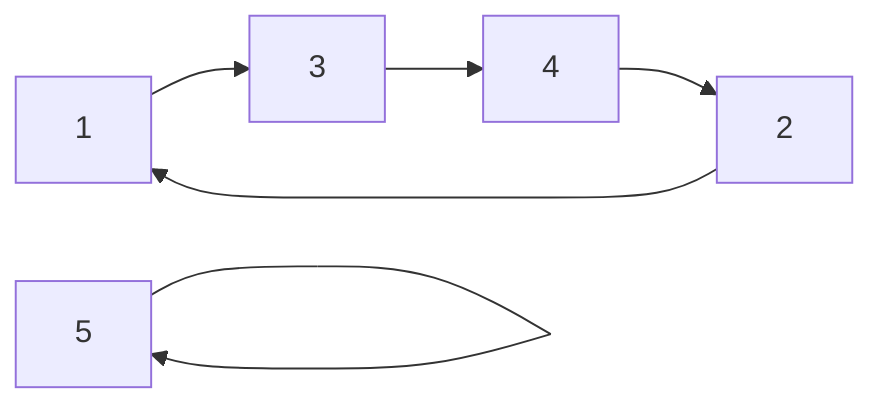
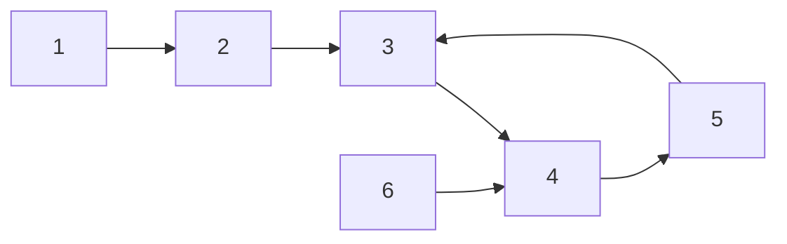

## USACO 环与函数图：

| 学习主题 | 课堂真题 | 从题目中学会什么 |
| --- | --- | --- |
| 置换环与重复操作 | Swapity Swapity Swap，2020 February Silver | 模拟一轮、建立映射、按环长取模 |
| 环上的轨迹合并 | Dance Mooves，2021 January Silver | 轮末位置与轮内轨迹的区别、集合并 |
| 一般函数图与入度剥离 | The Bovine Shuffle，2017 December Silver | 环外节点为什么最终消失 |
| 环上贪心与正确性证明 | Visits，2022 US Open Silver | 为什么每个环只需损失最小收益 |
| 环上窗口与频次维护 | Dance Mooves，2021 January Gold | 有限时间为什么不能合并整个环 |
| 入树 DP 与环形 DP | Bessie's Function，2025 February Gold | 把环外贡献汇入环，再处理首尾约束 |

银组课程先完成前四个主题。金组课程再讲最后两个主题；倍增作为独立拓展。


## 一、普通图、置换、函数图区别

| 类型 | 节点的出边 | 节点的入边 | 典型结构 |
| --- | --- | --- | --- |
| 普通有向图 | 可以任意多条 | 可以任意多条 | 可能多个环相交，也可能无环 |
| 函数图 Functional Graph | 每个节点恰好 1 条 | 可以是 0、1 或更多条 | 每个弱连通块恰好一个有向环，外接朝环汇入的树 |
| 置换图 Permutation Graph，本课指置换映射形成的有向图 | 每个节点恰好 1 条 | 每个节点也恰好 1 条 | 若干互不相交的有向环，没有环外节点 |

### 环的基本概念与判环

沿边从某个节点出发，经过若干节点后回到自身，形成一个环。

- 无向图中的环：沿无向边行走，最后回到起点。
- 有向图中的环：必须始终沿箭头方向前进。
- 自环 `u→u`：函数图中长度为 1 的环。
- 互指 `u→v→u`：函数图中长度为 2 的有向环。

不同奶牛产生同一对端点的边时，它们仍是不同的边，不能随意去重。无向简单图、有向图、多重图对“环”的约定不同，应按题目建模理解。

#### 1. 普通有向图怎么判环

DFS 三色标记：

| 状态 | 含义 |
| --- | --- |
| 0 | 未访问 |
| 1 | 在当前递归路径中，尚未退出 |
| 2 | 已处理完成，已经退出 |

沿一条边走到状态 1 的节点，才能说明当前路径形成了有向环；走到状态 2 的节点，不一定有环。

例如边 `1→2、1→3、3→2` 没有有向环，但 DFS 从 3 走到 2 时，2 可能已经访问过。

```cpp
// 核心片段：adj 是普通有向图的邻接表，state 初始为 0。
bool dfs(int u) {
    state[u] = 1;
    for (int v : adj[u]) {
        if (state[v] == 1) return true;
        if (state[v] == 0 && dfs(v)) return true;
    }
    state[u] = 2;
    return false;
}
```

图不一定连通，需要从每个未访问节点开始 DFS。深链会有递归栈风险，可以用显式栈记录进入、退出，或使用适合本题结构的其他方法。

#### 2. 无向图怎么判环

无向边存两次，走到父节点通常只是沿原边返回，不表示有环。

存在重边时，应记录并跳过**父边编号**，不能跳过所有指向父节点的边。并查集也能用于无向图增量判环，但不能直接判断有向环。

### 建模时先问三个问题

1. 每个人只有一个下一位联系人。
2. 每个位置只对应一个下一位置。
3. 每台机器固定跳到另一台机器。
4. 每个字母统一替换为某一个字母。
5. 固定的一整轮操作反复执行。

先问：

- **状态是什么？** 是奶牛编号、位置，还是包含操作阶段的完整状态？
- **后继是否唯一？** 能否用一个 `to[u]` 表示？
- **映射是否一一对应？** 如果是置换，就可以只处理环；否则还会有入树。

“操作会重复”不等于“第一次访问到旧位置就能直接停止”。若后继还取决于轮内第几次操作，单独一个位置不是完整状态。

## 二、置换环与环长取模

**真题入口：** [2020 February Silver — Swapity Swapity Swap](https://usaco.org/index.php?page=viewproblem2&cpid=1014)。一组固定的区间翻转要重复很多轮，怎样跳过重复模拟？

先抓住两点：完整执行全部翻转才是一轮；翻转不会增删奶牛，所以一轮结果是一一对应的映射。接下来学习置换环，正是为了计算这种映射反复作用后的结果。

### 知识点：分环与取模

置换 p 是 1 到 N 的一个排列，每个数恰好出现一次。

建立边 `i→p[i]` 后：

- 每个节点只有一个后继。
- 每个节点也只有一个前驱。

从某节点一直走，有限步内必定重复。又因为每个节点入度为 1，不会出现额外的链汇入环，所以起点本身就在环上。

例如：

```text
to[1]=3, to[3]=4, to[4]=2, to[2]=1, to[5]=5
```



置换环为 `(1,3,4,2)` 和 `(5)`。

#### 1. 沿置换分环

```cpp
vector<bool> used(n + 1, false);
for (int start = 1; start <= n; start++) {
    if (used[start]) continue;
    vector<int> cycle;
    int u = start;
    while (!used[u]) {
        used[u] = true;
        cycle.push_back(u);
        u = to[u];
    }
    // 此处 cycle 恰好是一个完整置换环。
}
```

每个节点只进入一次，总时间 $O(N)$。

**这个片段把整条路径视为环，前提是 to 是置换。普通函数图不能直接照搬这一结论。**

#### 2. 在环上走 K 步

设：

$$
cycle=[c_0,c_1,\ldots,c_{L-1}],\qquad to[c_i]=c_{(i+1)\bmod L}
$$

从 $c_i$ 走 K 步后：

$$
\boxed{c_{(i+K\bmod L)\bmod L}}
$$

每走 L 步回到原点，所以只需要处理 `K%L`。

例如 `(1,3,4,2)` 长度为 4，从 1 走 10 步，相当于走 2 步，到达 4。

#### 3. 完整练习代码：置换跳转

输入 N、K，再输入一个置换 `to[1..N]`；按节点编号输出每个节点走 K 步后的节点。保证 $0\le K\le10^{18}$。

```cpp
#include <bits/stdc++.h>
using namespace std;

int main() {
    ios::sync_with_stdio(false);
    cin.tie(nullptr);
    int n;
    long long k;
    cin >> n >> k;
    vector<int> to(n + 1), answer(n + 1);
    for (int i = 1; i <= n; i++) cin >> to[i];
    vector<bool> used(n + 1, false);
    for (int start = 1; start <= n; start++) {
        if (used[start]) continue;
        vector<int> cycle;
        int u = start;
        while (!used[u]) {
            used[u] = true;
            cycle.push_back(u);
            u = to[u];
        }
        int len = int(cycle.size());
        int shift = int(k % len);
        for (int i = 0; i < len; i++) answer[cycle[i]] = cycle[(i + shift) % len];
    }
    for (int i = 1; i <= n; i++) cout << answer[i] << '\n';
}
```

时间 $O(N)$，空间 $O(N)$。不同环长度可能不同，不能对 N 统一取模。

### 回到真题：把翻转操作变成置换

#### 1. 一轮是什么意思

本题一轮指**完整执行全部 M 次区间翻转**，然后把这一轮重复 K 次。

翻转操作不增删奶牛，所以一轮后的映射一定是置换。

#### 2. 两个数组方向要区分

```cpp
cowAt[pos] // 这个位置当前是哪头牛
to[cow]    // 初始在 cow 位置的牛，一轮后到了哪里
```

一轮模拟结束后：

```cpp
for (int pos = 1; pos <= n; pos++) {
    to[cowAt[pos]] = pos;
}
```

因为初始牛 i 就在位置 i，所以牛的初始编号同时标识了它的一轮出发位置。

#### 3. 为什么可以复用同一置换

后续每轮仍然操作相同的位置区间。无论某位置上站的是谁，从这个位置出发，一整轮后的目标位置都固定。

所以第 i 头牛经过 K 轮后的位置为 $to^K(i)$。

#### 4. 输出方向

题目问“每个位置上是哪头牛”，所以：

```cpp
answer[finalPosition] = cow;
```

不能把“每头牛到哪个位置”直接按牛编号输出。

#### 5. 完整代码

```cpp
#include <bits/stdc++.h>
using namespace std;

int main() {
    ios::sync_with_stdio(false);
    cin.tie(nullptr);
    int n, m;
    long long k;
    cin >> n >> m >> k;
    vector<int> cowAt(n + 1);
    iota(cowAt.begin(), cowAt.end(), 0);
    for (int i = 0; i < m; i++) {
        int l, r;
        cin >> l >> r;
        reverse(cowAt.begin() + l, cowAt.begin() + r + 1);
    }
    vector<int> to(n + 1);
    for (int pos = 1; pos <= n; pos++) to[cowAt[pos]] = pos;
    vector<bool> used(n + 1, false);
    vector<int> answer(n + 1);
    for (int start = 1; start <= n; start++) {
        if (used[start]) continue;
        vector<int> cycle;
        int u = start;
        while (!used[u]) {
            used[u] = true;
            cycle.push_back(u);
            u = to[u];
        }
        int len = int(cycle.size());
        int shift = int(k % len);
        for (int i = 0; i < len; i++) {
            int cow = cycle[i];
            int finalPosition = cycle[(i + shift) % len];
            answer[finalPosition] = cow;
        }
    }
    for (int pos = 1; pos <= n; pos++) cout << answer[pos] << '\n';
}
```

一轮翻转最坏 $O(NM)$；分环和输出 $O(N)$；总时间 $O(NM+N)$，空间 $O(N)$。本题 M 最多 100，K 很大，因此只模拟一轮。

### 本节建模总结

1. 将一整轮操作压缩为 `to[pos]`。
2. 因为映射是一一对应的，按置换环分别处理。
3. 环长为 L，执行 K 轮等价于沿环走 `K%L` 步。
4. 最后根据题目要求，将“牛到的位置”转换为“位置上的牛”。


## 三、环上的轨迹合并

**真题入口：** [2021 January Silver — Dance Mooves](https://usaco.org/index.php?page=viewproblem2&cpid=1086)。仍然是反复交换，但这次问的是每头牛一共经过多少个不同位置。

### 新知识点：末态映射不能代替过程信息

上一节只需要一轮结束后的位置。本题中，牛可能一轮结束回到原位，却在轮内经过多个位置。因此每个起点需要同时保存：

- `to[u]`：一轮后的位置，决定下一轮从哪里开始。
- `visited[u]`：这一轮经过的位置，决定答案中有哪些位置。

后续每轮复用同一套位置操作，所以从 u 出发，依次经历 `visited[u]`、`visited[to[u]]` 等轨迹。无限重复时，会遍历整个置换环对应的轨迹集合，答案就是这些集合的并集。

### 回到真题：模拟一轮、分环、合并轨迹

#### 1. 只记录一轮轨迹

模拟完整 K 次交换，同时记录每头牛在这一轮经过的位置，包括时间 0 的起点。

```cpp
visited[cowA].push_back(b);
visited[cowB].push_back(a);
swap(cowAt[a], cowAt[b]);
```

每次交换增加两条位置记录，总记录数为 $N+2K$，不必为每头牛重新模拟全部交换。

#### 2. 一轮结束后的置换

仍然定义 `to[cowAt[pos]]=pos`。

对环 `c0→c1→...→cL-1→c0`，从 c0 出发的牛：

- 第一轮走 `visited[c0]` 这条轨迹。
- 第二轮从 c1 出发，走 `visited[c1]` 对应的轨迹。
- 后续沿环继续，最终经历环内所有轨迹。

所以**同一置换环里的牛，长期访问的位置集合相同**，等于所有首轮轨迹的并集。

注意：并集可能包含其他置换环编号对应的位置，因为轮内会经过中间位置。

#### 3. 样例手动模拟

```text
5 4
1 3
1 2
2 3
2 4
```

| 阶段 | 各位置上的牛，从位置 1 到 5 |
| --- | --- |
| 初始 | 1,2,3,4,5 |
| 交换 1、3 | 3,2,1,4,5 |
| 交换 1、2 | 2,3,1,4,5 |
| 交换 2、3 | 2,1,3,4,5 |
| 交换 2、4 | 2,4,3,1,5 |

于是：

```text
to[1]=4, to[4]=2, to[2]=1
to[3]=3
to[5]=5
```

有 3 个置换环：`(1,4,2)`、`(3)`、`(5)`。

首轮位置记录按集合写为：

```text
visited[1]={1,2,3,4}
visited[2]={1,2}
visited[3]={1,2,3}
visited[4]={2,4}
visited[5]={5}
```

所以答案为 `4、4、3、4、1`。

#### 4. 用标记编号去重

每处理一个环，`cycleId++`。若 `mark[pos]!=cycleId`，说明这个位置还没有被当前环统计，计数加 1。

这样不需要每个环都清空一个长度 N 的数组，也不必对每个环用 set 排序去重。

#### 5. 完整代码

```cpp
#include <bits/stdc++.h>
using namespace std;

int main() {
    ios::sync_with_stdio(false);
    cin.tie(nullptr);
    int n, k;
    cin >> n >> k;
    vector<int> cowAt(n + 1);
    vector<vector<int>> visited(n + 1);
    for (int i = 1; i <= n; i++) {
        cowAt[i] = i;
        visited[i].push_back(i);
    }
    for (int t = 1; t <= k; t++) {
        int a, b;
        cin >> a >> b;
        int cowA = cowAt[a], cowB = cowAt[b];
        visited[cowA].push_back(b);
        visited[cowB].push_back(a);
        swap(cowAt[a], cowAt[b]);
    }
    vector<int> to(n + 1);
    for (int pos = 1; pos <= n; pos++) to[cowAt[pos]] = pos;
    vector<bool> used(n + 1, false);
    vector<int> mark(n + 1, 0), answer(n + 1);
    int cycleId = 0;
    for (int start = 1; start <= n; start++) {
        if (used[start]) continue;
        cycleId++;
        vector<int> cycle;
        int u = start;
        while (!used[u]) {
            used[u] = true;
            cycle.push_back(u);
            u = to[u];
        }
        int count = 0;
        for (int cow : cycle) {
            for (int pos : visited[cow]) {
                if (mark[pos] != cycleId) {
                    mark[pos] = cycleId;
                    count++;
                }
            }
        }
        for (int cow : cycle) answer[cow] = count;
    }
    for (int cow = 1; cow <= n; cow++) cout << answer[cow] << '\n';
}
```

时间、空间均为 $O(N+K)$。即使 visited 中某位置重复出现，也只扫描总计 $N+2K$ 条记录。

### 本节建模总结

**重复操作的终点用置换保存，重复操作的过程用轨迹保存。** 同环奶牛答案相同，是无限重复的结果；不是因为它们第一轮走过相同的位置。


## 四、一般函数图与入度剥离

**真题入口：** [2017 December Silver — The Bovine Shuffle](https://usaco.org/index.php?page=viewproblem2&cpid=764)。每个位置的牛都前往指定位置，但不同位置可以有同一个目的地。

这次映射不再是一一对应的：仍然每个节点有唯一后继，却可能有多个前驱。所以不能套用“每个节点都在置换环上”，需要先认识一般函数图的结构。

### 知识点一：环与朝环汇入的树

每个节点恰好有一个后继，但不同节点可以指向同一个节点。



- 环是 `3→4→5→3`。
- 1、2、6 是环外节点。
- 从 1 出发，先走过链 `1→2`，再进入环。

#### 1. 为什么每个弱连通块恰好有一个环

“弱连通块”指暂时忽略箭头后得到的连通块，不能与强连通分量混淆。

- 节点有限、后继始终存在，所以沿后继走一定会进入某个环。
- 若有边 `u→v`，从 u、v 最终进入的环必然相同。
- 因而同一个弱连通块里的节点最终都进入同一个环，不可能包含两个不同的有向环。

反向看，环外节点构成以环节点为根、边朝根汇入的树，常称“内向基环树”结构。这里允许自环和二元环，不应直接当成无向简单图理解。

#### 2. 节点在环上，还是仅仅能到达环

例子中，1 可以到达环，但它自己不在环上。

因此不能把“从这个节点出发会遇到重复”当作“这个节点就在环上”的判断条件。

#### 3. 不能直接把步数对环长取模

从 1 出发走 K 步，先要处理到环的距离 2：

- $K<2$ 时，仍在链上。
- $K\ge2$ 时，先到 3，再把剩余的 `K-2` 对环长 3 取模。

对于一般函数图，可以使用倍增统一回答跳转查询，避免每次手动区分链与环。

### 知识点二：入度剥离

为什么要删除入度为 0 的节点？结合题意，它们没有任何前驱，下一轮就不会有牛进入；把它们删去后，又可能产生新入度为 0 的节点。这个过程恰好把环外部分逐层剥离。

#### 1. 算法步骤

1. 统计每个节点的入度 `indegree`。
2. 所有入度为 0 的节点进入队列。
3. 弹出 u，视为删除它，并将唯一后继 `to[u]` 的入度减 1。
4. 如果后继入度变为 0，加入队列。
5. 队列处理完后，未被剥离的节点恰好是环上节点。

```cpp
queue<int> q;
for (int u = 1; u <= n; u++) {
    if (indegree[u] == 0) q.push(u);
}
while (!q.empty()) {
    int u = q.front(); q.pop();
    int v = to[u];
    if (--indegree[v] == 0) q.push(v);
}
// 此时 indegree[u] > 0 表示 u 在环上。
```

#### 2. 为什么有效

- 环上节点始终有环内前驱，入度不会变为 0。
- 环外树总能从没有前驱的叶端逐层删除。
- 所有环外节点被删除后，只剩环。

这是函数图的特殊性质。**普通有向图剥离入度 0 节点后，剩余节点可能只是从环可达，不一定全在环上。**

#### 3. 剥离顺序还有什么用

记录弹出的节点顺序 `removedOrder`：

- 正序：环外节点从叶端向环汇入，适合把 DP 贡献传给后继。
- 倒序：先有靠近环的节点信息，再推回外层，适合计算到环距离、最终进入哪个环。

例如环上距离设为 0，倒序处理被剥离的 u：

```cpp
distanceToCycle[u] = distanceToCycle[to[u]] + 1;
```

注意“顺序”的意义取决于状态依赖方向，不是所有树形 DP 都机械倒序。

### 回到真题：统计始终有牛的位置

#### 1. 题意映射

每个位置 i 的所有牛下一轮都移动到 `a[i]`，目标不保证不同，所以这是函数图，不一定是置换。

最初每个位置都有牛。求无论经过多少轮，始终有牛的位置数。

#### 2. 为什么答案是环上节点数

- 环上的每个位置都有一个环内前驱，每轮都会接到来自前驱的牛，因此永不空缺。
- 环外位置不可能沿反方向无限找到前驱。经过足够多轮，树上的牛全部向环汇入，环外位置最终会空。

所以使用入度剥离，统计没有被删除的节点即可。

#### 3. 样例

`a={3,2,1,3}`：环为 `1→3→1`、`2→2`，节点 4 指向 3，但没有前驱，第一轮后就为空。答案为 3。

#### 4. 完整代码

```cpp
#include <bits/stdc++.h>
using namespace std;

int main() {
    ios::sync_with_stdio(false);
    cin.tie(nullptr);
    int n;
    cin >> n;
    vector<int> to(n + 1), indegree(n + 1, 0);
    for (int u = 1; u <= n; u++) {
        cin >> to[u];
        indegree[to[u]]++;
    }
    queue<int> q;
    for (int u = 1; u <= n; u++) {
        if (indegree[u] == 0) q.push(u);
    }
    int answer = n;
    while (!q.empty()) {
        int u = q.front();
        q.pop();
        answer--;
        int v = to[u];
        if (--indegree[v] == 0) q.push(v);
    }
    cout << answer << '\n';
}
```

时间、空间均为 $O(N)$。

### 本节建模总结

**唯一后继不代表一一对应。** 先判断能否形成置换；不能时，再区分环与环外入树。本题只需要环上节点数，入度剥离后直接计数即可。


## 五、函数图上的贪心

**真题入口：** [2022 US Open Silver — Visits](https://usaco.org/index.php?page=viewproblem2&cpid=1230)。每头牛只有一个访问目标，因此建立 `u→to[u]` 后是函数图。

### 知识点：把全图矛盾缩小到每个环

本题成功访问对应一个先后顺序要求：u 要先于目标离开。环外部分可以按拓扑顺序安排；有向环却要求沿一圈严格“先于”，不可能全部满足。

于是问题分成两步：先证明每个环至少损失一次收益，再证明只损失该环的最小收益就能实现。**找环是工具，证明损失的下界能达到，才得到贪心结论。**

### 回到真题：总收益减去各环最小收益

#### 1. 建图

奶牛 i 想访问 `a[i]`，建立边 `i→a[i]`，节点收益为 `v[i]`。

这是函数图。每头牛离开之前，如果目标已经离开，则它无法成功出发。

#### 2. 每个环至少损失一头牛

如果环上所有牛都成功离开，那么每个 i 成功时，它的目标 `a[i]` 还没离开，所以 i 必须比 `a[i]` 更早出发。

沿环连起来，就要求出发顺序首尾互相在前，矛盾。因此环上至少有一头牛无法获得收益。

#### 3. 为什么只损失环上最小收益就够

选环上收益最小的节点 c，暂时删去边 `c→a[c]`，剩余图无环。

按照剩余边的拓扑顺序安排，使所有 $i\ne c$ 都先于 `a[i]` 处理：

- 所有其他牛到达自己的回合时，目标仍在家，所以都能成功。
- c 在其目标已经离开后才处理，因此不能获得收益。

环外节点的收益全部保留，所以：

$$
\boxed{\text{答案}=\sum_i v_i-\sum_{\text{每个环 }C}\min_{i\in C}v_i}
$$

题目保证 `a[i]!=i`；收益可以为 0，此时该环的必要损失也可以是 0。

#### 4. 完整代码

先剥离环外节点，再逐环计算最小值。

```cpp
#include <bits/stdc++.h>
using namespace std;

using ll = long long;
int main() {
    ios::sync_with_stdio(false);
    cin.tie(nullptr);
    int n;
    cin >> n;
    vector<int> to(n + 1), indegree(n + 1, 0);
    vector<ll> value(n + 1);
    ll answer = 0;
    for (int u = 1; u <= n; u++) {
        cin >> to[u] >> value[u];
        indegree[to[u]]++;
        answer += value[u];
    }
    queue<int> q;
    for (int u = 1; u <= n; u++) if (indegree[u] == 0) q.push(u);
    while (!q.empty()) {
        int u = q.front(); q.pop();
        if (--indegree[to[u]] == 0) q.push(to[u]);
    }
    vector<bool> used(n + 1, false);
    for (int start = 1; start <= n; start++) {
        if (indegree[start] == 0 || used[start]) continue;
        ll minimum = LLONG_MAX;
        int u = start;
        do {
            used[u] = true;
            minimum = min(minimum, value[u]);
            u = to[u];
        } while (u != start);
        answer -= minimum;
    }
    cout << answer << '\n';
}
```

时间、空间均为 $O(N)$，答案必须使用 `long long`。

还可以把每条边权设为出发节点的收益，忽略方向后用 Kruskal 求最大生成森林，作为并查集专题的联系。但这需要保留二元环产生的平行边，且排序后变为 $O(N\log N)$，不是本课主线。

### 补充工具：不做入度剥离，能怎样找环？

Visits 也可以用路径时间戳枚举各个环。下面把“当前路径走回自身”与“进入以前走过的路径”区分开；它也能用于一般函数图找环。

适合只给 `to[u]`、希望区分“本次路径”与“以前走过”的情况。

```cpp
vector<int> run(n + 1, 0), position(n + 1, -1);
int runId = 0;
for (int start = 1; start <= n; start++) {
    if (run[start] != 0) continue;
    runId++;
    vector<int> path;
    int u = start;
    while (run[u] == 0) {
        run[u] = runId;
        position[u] = int(path.size());
        path.push_back(u);
        u = to[u];
    }
    if (run[u] == runId) {
        // path[position[u]..末尾] 才是这次新发现的环。
    }
    // run[u] != runId：进入以前处理过的路径，不产生新环。
}
```

例子：路径为 `1,2,3,4,5`，下一步回到 3，那么环是后缀 `3,4,5`，不是整条路径。

总时间 $O(N)$，空间 $O(N)$。若还要求每个节点的答案，可在本次 path 上倒序回填。

### 本节建模总结

环外顺序可以安排，环内顺序必有冲突；每个弱连通块独立解决一个环。不能把“每环减最小值”当成所有函数图题的通用公式。


## 六、环上滑动窗口

**真题入口：** [2021 January Gold — Dance Mooves](https://usaco.org/index.php?page=viewproblem2&cpid=1091)。与银组比较，只改成了执行有限的 M 分钟。

### 新知识点：从整个环的集合并，变成连续一段轨迹的集合并

设每轮 K 分钟，将总时间拆为 `D=M/K` 个完整轮与 `R=M%K` 分钟：完整轮对应环上连续 D 份轨迹，余数对应下一份轨迹的时间前缀。

不同起点在同一个环中，相当于把这段窗口向前滑一格。因此使用 `frequency[pos]` 记录位置被窗口覆盖的次数：从 0 变为 1 时不同位置数加一，从 1 变为 0 时减一。不能用布尔数组直接删除，因为同一位置可能被多份轨迹覆盖。

### 回到真题：完整轮窗口与余数前缀

> 先完成银组版本，再学本节。这里的 M 表示总分钟数，K 才是一轮交换次数。

#### 1. 时间拆分

$$
D=\left\lfloor\frac{M}{K}\right\rfloor,\qquad R=M\bmod K
$$

含义是 D 个完整轮次，再执行 R 次交换。

每条轨迹记录 `{位置,首轮到达时间}`，初始位置记为时间 0。

#### 2. 分情况处理每个置换环

设环长度为 L。

- **D>=L**：已经经历环内全部首轮轨迹，答案与银组相同，取整个环的并集。
- **D<L**：起点在环的第 i 个节点时，只能合并连续 D 个完整轨迹，再加下一个节点轨迹中时间不超过 R 的前缀。

用符号写为：

$$
\bigcup_{j=0}^{D-1}S_{c_{(i+j)\bmod L}}
\quad\cup\quad
P_{c_{(i+D)\bmod L}}(R)
$$

其中 $S_u$ 是完整首轮位置记录，$P_u(R)$ 是首轮前 R 分钟的位置记录。D=0 时，前面的完整轨迹并集为空，只统计前缀。

#### 3. 环上滑动窗口

维护 `frequency[pos]`：当前窗口内这个位置出现多少次。

- 次数从 0 变 1，不同位置数加 1。
- 次数从 1 变 0，不同位置数减 1。

每个起点处理顺序：

1. 加入下一段轨迹的 R 分钟前缀。
2. 记录答案。
3. 移除这个临时前缀。
4. 将 D 个完整轨迹组成的窗口向前移动一格。

不能只用 bool 标记，因为删除一段轨迹后，某位置可能仍被另一段轨迹覆盖。

#### 4. 完整代码

```cpp
#include <bits/stdc++.h>
using namespace std;

int main() {
    ios::sync_with_stdio(false);
    cin.tie(nullptr);
    int n, k;
    long long minutes;
    cin >> n >> k >> minutes;
    vector<int> cowAt(n + 1);
    // {位置, 首轮中到达该位置的时间}；允许重复记录。
    vector<vector<pair<int, int>>> path(n + 1);
    for (int i = 1; i <= n; i++) {
        cowAt[i] = i;
        path[i].push_back({i, 0});
    }
    for (int t = 1; t <= k; t++) {
        int a, b;
        cin >> a >> b;
        path[cowAt[a]].push_back({b, t});
        path[cowAt[b]].push_back({a, t});
        swap(cowAt[a], cowAt[b]);
    }
    vector<int> to(n + 1);
    for (int pos = 1; pos <= n; pos++) to[cowAt[pos]] = pos;
    vector<bool> used(n + 1, false);
    vector<int> frequency(n + 1, 0), answer(n + 1);
    int distinct = 0;
    auto modify = [&](int node, int timeLimit, int delta) {
        for (auto [pos, time] : path[node]) {
            if (time > timeLimit) break;
            if (delta == 1) {
                if (frequency[pos] == 0) distinct++;
                frequency[pos]++;
            } else {
                frequency[pos]--;
                if (frequency[pos] == 0) distinct--;
            }
        }
    };
    long long rounds = minutes / k;
    int remainder = int(minutes % k);
    for (int start = 1; start <= n; start++) {
        if (used[start]) continue;
        vector<int> cycle;
        int u = start;
        while (!used[u]) {
            used[u] = true;
            cycle.push_back(u);
            u = to[u];
        }
        int len = int(cycle.size());
        if (rounds >= len) {
            for (int node : cycle) modify(node, k, 1);
            for (int node : cycle) answer[node] = distinct;
            for (int node : cycle) modify(node, k, -1);
            continue;
        }
        int full = int(rounds);
        for (int j = 0; j < full; j++) modify(cycle[j], k, 1);
        for (int i = 0; i < len; i++) {
            int next = cycle[(i + full) % len];
            modify(next, remainder, 1);
            answer[cycle[i]] = distinct;
            modify(next, remainder, -1);
            if (full > 0) {
                modify(cycle[i], k, -1);
                modify(next, k, 1);
            }
        }
        // 绕环一圈后，完整窗口回到初始位置，清空其贡献。
        for (int j = 0; j < full; j++) modify(cycle[j], k, -1);
    }
    for (int cow = 1; cow <= n; cow++) cout << answer[cow] << '\n';
}
```

每条首轮记录只被常数次加入、删除，因此总时间 $O(N+K)$，空间 $O(N+K)$。

关键边界：`M<K`、`R=0`、长度为 1 的环、`D>=L`、相同位置反复出现。每个环处理完成后，清空其频次贡献，不能污染下一个环。

### 本节建模总结

银组是“无限轮 → 整环并集”，金组是“有限轮 → 环上窗口并集”。需要改变的是集合覆盖的范围，首轮模拟与置换建模仍然可以复用。


## 七、树与环分开 DP

**真题入口：** [2025 February Gold — Bessie's Function](https://usaco.org/index.php?page=viewproblem2&cpid=1497)。修改函数，使所有 x 满足 `f(f(x))=f(x)`，并最小化修改费用。

### 新知识点：函数条件 → 固定点选择 → 入树 DP → 环形 DP

先把公式翻译成图：一步到达的节点必须是固定点。再证明可以把修改统一为“改成指向自己”，从而转化为带权的节点选择问题。

树部分没有循环依赖，可以沿入度剥离顺序将贡献传给后继；环部分存在首尾约束，需要枚举首节点的选择状态，再按链转移并检查闭环。

这里与 Visits 不同：选择一个节点会同时影响相邻边的约束，不能只减去环上一个最小值。需要保留 `dp0[u]`、`dp1[u]` 两种状态来表达这种依赖。

### 回到真题：从公式推导状态与转移

> 本节属于函数图 DP 拓展，需要先理解树形 DP。“环上减一个最小值”不是所有函数图优化题的通用结论。

#### 1. 将函数条件翻译成图

要求：

$$
f(f(x))=f(x)
$$

意思是：从 x 走一步到达的节点，本身必须是固定点，即有自环。

合法图最终由若干以固定点为中心的结构组成，每个节点最多走一步就到固定点。

#### 2. 为什么修改可以统一成“改为自环”

考虑任意合法修改方案。如果节点 i 的出边被修改了，可以把它进一步改为 `i→i`：

- i 自己满足条件。
- 原来有节点指向 i 时，把 i 设为固定点也不会让这些节点失效。
- 不增加修改节点数量与费用。

因此存在最优解：所有被修改的节点都改为自环，其他节点保持原边。

对原边 `u→v`，至少要让 u 或 v 成为固定点：u 被选时它改为自环；u 不选时保留原边，因此 v 必须是固定点。

这是原函数图上的**最小权点覆盖结构**。原本已经有自环的节点固定选中，费用为 0。

#### 3. 树部分的 DP

把指向 u 的环外节点看作反向树的孩子。定义：

- `dp0[u]`：u 不选为固定点时，已汇入的反向树部分的最小费用。
- `dp1[u]`：u 选为固定点时，对应最小费用。

初始化：`dp0[u]=0`；`dp1[u]=c[u]`，已有自环则初始化为 0。

对于孩子 x：

$$
dp0[u]\mathrel{+}=dp1[x]
$$

$$
dp1[u]\mathrel{+}=\min(dp0[x],dp1[x])
$$

u 不选，孩子就必须选；u 选，孩子可选也可不选。

沿入度剥离顺序，把每个环外节点的贡献汇入唯一后继。队列结束后，每个环节点的 dp0、dp1 已经包含所有环外树贡献。

#### 4. 环上的 DP

环上不能出现相邻两个节点都不选。

枚举第一个节点状态为 0 或 1，把环临时当成链：

$$
next0=prev1+dp0[u]
$$

$$
next1=\min(prev0,prev1)+dp1[u]
$$

最后检查首尾：

- 第一个没选，最后一个必须选。
- 第一个已选，最后一个任选。

长度为 1 的自环也适用：必须选中自身，其修改费用为 0。

#### 5. 完整代码

```cpp
#include <bits/stdc++.h>
using namespace std;

using ll = long long;
const ll INF = (1LL << 60);
int main() {
    ios::sync_with_stdio(false);
    cin.tie(nullptr);
    int n;
    cin >> n;
    vector<int> to(n + 1), indegree(n + 1, 0);
    for (int u = 1; u <= n; u++) {
        cin >> to[u];
        indegree[to[u]]++;
    }
    vector<ll> dp0(n + 1, 0), dp1(n + 1);
    for (int u = 1; u <= n; u++) {
        ll cost;
        cin >> cost;
        dp1[u] = (to[u] == u ? 0 : cost);
    }
    queue<int> q;
    for (int u = 1; u <= n; u++) if (indegree[u] == 0) q.push(u);
    // 非环节点从叶端向环处理，将反向树 DP 汇入后继。
    while (!q.empty()) {
        int u = q.front(); q.pop();
        int v = to[u];
        dp0[v] += dp1[u];
        dp1[v] += min(dp0[u], dp1[u]);
        if (--indegree[v] == 0) q.push(v);
    }
    vector<bool> used(n + 1, false);
    ll answer = 0;
    for (int start = 1; start <= n; start++) {
        if (indegree[start] == 0 || used[start]) continue;
        vector<int> cycle;
        int u = start;
        do {
            used[u] = true;
            cycle.push_back(u);
            u = to[u];
        } while (u != start);
        ll best = INF;
        // 枚举环上第一个节点是否选为固定点。
        for (int firstState = 0; firstState <= 1; firstState++) {
            ll prev0 = (firstState == 0 ? dp0[cycle[0]] : INF);
            ll prev1 = (firstState == 1 ? dp1[cycle[0]] : INF);
            for (int i = 1; i < int(cycle.size()); i++) {
                int v = cycle[i];
                ll next0 = prev1 + dp0[v];
                ll next1 = min(prev0, prev1) + dp1[v];
                prev0 = next0;
                prev1 = next1;
            }
            // 首尾之间也有边，不允许两端同时不选。
            ll candidate = (firstState == 0 ? prev1 : min(prev0, prev1));
            best = min(best, candidate);
        }
        answer += best;
    }
    cout << answer << '\n';
}
```

每个节点剥离一次、每个环做两次线性 DP，总时间 $O(N)$，空间 $O(N)$。费用总和可能很大，使用 `long long`。

#### 6. 小例子

```text
N=3
a={2,3,1}
c={5,1,4}
```

三元环相邻不能同时不选，至少选两个节点。选择节点 2、3，费用为 $1+4=5$。

修改后 `a={2,2,3}`：1 指向固定点 2，2、3 指向自己，满足要求。

若环外还有很多节点指向某个环节点，那个环节点的 DP 费用会改变，所以不能只根据环上原始 c 值贪心。

### 本节建模总结

**先利用函数图结构拆开环与入树，再按依赖定义 DP。** 入度剥离不仅能找环，也能提供把环外贡献汇入环的处理顺序。


## 八、跳转查询拓展：倍增

这一节补充另一种处理唯一后继的方法。Swapity 的重复映射也可以用倍增计算，但置换分环取模已足够直接；一般函数图面对大量不同起点、不同步数的查询时，倍增更方便。下面是自编基础练习，不是另加的一道 USACO 真题。

定义：

$$
up[u][j]=\text{从 u 出发走 }2^j\text{ 步后的位置}
$$

初始与转移：

$$
up[u][0]=to[u]
$$

$$
up[u][j]=up[up[u][j-1]][j-1]
$$

把 K 按二进制拆开，对每个为 1 的位执行对应跳跃。

例如 $13=8+4+1$，依次跳 1、4、8 步，总计 13 步。函数图后继唯一，复合结果一致。

### 完整代码

输入 N、Q、`to[1..N]`，之后 Q 行 `u K`。本程序支持 $0\le K\le10^{18}$，所以使用 60 层。

```cpp
#include <bits/stdc++.h>
using namespace std;

const int LOG = 60; // 支持 0 <= k <= 10^18
int main() {
    ios::sync_with_stdio(false);
    cin.tie(nullptr);
    int n, q;
    cin >> n >> q;
    vector<array<int, LOG>> up(n + 1);
    for (int u = 1; u <= n; u++) cin >> up[u][0];
    for (int j = 1; j < LOG; j++) {
        for (int u = 1; u <= n; u++) {
            up[u][j] = up[up[u][j - 1]][j - 1];
        }
    }
    while (q--) {
        int u;
        long long k;
        cin >> u >> k;
        for (int j = 0; j < LOG; j++) {
            if ((k >> j) & 1LL) u = up[u][j];
        }
        cout << u << '\n';
    }
}
```

时间 $O((N+Q)\log(K_{\max}+1))$，空间 $O(N\log(K_{\max}+1))$。这里按固定 60 层实现；K=0 时不跳，返回自身。

## 九、哪些环题不能直接套函数图

| 题目/结构 | 本质 | 不能误用的结论 |
| --- | --- | --- |
| 置换环 | 入度、出度都为 1 | 每个节点本身就在环上 |
| 一般函数图 | 出度为 1，可能有入树 | 不能把首次走过的整条路径都算作环 |
| Cereal 2 的谷物图 | 一般无向多重图，一个分量可能有多个环 | 不满足“每个分量恰好一个环”的函数图性质 |
| Redistributing Gifts 的合法分配 | 每个具体分配是一个置换，可拆成交换环 | 所有可接受关系构成的图本身不一定是函数图 |
| 普通有向图 | 可能一个节点有多个后继 | visited=true 不足以判断有向环 |

“有环”是一种结构特征，不是某个算法的名字。要继续问：有几个后继？是否置换？求位置、集合、收益还是方案数？

## 十、课后练习

| 层次 | 真题/练习 | 本题要练会什么 |
| --- | --- | --- |
| 基础 | 本课置换跳转练习 | 正确写出环与模运算，区分节点答案与位置答案 |
| 基础拓展 | 本课倍增练习 | 一般函数图跳 K 步，处理 K=0 |
| 银组必做 | [The Bovine Shuffle](https://usaco.org/index.php?page=viewproblem2&cpid=764) | 入度剥离留下环 |
| 银组必做 | [Swapity Swapity Swap](https://usaco.org/index.php?page=viewproblem2&cpid=1014) | 一轮映射、分环、输出方向 |
| 银组必做 | [Dance Mooves](https://usaco.org/index.php?page=viewproblem2&cpid=1086) | 轨迹记录、置换环、集合并 |
| 银组综合 | [Visits](https://usaco.org/index.php?page=viewproblem2&cpid=1230) | 只对环做关键选择，证明最优性 |
| 金组选做 | [Dance Mooves](https://usaco.org/index.php?page=viewproblem2&cpid=1091) | 环上滑动窗口、频次维护 |
| 金组选做 | [Bessie's Function](https://usaco.org/index.php?page=viewproblem2&cpid=1497) | 树与环分开处理，树形 DP 接环形 DP |
