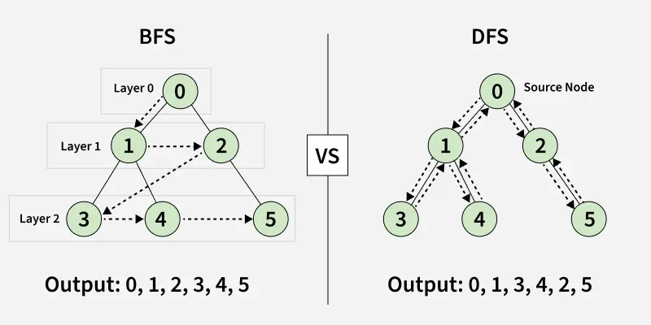

## DFS 与 BFS：从搜索入门到 USACO 银组

## 📌 本章学习目标

| 阶段 | 核心内容 | 练习 |
|---|---|---|
| 入门 | 递归、选择与撤销 | 全排列；Air Cownditioning II；Back and Forth |
| 基础 | 路径枚举、递归依赖 | Walking Home；Alchemy（拓展） |
| 基础 | Flood Fill、连通块 | Lake Counting；Fence Planning |
| 基础 | 普通 BFS、距离数组 | 自编迷宫；Corn Maze |
| 进阶 | 连通块统计、多源起点 | Icy Perimeter；多源 BFS 模板 |
| 拓展 | 队列维护连锁反应、扩充状态 | Comfortable Cows；Maze Tac Toe |

## 一、先建模，再选择 DFS / BFS



搜索的对象不一定是一张画出来的图。只要能确定“当前状态”和“可以到达的下一个状态”，就可以搜索。

| 题目场景 | 状态 | 转移 |
|---|---|---|
| 朋友关系 | 当前人的编号 `u` | 沿朋友关系到 `v` |
| 迷宫 | 当前格子 `(x, y)` | 移动到相邻可走格子 |
| 全排列 | 已填的位置、已选数字 | 为下一个位置选择数字 |
| 迷宫 + 棋盘 | `(x, y, boardState)` | 移动，并更新棋盘 |

## 二、DFS：深度优先搜索

**核心思想：沿一个分支继续搜索，完成后返回，探索其他分支。**

### ✔️ 1. 图的存储：邻接表

```cpp
vector<vector<int>> adj(n + 1);

// 无向边：两边都要存
adj[u].push_back(v);
adj[v].push_back(u);

// 有向边：只存 u → v
// adj[u].push_back(v);
```

### ✔️ 2. 递归 DFS 模板

下面是代码片段，调用前需要准备好 `adj` 和 `vis`。

```cpp
void dfs(int u) {
    vis[u] = true;

    for (int v : adj[u]) {
        if (vis[v]) continue;
        dfs(v);
    }
}
```

对于“整张图有哪些连通块”，还需要枚举所有起点：

```cpp
int components = 0;
for (int u = 1; u <= n; u++) {
    if (vis[u]) continue;
    components++;
    dfs(u);
}
```

**一次 DFS 只找出起点所在的连通块，不能默认遍历到整张图。**

### ✔️ 3. 显式栈 DFS 模板

```cpp
stack<int> st;
vis[start] = true;
st.push(start);

while (!st.empty()) {
    int u = st.top();
    st.pop();

    for (int v : adj[u]) {
        if (vis[v]) continue;
        vis[v] = true;  // 入栈时标记，避免被反复加入
        st.push(v);
    }
}
```

- 连通块可能是一条很长的链，递归深度也会很大；显式栈可避免递归调用栈溢出。
- 显式栈仍然消耗内存，只是没有把每一层放在函数调用栈中。
- 这个简单版本适合遍历节点。树形 DP 若依赖“子节点先算完”，还要额外维护返回阶段或逆序处理遍历序列。

### ✔️ 4. 遍历型 DFS 与回溯型 DFS

| 类型 | 标记含义 | 返回后撤销吗？ |
|---|---|---|
| 图 / 网格连通块遍历 | 这个状态已经处理过 | 通常不撤销 |
| 全排列等方案枚举 | 当前分支已经用了这个数字 | 返回后撤销 |

**DFS 不一定需要撤销；是否撤销取决于标记的含义。**

## 三、回溯入门：按字典序输出全排列

### 1. 输入 `n`，按照字典序输出 `1 ~ n` 的所有全排列。练习时建议 `n ≤ 9`。

### 思路

1. `path` 保存当前已选择的数字。
2. 从小到大枚举下一个数字 `x`。
3. 若当前分支没有用过它，就选择、递归，再撤销。
4. 选满 `n` 个数字后，直接输出，不必保存所有排列。

```text
选择 x → 搜索剩余位置 → 撤销 x
```

例如输入 `3`：

```text
1 2 3
1 3 2
2 1 3
2 3 1
3 1 2
3 2 1
```

### 参考代码

```cpp
// program: permutations
#include <bits/stdc++.h>
using namespace std;

int n;
vector<int> path;
vector<bool> used;

void dfs() {
    if ((int)path.size() == n) {
        for (int i = 0; i < n; i++) {
            cout << path[i] << (i + 1 == n ? '\n' : ' ');
        }
        return;
    }

    for (int x = 1; x <= n; x++) {
        if (used[x]) continue;

        used[x] = true;
        path.push_back(x);

        dfs();

        path.pop_back();
        used[x] = false;
    }
}

int main() {
    cin >> n;
    used.assign(n + 1, false);
    dfs();
    return 0;
}
```

**复杂度：**输出 `n!` 个排列，每个有 `n` 个数字，时间为 `O(n · n!)`；额外空间为 `O(n)`。

> 原先“交换数组元素”的 DFS 可以生成全排列，但直接按下标交换，不保证整体输出顺序是字典序。上面的“从小到大选未使用数字”更适合这一要求。

### 💬 课堂提问

1. 为什么 `used[x]` 在返回后要恢复为 `false`？
2. 如果省略 `path.pop_back()`，下一个分支会受到什么影响？
3. 为什么这里不能用全局 `visited` 永久禁止一个数字再次出现？

### 2.  在 `8 × 8` 棋盘上放置八个皇后，使任意两个皇后都不在同一行、同一列或同一条对角线上。求合法方案总数（八皇后）。

**思路：**

1. 每行放一个皇后，`dfs(row)` 表示准备在第 `row` 行放皇后。
2. 枚举当前行的每一列，检查该列和两条对角线是否被占用。
3. 合法则放置、标记，递归处理下一行，返回后撤销。
4. 八行都放完，方案数加一。

| 标记                     | 含义                                          |
| ------------------------ | --------------------------------------------- |
| `col[c]`                 | 第 `c` 列是否已有皇后                         |
| `diagonal1[row + c]`     | 行号与列号之和相同的对角线                    |
| `diagonal2[row - c + 7]` | 行号与列号之差相同的对角线，加 `7` 避免负下标 |

```c++
#include <bits/stdc++.h>
using namespace std;
const int N = 8;
bool col[N];
bool diagonal1[2 * N - 1];
bool diagonal2[2 * N - 1];
int answer = 0;
void dfs(int row) {
    if (row == N) {
        answer++;
        return;
    }
    for (int c = 0; c < N; c++) {
        int d1 = row + c;
        int d2 = row - c + N - 1;
        if (col[c] || diagonal1[d1] || diagonal2[d2]) {
            continue;
        }
        // 选择：在 (row, c) 放置皇后
        col[c] = diagonal1[d1] = diagonal2[d2] = true;
        dfs(row + 1);
        // 回溯：移走皇后
        col[c] = diagonal1[d1] = diagonal2[d2] = false;
    }
}
int main() {
    dfs(0);
    cout << answer << '\n';
    return 0;
}
```

**输出：**

```
92
```

其中一种合法摆法如下，`Q` 表示皇后，`.` 表示空格：

```
Q.......
....Q...
.......Q
.....Q..
..Q.....
......Q.
.Q......
...Q....
```

> 课堂提问：为什么不需要标记行是否被占用？
> 答：每层递归只处理一行，放一个皇后后就进入下一行，已经保证每行恰好一个。

## 四、Flood Fill：网格中的连通块

**Flood Fill 的意思是从一个格子出发，把与它连通的一整片区域找出来。DFS、BFS 都可以实现。**

### ✔️ 四方向与八方向

```cpp
// 四方向：上下左右
int dx[4] = {1, -1, 0, 0};
int dy[4] = {0, 0, 1, -1};
```

八方向还包含四个对角线方向。务必依据题意选择，不能看到网格就固定使用四方向。

### ✔️ 坐标约定

本章网格统一采用：

- `x` 表示行，范围 `[0, n)`。
- `y` 表示列，范围 `[0, m)`。
- 先检查边界，再访问 `grid[nx][ny]`。

## 五、真题：Lake Counting（水塘计数）

- [洛谷 P1596：Lake Counting S](https://www.luogu.com.cn/problem/P1596)
- 核心考点：**八方向 Flood Fill、连通块计数**。

### 思路

1. 扫描所有格子。
2. 每遇到尚未处理的 `W`，就发现一个新水塘，答案加一。
3. 搜索这一整个水塘，将访问到的 `W` 改成 `.`，避免重复统计。

两个 `W` 即使只通过对角线相邻，也属于同一个水塘。

### 参考代码：显式栈 DFS

```cpp
// program: lake_counting
#include <bits/stdc++.h>
using namespace std;

int main() {
    ios::sync_with_stdio(false);
    cin.tie(nullptr);

    int n, m;
    cin >> n >> m;
    vector<string> grid(n);
    for (string &row : grid) cin >> row;

    int answer = 0;

    for (int x = 0; x < n; x++) {
        for (int y = 0; y < m; y++) {
            if (grid[x][y] != 'W') continue;

            answer++;
            stack<pair<int, int>> st;
            grid[x][y] = '.';
            st.push({x, y});

            while (!st.empty()) {
                auto [cx, cy] = st.top();
                st.pop();

                for (int dx = -1; dx <= 1; dx++) {
                    for (int dy = -1; dy <= 1; dy++) {
                        if (dx == 0 && dy == 0) continue;

                        int nx = cx + dx;
                        int ny = cy + dy;
                        if (nx < 0 || nx >= n || ny < 0 || ny >= m)
                            continue;
                        if (grid[nx][ny] != 'W') continue;

                        grid[nx][ny] = '.';
                        st.push({nx, ny});
                    }
                }
            }
        }
    }

    cout << answer << '\n';
    return 0;
}
```

**复杂度：**每个格子最多入栈一次，时间、最坏额外空间均为 `O(nm)`。

### 自测

```text
输入：
3 3
W..
.W.
..W

输出：
1
```

## 六、BFS：广度优先搜索与最短路

**核心思想：先处理距离为 `0` 的状态，再处理距离为 `1`、`2`……的状态。**

普通 BFS 适用于所有边代价相同的最短路。常见情况是每走一步花费 `1`。

### 为什么第一次发现就是最短距离？

队列按层处理状态。当距离为 `d` 的格子扩展邻居时，邻居的候选距离为 `d + 1`。如果存在更短的路线，它应当已从更早的层被发现。

### ✔️ BFS 的五步

1. 初始化距离为 `-1`，表示尚未到达。
2. 起点距离设为 `0`，加入队列。
3. 取出队首，枚举相邻状态。
4. 检查边界、障碍物、是否访问过。
5. 更新距离后入队。

```cpp
dist[nx][ny] = dist[x][y] + 1;
q.push({nx, ny});
```

**入队前就更新距离，相当于同时完成访问标记，避免多个格子重复把它加入队列。**

### 完整例题：迷宫最短路

输入 `n, m` 和地图，`S` 为起点，`E` 为终点，`.` 可行走，`#` 为障碍物。输出最少步数，不可达输出 `-1`。

```cpp
// program: grid_bfs
#include <bits/stdc++.h>
using namespace std;

int main() {
    ios::sync_with_stdio(false);
    cin.tie(nullptr);

    int n, m;
    cin >> n >> m;
    vector<string> grid(n);
    vector<vector<int>> dist(n, vector<int>(m, -1));
    pair<int, int> start{-1, -1}, finish{-1, -1};

    for (int x = 0; x < n; x++) {
        cin >> grid[x];
        for (int y = 0; y < m; y++) {
            if (grid[x][y] == 'S') start = {x, y};
            if (grid[x][y] == 'E') finish = {x, y};
        }
    }

    if (start.first == -1 || finish.first == -1) {
        cout << -1 << '\n';
        return 0;
    }

    int dx[4] = {1, -1, 0, 0};
    int dy[4] = {0, 0, 1, -1};
    queue<pair<int, int>> q;
    auto [sx, sy] = start;
    dist[sx][sy] = 0;
    q.push(start);

    while (!q.empty()) {
        auto [x, y] = q.front();
        q.pop();

        if (make_pair(x, y) == finish) break;

        for (int d = 0; d < 4; d++) {
            int nx = x + dx[d];
            int ny = y + dy[d];
            if (nx < 0 || nx >= n || ny < 0 || ny >= m) continue;
            if (grid[nx][ny] == '#') continue;
            if (dist[nx][ny] != -1) continue;

            dist[nx][ny] = dist[x][y] + 1;
            q.push({nx, ny});
        }
    }

    cout << dist[finish.first][finish.second] << '\n';
    return 0;
}
```

```text
输入：
3 4
S..#
.#..
...E

输出：
5
```

**复杂度：**时间、最坏额外空间均为 `O(nm)`。

### BFS 不只适用于网格

图中把“枚举四个方向”换成 `for (int v : adj[u])` 即可。其他隐式图则按照题意生成下一状态。

### 边权改变后怎么办？

| 每条边的代价 | 常用算法 |
|---|---|
| 全部相同 | 普通 BFS |
| 只有 `0` 和 `1` | 0-1 BFS，使用 `deque` |
| 非负、一般权值 | Dijkstra |

不能只因题目出现“最少”或“最短”，就直接套普通 BFS。

## 七、真题：Corn Maze（玉米迷宫）

📌 USACO 2011 US Open，Silver。

- [洛谷 P1825：Corn Maze S](https://www.luogu.com.cn/problem/P1825)
- 核心考点：**BFS、强制传送、转移建模**。

### 思路

1. 普通格子移动到邻格花费 `1`。
2. 如果邻格是传送门，立即到达另一端，不增加时间。
3. 将“走一步 + 必须发生的传送”合并为一次代价为 `1` 的转移。
4. 队列保存的是这次完整转移后的落脚位置，因此从传送出口出发时不再次自动传送。

**虽然题面出现 `0` 代价，但合并强制动作后，每次完整转移代价相同，仍可使用普通 BFS。**

### 传送门预处理

用 `portal[c]` 保存字母 `c` 的两个端点。找到另一端为 `O(1)`，不必每次扫描整张地图。

### 参考代码

```cpp
// program: corn_maze
#include <bits/stdc++.h>
using namespace std;

int main() {
    ios::sync_with_stdio(false);
    cin.tie(nullptr);

    int n, m;
    cin >> n >> m;
    vector<string> grid(n);
    vector<pair<int, int>> portal[26];
    pair<int, int> start{-1, -1};

    for (int x = 0; x < n; x++) {
        cin >> grid[x];
        for (int y = 0; y < m; y++) {
            char c = grid[x][y];
            if (c == '@') start = {x, y};
            if ('A' <= c && c <= 'Z') {
                portal[c - 'A'].push_back({x, y});
            }
        }
    }

    vector<vector<int>> dist(n, vector<int>(m, -1));
    queue<pair<int, int>> q;
    dist[start.first][start.second] = 0;
    q.push(start);

    int dx[4] = {1, -1, 0, 0};
    int dy[4] = {0, 0, 1, -1};

    while (!q.empty()) {
        auto [x, y] = q.front();
        q.pop();

        if (grid[x][y] == '=') {
            cout << dist[x][y] << '\n';
            return 0;
        }

        for (int d = 0; d < 4; d++) {
            int nx = x + dx[d];
            int ny = y + dy[d];
            if (nx < 0 || nx >= n || ny < 0 || ny >= m) continue;
            if (grid[nx][ny] == '#') continue;

            char c = grid[nx][ny];
            if ('A' <= c && c <= 'Z') {
                auto &ends = portal[c - 'A'];
                pair<int, int> entrance{nx, ny};
                auto exit = (ends[0] == entrance ? ends[1] : ends[0]);
                nx = exit.first;
                ny = exit.second;
            }

            // 在完整转移后的落脚位置检查和记录距离
            if (dist[nx][ny] != -1) continue;
            dist[nx][ny] = dist[x][y] + 1;
            q.push({nx, ny});
        }
    }

    cout << -1 << '\n';
    return 0;
}
```

```text
输入：
5 6
###=##
#.W.##
#.####
#.@W##
######

输出：
3
```

**复杂度：**预处理和搜索均为 `O(nm)`，额外空间为 `O(nm)`。

### 💬 课堂提问

如果传送变成“可以选择是否使用”，能否仍然直接把两个动作合并？

答案：不能直接照搬。若保留走路代价 `1`、可选传送代价 `0` 两种边，可以使用 0-1 BFS。

## 八、多源 BFS：同时从多个起点扩散

### 适用问题

求每个格子到**最近的某个起点**的距离，例如最近出口、最近感染源。

### 思路

1. 所有起点的距离都设为 `0`，一起加入队列。
2. 后面的处理与普通 BFS 一样。
3. 每个格子首次被发现时，记录的是它到最近起点的距离。

**不是对每个起点分别做一次 BFS。** 多个起点共用一个队列，网格仍只遍历一遍。

### 完整练习模板

输入 `n m k`，接着输入地图（`.` 可走、`#` 为墙），最后输入 `k` 个起点的行列坐标，均从 `0` 开始。保证起点不是墙。输出距离矩阵，墙和不可达格子均输出 `-1`。

```cpp
// program: multisource_bfs
#include <bits/stdc++.h>
using namespace std;

int main() {
    ios::sync_with_stdio(false);
    cin.tie(nullptr);

    int n, m, k;
    cin >> n >> m >> k;
    vector<string> grid(n);
    for (string &row : grid) cin >> row;

    vector<vector<int>> dist(n, vector<int>(m, -1));
    queue<pair<int, int>> q;

    for (int i = 0; i < k; i++) {
        int x, y;
        cin >> x >> y;
        if (dist[x][y] != -1) continue; // 去掉重复起点
        dist[x][y] = 0;
        q.push({x, y});
    }

    int dx[4] = {1, -1, 0, 0};
    int dy[4] = {0, 0, 1, -1};

    while (!q.empty()) {
        auto [x, y] = q.front();
        q.pop();

        for (int d = 0; d < 4; d++) {
            int nx = x + dx[d];
            int ny = y + dy[d];
            if (nx < 0 || nx >= n || ny < 0 || ny >= m) continue;
            if (grid[nx][ny] == '#') continue;
            if (dist[nx][ny] != -1) continue;

            dist[nx][ny] = dist[x][y] + 1;
            q.push({nx, ny});
        }
    }

    for (int x = 0; x < n; x++) {
        for (int y = 0; y < m; y++) {
            cout << dist[x][y] << (y + 1 == m ? '\n' : ' ');
        }
    }
    return 0;
}
```

```text
输入：
1 5 2
.....
0 0
0 4

输出：
0 1 2 1 0
```

**复杂度：**时间 `O(nm + k)`，额外空间 `O(nm)`。曼哈顿距离公式只适用于没有障碍、四方向行走等相应条件；有墙时应按实际可走路径计算。

## 九、USACO 铜组真题：搜索所有选择

### ✔️ 1. Air Cownditioning II：每台空调选或不选

📌 USACO 2023 January，Bronze，Problem 2。

- [洛谷 P9011](https://www.luogu.com.cn/problem/P9011)
- [官方题面](https://usaco.org/index.php?page=viewproblem2&cpid=1276)
- 教学定位：**近年铜组 DFS 主例题，放在全排列之后。**

#### 问题概括

每头牛要求自己占据的牛栏至少降低一定温度。每台空调覆盖一个区间，有自己的降温量和费用。求满足全部需求的最小费用。最多只有 `M = 10` 台空调。

#### 为什么想到 DFS？

每台空调只有“选”和“不选”两种情况，一共只有 `2^M ≤ 1024` 个子集，可以全部枚举。

这道题不需要真的建立邻接表。**当前处理到了第几台空调、之前选了哪些空调所产生的效果，就是搜索状态。**

#### 状态与变量

| 符号 | 含义 |
|---|---|
| `need[pos]` | 牛栏 `pos` 至少需要的降温量 |
| `cool[pos]` | 当前分支已经提供的降温量 |
| `dfs(index, cost)` | 决定第 `index` 台及之后的空调，之前已花费 `cost` |
| `answer` | 当前找到的最小合法费用 |

#### 思路

1. 根据奶牛区间建立每个牛栏的需求 `need`。
2. 对第 `index` 台空调，先尝试不选，递归到下一台。
3. 再尝试选择：给覆盖区间累加降温量，增加费用，递归。
4. 递归返回后，从区间中减去这台空调的降温量，恢复当前分支。
5. 决定完全部空调后，检查所有牛栏是否满足 `cool[pos] >= need[pos]`，更新最小费用。

可以加入费用剪枝：若 `cost >= answer`，继续选择只会更贵，可以直接返回。

#### 小例子

一个牛栏需要降温 `3`。有三台都覆盖它的空调：

| 空调 | 降温 | 费用 |
|---|---|---|
| A | 2 | 4 |
| B | 1 | 2 |
| C | 3 | 9 |

单独选择 C 的费用为 `9`，选择 A、B 的费用为 `6`。DFS 会比较这些子集，答案为 `6`。不能只按单台空调的降温量作选择。

#### 参考代码

```cpp
// program: air_cownditioning_ii
#include <bits/stdc++.h>
using namespace std;

struct Conditioner {
    int left, right, power, price;
};

int N, M;
int need[101], cool[101];
vector<Conditioner> conditioners;
int answer = INT_MAX;

void dfs(int index, int cost) {
    if (cost >= answer) return; // 费用只会增加

    if (index == M) {
        for (int pos = 1; pos <= 100; pos++) {
            if (cool[pos] < need[pos]) return;
        }
        answer = cost;
        return;
    }

    // 情况一：不选择这台空调
    dfs(index + 1, cost);

    // 情况二：选择这台空调
    const auto &ac = conditioners[index];
    for (int pos = ac.left; pos <= ac.right; pos++) {
        cool[pos] += ac.power;
    }

    dfs(index + 1, cost + ac.price);

    // 回溯：撤销这台空调的效果
    for (int pos = ac.left; pos <= ac.right; pos++) {
        cool[pos] -= ac.power;
    }
}

int main() {
    ios::sync_with_stdio(false);
    cin.tie(nullptr);

    cin >> N >> M;
    for (int i = 0; i < N; i++) {
        int left, right, amount;
        cin >> left >> right >> amount;
        for (int pos = left; pos <= right; pos++) {
            need[pos] = amount;
        }
    }

    conditioners.resize(M);
    for (auto &ac : conditioners) {
        cin >> ac.left >> ac.right >> ac.power >> ac.price;
    }

    dfs(0, 0);
    cout << answer << '\n';
    return 0;
}
```

题面保证全部空调一起开启时有解。牛占据的区间互不相交，所以建立 `need` 时可以直接赋值。

**复杂度：**设牛栏坐标上限为 `L = 100`，DFS 时间为 `O(L · 2^M)`，额外空间为 `O(L + M)`。这里在递归过程中增减区间效果，不需要在每个叶子重新扫描所有空调。

```text
输入：
2 4
1 5 2
7 9 3
2 9 2 3
1 6 2 8
1 2 4 2
6 9 1 5

输出：
10
```

#### 💬 课堂提问

1. 为什么这个搜索不需要 `visited[index]`？
2. 如果选完空调后不撤销 `cool`，会如何影响其他分支？
3. 为什么 `cost >= answer` 可以剪枝？如果后续费用允许为负，还能这样做吗？

答案提示：相同 `index` 下，不同分支的降温效果可能不同；全局访问标记会误删方案。撤销用于隔离分支。费用剪枝依赖后续费用非负。

### ✔️ 2. Walking Home：路径枚举与转弯剪枝

📌 USACO 2021 December，Bronze，Problem 3。

- [洛谷 P7995](https://www.luogu.com.cn/problem/P7995)
- [官方题面](https://usaco.org/index.php?page=viewproblem2&cpid=1157)
- 教学定位：**网格 DFS 主例题，用来对比“统计路径”和“找连通块”。**

#### 问题概括

从 `N × N` 地图左上角走到右下角，只能向右或向下，不能经过 `H`，最多转弯 `K` 次，且 `K ≤ 3`。求不同路线的数量。

**这道题统计路线数量，不是用 BFS 求最短距离。** 因为只能向右或向下，所有到达终点的路线长度都相同。

#### 状态与转移

```cpp
dfs(x, y, lastDirection, turns)
```

- `(x, y)`：当前位置。
- `lastDirection`：上一步方向，`0` 为右，`1` 为下，`-1` 为起点尚未移动。
- `turns`：已经转弯的次数。
- 下一步如果和上一步方向不同，转弯次数加一；起点的第一步不算转弯。

#### 为什么不写二维 `visited`？

1. 只能右、下移动，`x + y` 每步增加，不会在一条路线中绕圈。
2. 不同路线可以经过相同格子，都应计入答案。
3. 即使位置相同，上次方向和剩余转弯机会也可能不同。

因此不能把某个格子永久标为“访问过就不再进入”。如果以后改成记忆化，应缓存完整状态的**后续路线数**，而不是简单禁止再次访问。

#### 思路

1. 从 `(0, 0, -1, 0)` 开始搜索。
2. 分别尝试右移、下移，检查边界和障碍。
3. 根据方向是否改变更新 `turns`，超过 `K` 立即剪枝。
4. 到达终点，答案加一。
5. 增加一个下界剪枝：若当前向右走、下面还有未走完的行，则至少还需转一次；当前向下走时同理。如果转弯额度已经不够，就不必继续。

#### 参考代码

```cpp
// program: walking_home
#include <bits/stdc++.h>
using namespace std;
using ll = long long;

int N, K;
vector<string> grid;
ll answer;

void dfs(int x, int y, int lastDirection, int turns) {
    if (turns > K) return;

    if (x == N - 1 && y == N - 1) {
        answer++;
        return;
    }

    // 忽略障碍也至少需要的后续转弯数
    int minimumExtraTurns = 0;
    if (lastDirection == 0 && x < N - 1) minimumExtraTurns = 1;
    if (lastDirection == 1 && y < N - 1) minimumExtraTurns = 1;
    if (turns + minimumExtraTurns > K) return;

    // 0：右；1：下
    const int dx[2] = {0, 1};
    const int dy[2] = {1, 0};

    for (int direction = 0; direction < 2; direction++) {
        int nx = x + dx[direction];
        int ny = y + dy[direction];
        if (nx >= N || ny >= N) continue;
        if (grid[nx][ny] == 'H') continue;

        int nextTurns = turns;
        if (lastDirection != -1 && lastDirection != direction) {
            nextTurns++;
        }
        dfs(nx, ny, direction, nextTurns);
    }
}

int main() {
    ios::sync_with_stdio(false);
    cin.tie(nullptr);

    int T;
    cin >> T;
    while (T--) {
        cin >> N >> K;
        grid.resize(N);
        for (string &row : grid) cin >> row;
        answer = 0; // 多组测试必须重置

        dfs(0, 0, -1, 0);
        cout << answer << '\n';
    }
    return 0;
}
```

**复杂度说明：**这不是每个格子只处理一次的 `O(N²)` 搜索。它枚举不同路线前缀，依赖 `K ≤ 3` 及剪枝控制规模。对固定 `K`，可用 `O(N^(K+1))` 作为保守时间上界；递归深度不超过 `2N - 1`，连同地图的总空间为 `O(N²)`。若取消小转弯次数的限制，应考虑带方向、转弯次数的路径计数 DP，不能继续枚举所有路线。

```text
输入：
3
3 1
...
...
...
3 2
...
...
...
3 3
...
...
...

输出：
2
4
6
```

#### 💬 课堂提问

1. 起点第一次选择向右，为什么不算一次转弯？
2. 为什么本题没有“选择后撤销地图”的代码？
3. 同一个格子能否被不同递归分支经过？
4. `turns == K` 时是否一定不能继续走？

答案提示：起点没有上一步方向；地图不被修改，坐标和次数采用值传递；不同路线可以经过同一格；转弯机会耗尽后仍可沿当前方向直行。

### ✔️ 3. Alchemy：按依赖递归获取原料

📌 USACO 2022 US Open，Bronze，Problem 3。

- [洛谷 P8268](https://www.luogu.com.cn/problem/P8268)
- [官方题面](https://usaco.org/index.php?page=viewproblem2&cpid=1229)
- 教学定位：**递归应用拓展，不是枚举所有选择的回溯题，也不是最短路题。**

#### 问题概括

有若干种金属与库存。每个配方消耗若干种原料各一单位，制造一单位编号更大的金属。每种金属最多只有一个制造配方。求最终最多能得到多少单位金属 `N`。

#### 递归函数的含义

```cpp
bool obtain(int metal)
```

表示：**尝试为上层提供并消耗一单位 `metal`，成功返回 `true`。**

1. 若有库存，直接消耗一单位，返回成功。
2. 若没有库存，也没有配方，返回失败。
3. 若有配方，对每一种原料递归调用 `obtain`。
4. 所有原料都获取成功，就相当于制造出这一单位金属并立即交给上层使用。

因为原料编号严格小于产物编号，递归调用中的编号不断变小，不会出现依赖环，递归深度最多为 `N`。

#### 小例子

```text
初始库存：金属1有2份，金属2有1份，金属3有0份
配方：1份金属1 + 1份金属2 → 1份金属3
```

第一次 `obtain(3)` 分别消耗金属1、金属2各一份，成功；第二次因为金属2不足且无法制造而失败。答案是 `1`。

#### 参考代码

```cpp
// program: alchemy
#include <bits/stdc++.h>
using namespace std;

int N;
vector<int> have;
vector<vector<int>> recipe;

bool obtain(int metal) {
    if (have[metal] > 0) {
        have[metal]--;
        return true;
    }

    if (recipe[metal].empty()) return false;

    for (int ingredient : recipe[metal]) {
        if (!obtain(ingredient)) return false;
    }
    return true;
}

int main() {
    ios::sync_with_stdio(false);
    cin.tie(nullptr);

    cin >> N;
    have.resize(N + 1);
    recipe.resize(N + 1);
    for (int i = 1; i <= N; i++) cin >> have[i];

    int K;
    cin >> K;
    for (int i = 0; i < K; i++) {
        int product, count;
        cin >> product >> count;
        recipe[product].resize(count);
        for (int &ingredient : recipe[product]) cin >> ingredient;
    }

    int answer = 0;
    while (obtain(N)) {
        answer++;
    }

    cout << answer << '\n';
    return 0;
}
```

初始已经拥有的金属 `N` 也会被 `obtain(N)` 计入答案。函数中的“消耗”表示把它计入最终保留的目标金属，而不是丢掉成品。

#### ❗ 为什么这里失败后没有撤销？

本题每种金属最多只有一个配方，没有其他替代制造分支；已有库存优先使用也不会降低能制造的目标数量。第一次无法继续提供金属 `N` 时，主循环立即结束，因此本次失败中已经消耗的部分原料不需要恢复。

**如果需要失败后尝试其他配方，或失败后继续处理其他目标，就不能直接照搬这个“不撤销”的实现。**

也不能使用永久 `visited[metal]`：同一种原料可能被多次需要，而每次调用都要实际消耗一单位库存。

**复杂度说明：**设初始所有金属总库存为 `S`、配方原料条目总数为 `R`。递归深度最多 `N`，总调用数可用 `O(N(S + 1))` 保守估计，总时间为 `O(R + N(S + 1))`，空间为 `O(N + R)`。它处理资源需求，不是每种金属只访问一次的普通图遍历。

```text
输入：
3
2 1 0
1
3 2 1 2

输出：
1
```

#### 💬 课堂提问

1. 为什么获取原料成功后要减少库存？
2. 为什么不需要判依赖环？
3. 为什么同一种金属可以递归调用多次？

答案提示：每一单位资源只能使用一次；配方沿编号递减递归；不同需求会消耗不同单位，不能用永久访问标记代替库存。

### ✔️ 三道近年真题的对比

| 题目 | 核心递归状态 | 是否撤销共享数据 | 主要教学点 |
|---|---|---|---|
| Air Cownditioning II | `index, cost`，加当前 `cool` | 是，撤销降温效果 | 选 / 不选、回溯、费用剪枝 |
| Walking Home | `x, y, lastDirection, turns` | 不改共享地图，无需撤销 | 路径计数、参数传递、转弯剪枝 |
| Alchemy | 想获取的金属 + 当前库存 | 成功调用真正消耗；首次失败后整体停止 | 递归依赖、资源消耗、返回值 |


### 4. Back and Forth：四层选择与结果去重

 USACO 2018 December，Bronze，Problem 3。

[官方题面](https://usaco.org/index.php?page=viewproblem2&cpid=857)

#### 问题概括

两个牛棚初始各有 `1000` 加仑牛奶，各有 `10` 个桶。连续四天交替从一个牛棚搬一桶牛奶到另一个牛棚，**桶也会留在目的地**。求第一个牛棚最终奶量有多少种可能。

#### 思路

1. `day` 表示已完成的搬运次数，`milk` 表示第一个牛棚的奶量。
2. 保存两个牛棚当前拥有的桶，枚举本次搬哪个桶。
3. 共四次搬运，使用 DFS 枚举所有选择。
4. 用 `set<int>` 去重最终奶量。不同搬运过程可能得到相同结果。

#### 参考代码

为方便入门，两个桶数组采用**值传递**，每个分支使用自己的副本，不需要手动撤销数组变化。若改成引用传递，则必须完整恢复。

```cpp
// program: back_and_forth
#include <bits/stdc++.h>
using namespace std;

set<int> answers;

void dfs(int day, int milk, vector<int> a, vector<int> b) {
    if (day == 4) {
        answers.insert(milk);
        return;
    }

    if (day % 2 == 0) { // A → B
        for (int i = 0; i < (int)a.size(); i++) {
            int bucket = a[i];
            vector<int> nextA = a, nextB = b;
            nextA.erase(nextA.begin() + i);
            nextB.push_back(bucket);
            dfs(day + 1, milk - bucket, nextA, nextB);
        }
    } else { // B → A
        for (int i = 0; i < (int)b.size(); i++) {
            int bucket = b[i];
            vector<int> nextA = a, nextB = b;
            nextB.erase(nextB.begin() + i);
            nextA.push_back(bucket);
            dfs(day + 1, milk + bucket, nextA, nextB);
        }
    }
}

int main() {
    ios::sync_with_stdio(false);
    cin.tie(nullptr);

    vector<int> a(10), b(10);
    for (int &x : a) cin >> x;
    for (int &x : b) cin >> x;

    dfs(0, 1000, a, b);
    cout << answers.size() << '\n';
    return 0;
}
```

分支数约为 `10 × 11 × 10 × 11 = 12100` 个叶子，复制短数组也可以接受。

```text
输入：
1 1 1 1 1 1 1 1 1 2
5 5 5 5 5 5 5 5 5 5

输出：
5
```

### ✔️ 5. Wormholes：配对回溯与判环（挑战）

📌 USACO 2013 December，Bronze，Problem 3。

[官方题面](https://usaco.org/index.php?page=viewproblem2&cpid=360)

#### 思路

1. 预处理每个洞右边、同行、最近的洞 `nextRight[i]`，不存在则记为 `0`。
2. 找第一个尚未配对的洞 `i`，只枚举它与其他未配对洞 `j` 配对。
3. 配对后递归；返回时撤销 `partner[i]`、`partner[j]`。
4. 全部配对完成后，从各个洞出发模拟“穿过配对洞，再向右到下一个洞”。
5. 若连续执行 `N` 次后仍没有离开，则出现循环，该配对方案计数一次。

**为什么固定第一个未配对洞？** 避免同一组配对仅因建立顺序不同而被重复枚举。

这里的判环发生在已确定配对后的有限状态转移图中，不需要枚举无限行走过程。可作为全排列、Back and Forth 之后的挑战题。

## 十、USACO 银组真题：搜索连通块并统计信息

### ✔️ 1. Fence Planning：连通块 + 包围矩形

📌 USACO 2019 US Open，Silver，Problem 3。

- [官方题面](https://usaco.org/index.php?page=viewproblem2&cpid=944)
- [洛谷 P5429](https://www.luogu.com.cn/problem/P5429)

#### 思路

1. 奶牛是节点，交流关系是无向边。
2. 一整个交流网络就是一个连通块。
3. 遍历连通块时，统计 `minX, maxX, minY, maxY`。
4. 包住该块的最小矩形周长为 `2 × ((maxX - minX) + (maxY - minY))`。
5. 对所有连通块取最小值。围栏可以宽或高为 `0`，不要额外加 `1`。

#### 参考代码：显式栈 DFS

```cpp
// program: fence_planning
#include <bits/stdc++.h>
using namespace std;
using ll = long long;

int main() {
    ios::sync_with_stdio(false);
    cin.tie(nullptr);

    int n, m;
    cin >> n >> m;
    vector<ll> x(n + 1), y(n + 1);
    for (int i = 1; i <= n; i++) cin >> x[i] >> y[i];

    vector<vector<int>> adj(n + 1);
    for (int i = 0; i < m; i++) {
        int u, v;
        cin >> u >> v;
        adj[u].push_back(v);
        adj[v].push_back(u);
    }

    vector<bool> vis(n + 1, false);
    ll answer = LLONG_MAX;

    for (int start = 1; start <= n; start++) {
        if (vis[start]) continue;

        ll minX = x[start], maxX = x[start];
        ll minY = y[start], maxY = y[start];
        stack<int> st;
        vis[start] = true;
        st.push(start);

        while (!st.empty()) {
            int u = st.top();
            st.pop();
            minX = min(minX, x[u]);
            maxX = max(maxX, x[u]);
            minY = min(minY, y[u]);
            maxY = max(maxY, y[u]);

            for (int v : adj[u]) {
                if (vis[v]) continue;
                vis[v] = true;
                st.push(v);
            }
        }

        ll perimeter = 2 * ((maxX - minX) + (maxY - minY));
        answer = min(answer, perimeter);
    }

    cout << answer << '\n';
    return 0;
}
```

**复杂度：**时间、额外空间均为 `O(N + M)`。

### ✔️ 2. Icy Perimeter：连通块面积与周长

📌 USACO 2019 January，Silver，Problem 2。

[官方题面](https://usaco.org/index.php?page=viewproblem2&cpid=895)

#### 思路

1. `#` 是冰淇淋，四方向相邻的 `#` 属于同一个连通块。
2. 每处理一个 `#`，面积加 `1`。
3. 对该格子的四条边，若邻格越界或为 `.`，周长加 `1`。
4. 已访问过的 `#` 仍然是冰淇淋，不能把它当成外边界。
5. 优先选面积最大的块；面积相同，选周长最小的块。内部孔洞边界也计入周长。

#### 参考代码：BFS Flood Fill

```cpp
// program: icy_perimeter
#include <bits/stdc++.h>
using namespace std;

int main() {
    ios::sync_with_stdio(false);
    cin.tie(nullptr);

    int n;
    cin >> n;
    vector<string> grid(n);
    for (string &row : grid) cin >> row;
    vector<vector<bool>> vis(n, vector<bool>(n, false));

    int dx[4] = {1, -1, 0, 0};
    int dy[4] = {0, 0, 1, -1};
    int bestArea = 0, bestPerimeter = INT_MAX;

    for (int sx = 0; sx < n; sx++) {
        for (int sy = 0; sy < n; sy++) {
            if (grid[sx][sy] != '#' || vis[sx][sy]) continue;

            int area = 0, perimeter = 0;
            queue<pair<int, int>> q;
            vis[sx][sy] = true;
            q.push({sx, sy});

            while (!q.empty()) {
                auto [x, y] = q.front();
                q.pop();
                area++;

                for (int d = 0; d < 4; d++) {
                    int nx = x + dx[d];
                    int ny = y + dy[d];

                    if (nx < 0 || nx >= n || ny < 0 || ny >= n) {
                        perimeter++;
                        continue;
                    }
                    if (grid[nx][ny] == '.') {
                        perimeter++;
                        continue;
                    }
                    if (vis[nx][ny]) continue;

                    vis[nx][ny] = true;
                    q.push({nx, ny});
                }
            }

            if (area > bestArea ||
                (area == bestArea && perimeter < bestPerimeter)) {
                bestArea = area;
                bestPerimeter = perimeter;
            }
        }
    }

    cout << bestArea << ' ' << bestPerimeter << '\n';
    return 0;
}
```

**复杂度：**时间、最坏额外空间均为 `O(N²)`。

```text
输入：
3
###
#.#
###

输出：
8 16
```

外边界为 `12`，内部孔洞贡献 `4`，总周长为 `16`。

### ✔️ 3. Comfortable Cows：队列处理连锁反应

📌 USACO 2021 February，**Silver**，Problem 1。这里指需要不断补牛消除舒适状态的银组版本。

[官方题面](https://usaco.org/index.php?page=viewproblem2&cpid=1110)

#### 思路

1. 维护当前实际存在的所有牛；只有原来没有牛时才真正添加。
2. 每增加一头牛，把它和上下左右位置加入待检查队列。
3. 对有牛的位置，若四邻恰好有三头牛，就在唯一空位添加牛。
4. 新牛又影响周围，继续入队，直到队列为空。
5. 第 `i` 次输入后，答案为“当前总牛数减去 `i`”。若输入位置早已被自动补上，不增加总牛数。

**这不是求最短路的 BFS，而是用队列处理不断产生的新任务。** 位置可能被反复检查，不能用永久 `visited` 禁止再次处理；自动补牛也可能超出输入坐标范围。

## 十一、挑战：Maze Tac Toe——位置相同，状态不一定相同

📌 USACO 2021 US Open，Silver，Problem 1。

[官方题面](https://usaco.org/index.php?page=viewproblem2&cpid=1134)

> 建议放在章节末尾作为拓展。先掌握普通 BFS、进制编码，再学习本题；不宜作为初次学习 BFS 的例题。

### 1. 为什么不能只记录位置？

走到同一迷宫位置时，棋盘可能不同。棋盘不同，后续能生成的获胜局面也不同。

状态必须写成：

```cpp
(x, y, boardState)
```

访问标记也必须包含完整状态：

```cpp
visited[x][y][boardState]
```

### 2. 用三进制编码棋盘

棋盘有九格，每格有三种状态：

| 内容 | 编码 |
|---|---|
| 空 | `0` |
| M | `1` |
| O | `2` |

因此一共有 `3^9 = 19683` 种编码：

$$
state = a_0 + a_1 3 + a_2 3^2 + \cdots + a_8 3^8
$$

取出第 `idx` 格：

```cpp
int digit = state / pow3[idx] % 3;
```

只有格子为空时才落子：

```cpp
if (digit == 0) newState = state + value * pow3[idx];
```

### 3. 搜索与去重

1. 移动到相邻非墙格子。
2. 如果该格子对应棋盘上的一个空位，就执行落子。
3. 检查完整状态是否访问过。
4. 如果形成 `MOO` 或 `OOM`，记录棋盘并停止从此状态扩展。
5. 最终统计不同的获胜棋盘，不能统计获胜路径条数，也不能按位置重复计数。

### 参考代码

用单个整数编码 `(位置, 棋盘)`，与三维访问数组含义相同，可以减少队列中每条记录的大小。

```cpp
// program: maze_tac_toe
#include <bits/stdc++.h>
using namespace std;

const int STATES = 19683;
int pow3[10];

bool isWin(int state) {
    int a[9];
    for (int i = 0; i < 9; i++) {
        a[i] = state % 3;
        state /= 3;
    }

    const int lines[8][3] = {
        {0, 1, 2}, {3, 4, 5}, {6, 7, 8},
        {0, 3, 6}, {1, 4, 7}, {2, 5, 8},
        {0, 4, 8}, {2, 4, 6}
    };
    for (auto &line : lines) {
        int p = a[line[0]], q = a[line[1]], r = a[line[2]];
        if (p == 1 && q == 2 && r == 2) return true;
        if (p == 2 && q == 2 && r == 1) return true;
    }
    return false;
}

int main() {
    ios::sync_with_stdio(false);
    cin.tie(nullptr);

    int n;
    cin >> n;
    vector<string> cell(n * n);
    int start = -1;
    for (int x = 0; x < n; x++) {
        string row;
        cin >> row;
        for (int y = 0; y < n; y++) {
            int pos = x * n + y;
            cell[pos] = row.substr(3 * y, 3);
            if (cell[pos] == "BBB") start = pos;
        }
    }

    pow3[0] = 1;
    for (int i = 1; i <= 9; i++) pow3[i] = pow3[i - 1] * 3;

    vector<unsigned char> win(STATES, 0), winningBoards(STATES, 0);
    for (int s = 0; s < STATES; s++) win[s] = isWin(s);

    // 编码 = pos * STATES + boardState
    vector<unsigned char> visited(n * n * STATES, 0);
    queue<int> q;
    int initial = start * STATES;
    visited[initial] = 1;
    q.push(initial);

    int dx[4] = {1, -1, 0, 0};
    int dy[4] = {0, 0, 1, -1};
    int answer = 0;

    while (!q.empty()) {
        int code = q.front();
        q.pop();
        int pos = code / STATES;
        int state = code % STATES;
        int x = pos / n, y = pos % n;

        for (int d = 0; d < 4; d++) {
            int nx = x + dx[d], ny = y + dy[d];
            if (nx < 0 || nx >= n || ny < 0 || ny >= n) continue;
            int nextPos = nx * n + ny;
            const string &tile = cell[nextPos];
            if (tile == "###") continue;

            int newState = state;
            if (tile[0] == 'M' || tile[0] == 'O') {
                int r = tile[1] - '1';
                int c = tile[2] - '1';
                int idx = r * 3 + c;
                int digit = state / pow3[idx] % 3;
                if (digit == 0) {
                    int value = (tile[0] == 'M' ? 1 : 2);
                    newState += value * pow3[idx];
                }
            }

            int nextCode = nextPos * STATES + newState;
            if (visited[nextCode]) continue;
            visited[nextCode] = 1;

            if (win[newState]) {
                if (!winningBoards[newState]) {
                    winningBoards[newState] = 1;
                    answer++;
                }
                continue; // 获胜即停止，不能继续落子
            }
            q.push(nextCode);
        }
    }

    cout << answer << '\n';
    return 0;
}
```

**复杂度：**预处理 `O(3^9)`，搜索最坏时间、空间均为 `O(N² · 3^9)`。`N = 25` 时访问数组约为 `12.3 MB`（十进制），还要另外考虑队列等空间。

本题求可达棋盘，不求最短路，因此用 DFS 也能建模；使用 BFS 是为了沿用队列搜索框架。

## 十二、真题练习清单

| 顺序 | 题目 | 年份 / 组别 | 重点 | 建议 |
|---|---|---|---|---|
| 1 | [Air Cownditioning II / P9011](https://www.luogu.com.cn/problem/P9011) | 2023 January Bronze | 子集枚举、回溯、费用剪枝 | 近年铜组主例题 |
| 2 | [Walking Home / P7995](https://www.luogu.com.cn/problem/P7995) | 2021 December Bronze | 路径枚举、方向、转弯剪枝 | 网格 DFS 主例题 |
| 3 | [Alchemy / P8268](https://www.luogu.com.cn/problem/P8268) | 2022 US Open Bronze | 递归依赖、库存消耗 | 递归应用拓展 |
| 4 | [Back and Forth](https://usaco.org/index.php?page=viewproblem2&cpid=857) | 2018 December Bronze | 有限层 DFS、分支状态、答案去重 | 铜组回溯补充 |
| 5 | [Wormholes](https://usaco.org/index.php?page=viewproblem2&cpid=360) | 2013 December Bronze | 配对回溯、有限状态判环 | 铜组挑战 |
| 6 | [Lake Counting / P1596](https://www.luogu.com.cn/problem/P1596) | 2010 October，洛谷标 S | 八方向连通块 | Flood Fill 入门 |
| 7 | [Fence Planning / P5429](https://www.luogu.com.cn/problem/P5429) | 2019 US Open Silver | 邻接表、连通块、包围矩形 | 银组基础必做 |
| 8 | [Corn Maze / P1825](https://www.luogu.com.cn/problem/P1825) | 2011 US Open Silver | 最短路、强制传送建模 | BFS 基础必做 |
| 9 | [Icy Perimeter](https://usaco.org/index.php?page=viewproblem2&cpid=895) | 2019 January Silver | 连通块面积、边界统计 | 银组基础必做 |
| 10 | [Comfortable Cows](https://usaco.org/index.php?page=viewproblem2&cpid=1110) | 2021 February Silver | 队列、局部更新、连锁反应 | 进阶 |
| 11 | [Maze Tac Toe](https://usaco.org/index.php?page=viewproblem2&cpid=1134) | 2021 US Open Silver | 三进制、完整状态、终局去重 | 挑战 |

### ✔️ DFS 与 BFS 对比

| 比较内容               | DFS 深度优先搜索            | BFS 广度优先搜索         |
| ---------------------- | --------------------------- | ------------------------ |
| 搜索方式               | 一条分支走到底，再返回      | 先近后远，逐层扩展       |
| 常用工具               | 递归或显式栈                | 队列 `queue`             |
| 可达性 / 连通块        | 可以                        | 可以                     |
| 枚举方案与回溯         | 很常用                      | 可以，但通常不方便       |
| 所有边代价相同的最短路 | 普通 DFS 首次到达不保证最短 | 首次发现即可确定最短距离 |
| 主要空间问题           | 递归深度可能过大            | 队列可能较大             |

## 
