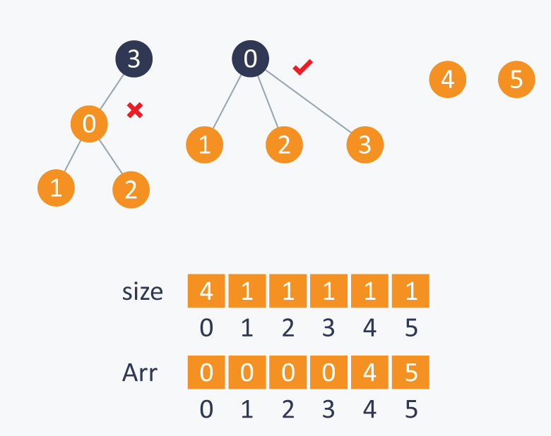
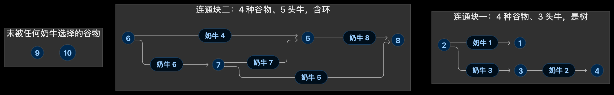

## 📚并查集：从连通块到离线算法

## 一、并查集是什么？

当图中不断加入新的边，我们希望快速回答：

1. 两个节点是否属于同一个连通块？
2. 加入一条边后，两个连通块如何合并？
3. 某个连通块有多少个节点？
4. 当前一共有多少个连通块？

**并查集（Disjoint Set Union，DSU）维护的是一组互不相交的集合。**

- **并**：把两个集合合并。
- **查**：查询某个元素属于哪个集合。
- **集**：所有元素被划分为若干个不相交的集合。

放到无向图中，一个集合通常对应一个连通块。

## 二、用一个例子理解合并

有 6 个节点，最初没有边：


$$
\{0\},\{1\},\{2\},\{3\},\{4\},\{5\}
$$

依次加入边：

| 操作 | 当前集合 | 集合数量 |
| --- | --- | --- |
| 初始 | `{0}`、`{1}`、`{2}`、`{3}`、`{4}`、`{5} | 6 |
| 加入 `(0,1)` | `{0,1}`、`{2}`、`{3}`、`{4}`、`{5}` | 5 |
| 加入 `(0,2)` | `{0,1,2}`、`{4}`、`{5}` | 4 |
| 加入 `(0,3)` | `{0,1,2,3}`、`{4}`、`{5}` | 3 |

加入 `(1,3)` 时，1 和 3 已经连通，因此不能再次减少集合数量。

## 三、核心表示：父节点与代表元

### 1. 每个集合选一个代表

使用 `parent[x]` 表示并查集内部的父节点。

若：

```cpp
parent[x] == x
```

说明 `x` 是这个集合的根，也称为代表元（代表元与父节点意义不一定一样）。

例如：

```cpp
parent[1] = 0;
parent[2] = 0;
parent[3] = 0;
```

1、2、3 属于同一个集合，根是 0。

**`parent[x]` 不一定等于代表元，必须通过 `find(x)` 查找。**

### 2. 初始化

每个节点单独作为一个集合：

```cpp
for (int i = 1; i <= n; i++) {
    parent[i] = i;
    sz[i] = 1;
}
```

`sz[root]` 记录这个根所代表的集合大小。

### 3. 查找代表元

未优化的查找思路：不断沿父指针向上走，直到根。

```cpp
int find(int x) {
    if (parent[x] == x) return x;
    return find(parent[x]);
}
```

如果合并方式不好，树可能变成很长的链，单次查找最坏为 O(N)。

## 四、两种优化

### 1. 路径压缩

```cpp
int find(int x) {
    if (parent[x] == x) return x;
    return parent[x] = find(parent[x]);
}
```

这行代码分成两步理解：

```cpp
int root = find(parent[x]);
parent[x] = root;
return root;
```

查到根以后，让经过的节点直接指向根。下次查找就会更快。

路径压缩只改变并查集内部结构，不改变集合成员关系。

### 2. 按大小合并

合并时，让小集合的根指向大集合的根：

```cpp
a = find(a);
b = find(b);
if (a == b) return false;
if (sz[a] < sz[b]) swap(a, b);
parent[b] = a;
sz[a] += sz[b];
return true;
```

注意：

1. 连接的是两个集合的**根**。
2. 只有合并成功，才更新集合大小与集合数量。
3. 只有根节点上的 `sz` 保证有效；查询应使用 `sz[find(x)]`。

## 五、统一 C++ 模板

下面使用 `parent` 与 `sz` 两个数组，便于初学者理解。

```cpp
struct DSU {
    vector<int> parent, sz;
    int components;

    explicit DSU(int n) : parent(n + 1), sz(n + 1, 1), components(n) {
        iota(parent.begin(), parent.end(), 0);  //parent = {0, 1, 2, 3, 4, 5};
    }

    int find(int x) {
        if (parent[x] == x) return x;
        return parent[x] = find(parent[x]); // 路径压缩
    }

    bool same(int a, int b) {
        return find(a) == find(b);
    }

    bool unite(int a, int b) {
        a = find(a);
        b = find(b);
        if (a == b) return false; // 已在同一集合，不重复合并
        if (sz[a] < sz[b]) swap(a, b);
        parent[b] = a;           // 小集合的根接到大集合的根
        sz[a] += sz[b];
        components--;
        return true;
    }

    int size(int x) {
        return sz[find(x)];  //返回集合的大小
    }
};
```

常用接口：

| 代码 | 含义 |
| --- | --- |
| `DSU dsu(n);` | 建立 1 到 n 的 n 个单点集合 |
| `dsu.find(x)` | 查找 x 所在集合的代表元 |
| `dsu.same(a,b)` | 判断 a、b 是否在同一集合 |
| `dsu.unite(a,b)` | 合并两个集合，返回本次是否真正发生合并 |
| `dsu.size(x)` | 查询 x 所在集合的节点数 |
| `dsu.components` | 当前集合数量，统计初始化的全部 n 个节点 |

`explicit` 用来限制隐式类型转换，不影响本课合并与查询的算法逻辑。

```c++
DSU dsu(5);      // 可以：明确调用构造函数
DSU dsu = 5;     // 不可以：把整数 5 隐式转换为 DSU
```

### 另一种写法：根节点存负数

有些代码只用一个 `parent` 数组：

- `parent[x] < 0`：x 是根，`-parent[x]` 是集合大小。
- `parent[x] >= 0`：存父节点编号。

因此你可能看到：

```cpp
#include <bits/stdc++.h>
using namespace std;

struct DSU {
    vector<int> parent;
    int components;
  
    explicit DSU(int n) : parent(n + 1, -1), components(n) {}

    // 查找根节点，并进行路径压缩
    int find(int x) {
        if (parent[x] < 0) return x;
        return parent[x] = find(parent[x]);
    }

    // 合并两个集合：小集合接到大集合
    bool unite(int a, int b) {
        a = find(a);
        b = find(b);

        if (a == b) return false;

        // 负数越小，集合越大，让 a 为大集合的根
        if (parent[a] > parent[b]) swap(a, b);

        parent[a] += parent[b]; // 更新集合大小的负数
        parent[b] = a;          // b 的根指向 a
        components--;
        return true;
    }

    // 判断是否属于同一集合
    bool same(int a, int b) {
        return find(a) == find(b);
    }

    // 查询集合大小
    int size(int x) {
        return -parent[find(x)];
    }
};
```

### 时间复杂度

| 操作                  | 时间复杂度       |
| --------------------- | ---------------- |
| 初始化 N 个元素       | O(N)             |
| 查找 `find`           | 均摊 O(alpha(N)) |
| 合并 `unite`          | 均摊 O(alpha(N)) |
| 初始化后进行 M 次操作 | O(N+M*alpha(N))  |

alpha(N)是反阿克曼函数，增长极慢，在实际竞赛的数据范围内可以近似看成常数。通常可以理解为：查找、合并几乎是 O(1)，但不是严格的单次最坏 \(O(1)\)。

### DFS/BFS 与并查集有什么区别

| 场景                                 | 常用方法               | 原因                                   |
| ------------------------------------ | ---------------------- | -------------------------------------- |
| 一张固定的图，求所有连通块           | DFS/BFS 或并查集       | 都可以完成，遍历还能获取更多结构信息   |
| 不断加边，中间反复询问连通性         | 并查集                 | 每次只需要合并，不必重新遍历           |
| 求最少走几条边                       | BFS                    | 普通并查集不维护距离                   |
| 求具体路径                           | DFS/BFS 等             | 并查集的父指针不是原图中的路径         |
| 删除边或节点                         | 普通并查集不能直接处理 | 可考虑倒序离线；更复杂情况需要其他技术 |
| 判断有向图中能否从一个点走到另一个点 | 有向图搜索等           | 普通并查集会忽略方向                   |

**并查集擅长维护“是不是同一组”，不负责还原“具体怎样走”。**

## 六、基础练习：合并与查询

[洛谷 P3367：并查集](https://www.luogu.com.cn/problem/P3367)

操作 `1 x y`：合并；操作 `2 x y`：询问，输出 `Y` 或 `N`。

### 完整代码

```cpp
#include <bits/stdc++.h>
using namespace std;

struct DSU{
    vector<int>parent;
    int components;

    explicit DSU(int n):parent(n+1,-1),components(n){}

    int find(int x){
        if(parent[x]<0) return x;
        return parent[x]=find(parent[x]);
    }

    bool unite(int a,int b){
        a=find(a);
        b=find(b);

        if(a==b) return false;
        if(parent[a]>parent[b]) swap(a,b);

        parent[a]+=parent[b];
        parent[b]=a;
        components--;
        return true;
    }

    bool same(int a,int b){
        return find(a)==find(b);
    }

    int size(int x){
        return -parent[find(x)];
    }
};
int main() {
    ios::sync_with_stdio(0);
    cin.tie(0);
    int n,m;
    cin>>n>>m;
    DSU dsu(n);
    while(m--){
        int z,x,y;
        cin>>z>>x>>y;
        if(z==1) dsu.unite(x,y);
        else cout<<(dsu.same(x,y)?"Y":"N")<<"\n";
    }
    return 0;
}
```

***

## 真题一：Wormhole Sort

[Wormhole Sort — 2020 January Silver](https://usaco.org/index.php?page=viewproblem2&cpid=992)

### 1. 如何建模

位置 i 上的奶牛编号为 `p[i]`，目标是让每个位置上的编号等于自身编号。

若只使用宽度至少为 W 的虫洞，那么允许交换的边构成一张无向图。

能够完成排序，当且仅当对所有 i：

$$
\operatorname{find}(i)=\operatorname{find}(p[i])
$$

这里使用“位置 i 上是奶牛 p[i]”的排列记法；它与题面“奶牛 i 位于 p[i]”的记法互为逆排列，对所有 i 的连通块判定完全等价。

### 2. 解题步骤

1. 若原排列已经有序，输出 `-1`。
2. 二分最小允许宽度 W。
3. 每次新建并查集，只合并 `w >= W` 的边。
4. 检查全部 `same(i,p[i])`；满足则尝试更大阈值。

### 3. 完整代码

```cpp
#include <bits/stdc++.h>
using namespace std;

struct DSU {
    vector<int> parent;
    int components;

    explicit DSU(int n) : parent(n + 1, -1), components(n) {}

    int find(int x) {
        if (parent[x] < 0) return x;
        return parent[x] = find(parent[x]); // 路径压缩
    }

    bool same(int a, int b) {
        return find(a) == find(b);
    }

    bool unite(int a, int b) {
        a = find(a);
        b = find(b);

        if (a == b) return false;

        // 负数越小，集合越大
        if (parent[a] > parent[b]) swap(a, b);

        parent[a] += parent[b]; // 更新集合大小的负数
        parent[b] = a;          // 小集合的根指向大集合的根
        components--;
        return true;
    }

    int size(int x) {
        return -parent[find(x)];
    }
};

struct Edge { int u, v, w; };

int main() {
    ios::sync_with_stdio(false);
    cin.tie(nullptr);
    int n, m;
    cin >> n >> m;
    vector<int> p(n + 1);
    bool sorted = true;
    for (int i = 1; i <= n; i++) {
        cin >> p[i];
        if (p[i] != i) sorted = false;
    }
    vector<Edge> edges(m);
    int maxWidth = 0;
    for (auto &e : edges) {
        cin >> e.u >> e.v >> e.w;
        maxWidth = max(maxWidth, e.w);
    }
    if (sorted) {
        cout << -1 << '\n';
        return 0;
    }
    auto check = [&](int width) {
        DSU dsu(n); // 每次判定都重新建立，不能沿用上一次的合并
        for (const auto &e : edges) {
            if (e.w >= width) dsu.unite(e.u, e.v);
        }
        for (int i = 1; i <= n; i++) {
            if (!dsu.same(i, p[i])) return false;
        }
        return true;
    };
    int low = 0, high = maxWidth;
    while (low < high) {
        int mid = low + (high - low + 1) / 2;
        if (check(mid)) low = mid;
        else high = mid - 1;
    }
    cout << low << '\n';
}
```

设最大边权为 W_max，时间复杂度：

1. 一次 `check`：初始化 N 个节点、扫描 M 条边，再检查 N 个位置，约为  O((N+M)alpha(N))
2. 二分次数：虫洞宽度最大为 \(10^9\)，最多约 30 次判定。
3. 整体复杂度：  

$$
O\left((N+M)\alpha(N)\log(W_{\max}+1)\right)
$$

**注意点**：二分阈值会时大时小，所以每次 `check` 都重新初始化并查集，不能无条件复用上次结果。**

## 真题二：Cereal 2

[USACO 2022 January Silver — Cereal 2](https://usaco.org/index.php?page=viewproblem2&cpid=1184)

### 1. 建图

- 每种谷物作为一个节点。
- 每头奶牛作为一条边，连接它最喜欢和第二喜欢的谷物。
- 不同连通块之间互不影响，可以分别安排出场顺序。

### 2. 用并查集建立生成森林

依次处理每头奶牛对应的边：

```c++
if (dsu.unite(first[i], second[i])) {
    // 合并成功：作为生成树的一条边
} else {
    // 两端已经连通：记录为非树边
}
```

- `unite(u,v)` 成功：保留为树边。
- 合并失败：两端已经连通，记录为非树边。
- 全部合并完成后，每个含环的连通块选一条非树边，记录对应奶牛 `cycleCow[root]`。

### 3. 构造出场顺序

- **树形连通块**：任选根，用 BFS 遍历，按发现树边的顺序安排奶牛。
- **含环连通块**：先安排 `cycleCow[root]`，它拿走第一选择；再以这个谷物为根，BFS 遍历生成树，安排树边对应的奶牛。

BFS 保证父边先于子边。每条树边处理时，子节点谷物还未被拿走，因此对应奶牛一定能吃到。

### 4. 统计答案

对每个连通块，设有 `V` 个谷物、`E` 头奶牛：

| 结构         | 安排方法                                                  |
| ------------ | --------------------------------------------------------- |
| 树，`E=V-1`  | 按父边先于子边的顺序安排，全部能吃到                      |
| 含环，`E>=V` | 先安排一条非树边对应的牛，再安排全部树边，保证 `V` 头吃到 |

因此最少饥饿数量为：
$$
boxed{\sum_{\text{连通块}}\max(0,E-V)} 
$$
将尚未安排的奶牛放到队伍最后，输出饥饿数量与完整排列。

### 5. Case



| 连通块               | 谷物数 \(V\) | 奶牛数 \(E\) | 最少饥饿数量 |
| -------------------- | ------------ | ------------ | ------------ |
| `{1,2,3,4}`          | 4            | 3            | 0            |
| `{5,6,7,8}`          | 4            | 5            | 1            |
| 孤立点 `{9}`、`{10}` | 各 1         | 各 0         | 0            |

### 6. 复杂度

设 N 为奶牛数，M  为谷物种类数：

- 时间复杂度：O(M+N\alpha(M))
- 空间复杂度：O(N+M)

1.使用 并查集选生成森林 + BFS 构造出场顺序。

```c++
//1.合并成功的边保留为树边；失败的边记录为非树边。
//2.每个含环连通块选一条非树边，让对应奶牛先出场。
//3.从这头牛的第一选择谷物开始，BFS 遍历生成树，依次安排树边对应的奶牛。
//4.其余奶牛放到最后。
#include <bits/stdc++.h>
using namespace std;

struct DSU {
    vector<int> parent;

    explicit DSU(int n) : parent(n + 1, -1) {}

    int find(int x) {
        if (parent[x] < 0) return x;
        return parent[x] = find(parent[x]);
    }

    bool unite(int a, int b) {
        a = find(a);
        b = find(b);

        if (a == b) return false;

        // 负数越小，集合越大
        if (parent[a] > parent[b]) swap(a, b);

        parent[a] += parent[b];
        parent[b] = a;
        return true;
    }
};

int main() {
    ios::sync_with_stdio(false);
    cin.tie(nullptr);

    int N, M;
    cin >> N >> M;

    vector<int> first(N + 1), second(N + 1);

    // tree[u] 存储：{相邻谷物，对应奶牛编号}
    vector<vector<pair<int, int>>> tree(M + 1);

    vector<int> extraEdges;
    vector<bool> selected(N + 1, false);

    // 并查集的节点是谷物
    DSU dsu(M);

    // 1. 建立生成森林
    for (int cow = 1; cow <= N; cow++) {
        cin >> first[cow] >> second[cow];

        int u = first[cow];
        int v = second[cow];

        if (dsu.unite(u, v)) {
            tree[u].push_back({v, cow});
            tree[v].push_back({u, cow});
            selected[cow] = true;
        } else {
            extraEdges.push_back(cow);
        }
    }

    // 2. 每个最终连通块选一条非树边
    vector<int> cycleCow(M + 1, 0);

    for (int cow : extraEdges) {
        int root = dsu.find(first[cow]);

        if (cycleCow[root] == 0) {
            cycleCow[root] = cow;
        }
    }

    vector<int> order;
    vector<bool> visited(M + 1, false);
    queue<int> q;

    // 3. 分别处理每个连通块
    for (int root = 1; root <= M; root++) {
        if (dsu.find(root) != root) continue;

        int start = root;

        // 含环：额外边对应的奶牛先出场
        if (cycleCow[root] != 0) {
            int cow = cycleCow[root];

            order.push_back(cow);
            selected[cow] = true;

            // 它会先拿走第一选择，从这个谷物开始遍历
            start = first[cow];
        }

        // 4. BFS，保证父边先于子边
        visited[start] = true;
        q.push(start);

        while (!q.empty()) {
            int u = q.front();
            q.pop();

            for (auto [v, cow] : tree[u]) {
                if (visited[v]) continue;

                visited[v] = true;
                order.push_back(cow);
                q.push(v);
            }
        }
    }

    // 当前 order 中的奶牛都能吃到谷物
    int hungry = N - int(order.size());

    // 5. 没有选中的奶牛放到最后
    for (int cow = 1; cow <= N; cow++) {
        if (!selected[cow]) {
            order.push_back(cow);
        }
    }

    cout << hungry << '\n';

    for (int cow : order) {
        cout << cow << '\n';
    }

    return 0;
}
```

2. **纯 DFS 版本**: 第一次 DFS 用奶牛编号区分树边和非树边，因此能正确处理重边。 第二次只遍历已经建好的树，才可以直接跳过父节点。含环时，先安排非树边对应的牛，从它的第一选择谷物开始遍历

   **建图**
   谷物作为节点，奶牛作为边，连接它的第一、第二选择。

   **第一次 DFS：找生成树与非树边**
   每个连通块分别搜索：

   - 走到未访问节点的边，保留为树边。
   - 遇到已访问节点，且不是原来的父边，就发现了环，记录一条非树边。

   **第二次 DFS：安排出场顺序**  

   - 没有环：任选根，先输出树边对应的奶牛，再递归进入子节点。
   - 有环：先输出非树边对应的奶牛，再从它的第一选择谷物出发，按上述方式遍历生成树。

   **剩余奶牛放最后**
   前面安排的奶牛都能吃到，剩下的就是最少需要饿肚子的奶牛。

```c++
#include <bits/stdc++.h>
using namespace std;

struct Edge {
    int to;   // 相邻谷物
    int cow;  // 对应奶牛编号
};

int main() {
    ios::sync_with_stdio(false);
    cin.tie(nullptr);

    int N, M;
    cin >> N >> M;

    vector<int> first(N + 1), second(N + 1);

    vector<vector<Edge>> adj(M + 1);
    vector<vector<Edge>> tree(M + 1);

    for (int cow = 1; cow <= N; cow++) {
        cin >> first[cow] >> second[cow];

        int u = first[cow];
        int v = second[cow];

        adj[u].push_back({v, cow});
        adj[v].push_back({u, cow});
    }

    vector<bool> visited(M + 1, false);
    vector<bool> isTreeEdge(N + 1, false);
    vector<bool> selected(N + 1, false);

    vector<int> order;

    // 分别处理每个连通块
    for (int start = 1; start <= M; start++) {
        if (visited[start]) continue;

        int extraCow = 0;

        // 第一次 DFS：建立生成树，寻找非树边
        // 栈中保存：当前节点、下一条待检查邻接边的下标
        stack<pair<int, int>> st;

        visited[start] = true;
        st.push({start, 0});

        while (!st.empty()) {
            int u = st.top().first;
            int index = st.top().second;

            // 当前节点的所有邻接边都处理完了，回溯
            if (index == int(adj[u].size())) {
                st.pop();
                continue;
            }

            st.top().second++;

            auto [v, cow] = adj[u][index];

            if (!visited[v]) {
                visited[v] = true;

                isTreeEdge[cow] = true;
                selected[cow] = true;

                tree[u].push_back({v, cow});
                tree[v].push_back({u, cow});

                st.push({v, 0});
            } else if (!isTreeEdge[cow] && extraCow == 0) {
                // 已经访问过，且不是树边：找到一条非树边
                extraCow = cow;
            }
        }

        int root = start;

        // 含环：先安排额外奶牛
        if (extraCow != 0) {
            order.push_back(extraCow);
            selected[extraCow] = true;

            // 它先拿走第一选择，从这里开始遍历生成树
            root = first[extraCow];
        }

        // 第二次 DFS：构造树边对应奶牛的出场顺序
        // 当前节点、父节点、进入当前节点的边对应的奶牛
        stack<tuple<int, int, int>> dfs;
        dfs.push({root, 0, 0});

        while (!dfs.empty()) {
            auto [u, parent, cow] = dfs.top();
            dfs.pop();

            // 先安排父边对应的奶牛，再处理子树
            if (cow != 0) {
                order.push_back(cow);
            }

            for (auto [v, nextCow] : tree[u]) {
                if (v == parent) continue;

                dfs.push({v, u, nextCow});
            }
        }
    }

    // 当前 order 中的奶牛全部能吃到
    int hungry = N - int(order.size());

    // 其余奶牛安排在最后
    for (int cow = 1; cow <= N; cow++) {
        if (!selected[cow]) {
            order.push_back(cow);
        }
    }

    cout << hungry << '\n';

    for (int cow : order) {
        cout << cow << '\n';
    }

    return 0;
}
```

## 真题三：Closing the Farm

[2016 US Open](https://usaco.org/index.php?page=viewproblem2&cpid=646)

### 1. 题意与组别差异

给定无向图，按指定顺序关闭节点及其关联边，询问剩余开放节点是否全部连通。

| 版本 | 数据范围 | 适合的思路 |
| --- | --- | --- |
| 银组 | N,M < 3000 | 每次关闭后 DFS/BFS，O(N(N+M)) |
| 金组 | N,M < 200000 | 逆序开放 + 并查集 |

### 2. 为什么不能直接删除

假设 1、2、3 已经合并成一个集合，删除节点 2 后，1 和 3 是否仍连通，取决于原图有没有其他路径。

普通并查集只保留合并结果，无法直接把集合重新拆开。

**改变处理顺序：正向关闭节点，反向就是开放节点。**

### 3. 解题步骤

1. 读入全部关闭顺序 `order[1..n]`。
2. 初始所有节点都未开放，从 `order[n]` 开始倒序开放。
3. 新开放一个节点，开放连通块数先加 1。
4. 与所有已开放邻居合并；每次成功合并，开放连通块数减 1。
5. 若开放连通块数等于 1，记录 `YES`，最后按原顺序输出。

### 4. 样例推演与答案位置

原图的边为 `(1,2)`、`(2,3)`、`(3,4)`，关闭顺序是 `3,4,1,2`。

| 倒序操作 | 已开放节点 | 开放连通块数 | 存入 |
| --- | --- | --- | --- |
| 开放 2 | `{2}` | 1 | `answer[4]=YES` |
| 开放 1 | `{1,2}` | 1 | `answer[3]=YES` |
| 开放 4 | `{1,2,4}` | 2 | `answer[2]=NO` |
| 开放 3 | `{1,2,3,4}` | 1 | `answer[1]=YES` |

正序输出 `YES NO YES YES`。`answer[i]` 表示关闭前 `i-1` 个节点后的状态。 

### 5. 完整代码：银组、金组通用

```c++
//1.正序关闭 + 每次重新 DFS
#include <bits/stdc++.h>
using namespace std;

const int Nmax = 3005;

int N, M;
vector<int> adj[Nmax];
int order[Nmax];

bool closed[Nmax];
bool visited[Nmax];

int cnt;

// 统计从 u 出发能访问多少个开放农场
void dfs(int u) {
    visited[u] = true;
    cnt++;

    for (int v : adj[u]) {
        if (closed[v] || visited[v]) continue;
        dfs(v);
    }
}

int main() {
    ios::sync_with_stdio(false);
    cin.tie(nullptr);

    // freopen("closing.in", "r", stdin);
    // freopen("closing.out", "w", stdout);

    cin >> N >> M;

    for (int i = 0; i < M; i++) {
        int u, v;
        cin >> u >> v;

        adj[u].push_back(v);
        adj[v].push_back(u);
    }

    for (int i = 1; i <= N; i++) {
        cin >> order[i];
    }

    for (int i = 1; i <= N; i++) {
        memset(visited, false, sizeof(visited));
        cnt = 0;

        // order[i] 尚未关闭，可以作为搜索起点
        dfs(order[i]);

        int remaining = N - i + 1;

        cout << (cnt == remaining ? "YES" : "NO") << '\n';

        // 输出当前状态后，再关闭这个农场
        closed[order[i]] = true;
    }

    return 0;
}
```

```cpp
//2.逆序开放 + 并查集
#include <bits/stdc++.h>
using namespace std;

struct DSU {
    vector<int> parent;

    explicit DSU(int n) : parent(n + 1, -1) {}

    int find(int x) {
        if (parent[x] < 0) return x;
        return parent[x] = find(parent[x]);
    }

    bool unite(int a, int b) {
        a = find(a);
        b = find(b);

        if (a == b) return false;

        // 小集合合并到大集合
        if (parent[a] > parent[b]) swap(a, b);

        parent[a] += parent[b];
        parent[b] = a;
        return true;
    }
};

int main() {
    ios::sync_with_stdio(false);
    cin.tie(nullptr);
  
    int n, m;
    cin >> n >> m;
    vector<vector<int>> adj(n + 1);
    for (int i = 0; i < m; i++) {
        int u, v;
        cin >> u >> v;
        adj[u].push_back(v);
        adj[v].push_back(u);
    }
    vector<int> order(n + 1);
    for (int i = 1; i <= n; i++) cin >> order[i];

    DSU dsu(n);
    vector<bool> active(n + 1, false), answer(n + 1, false);
    int activeComponents = 0; // 只统计已经开放的节点
    for (int i = n; i >= 1; i--) {
        int u = order[i];
        active[u] = true;
        activeComponents++;
        for (int v : adj[u]) {
            if (active[v] && dsu.unite(u, v)) activeComponents--;
        }
        // 当前开放的节点恰好是 order[i..n]
        answer[i] = (activeComponents == 1);
    }
    for (int i = 1; i <= n; i++) {
        cout << (answer[i] ? "YES" : "NO") << '\n';
    }
}
//复杂度：O(N+M*alpha(N))，空间 O(N+M)。
```

## 真题四：MooTube

### 1. 题意

图是一棵树。两点的相关度等于唯一路径上的最小边权。

查询 `(k,v)`：除 v 自己外，有多少节点与 v 的相关度至少为 k？

### 2. 从路径转成连通块

路径最小边权至少为 k，等价于这条路径上的每条边权都至少为 k。

因此，只保留边权 `w >= k` 的边，答案就是：

$$
\operatorname{size}(v)-1
$$

减去 1 是为了排除 v 自己。

### 3. 为什么银组能搜索，金组需要优化

- 银组 N,Q <= 5000：每次 DFS/BFS，时间 O(NQ)，可以完成。
- 金组 N,Q <= 10^5：反复搜索代价过高。

所有查询提前给出，可以先排序、再计算，最后恢复输出顺序。这叫**离线处理**。

### 4. 解题步骤

1. 将边按边权从大到小排序。
2. 将查询按阈值 k 从大到小排序，记录原查询编号 `id`。
3. 处理每个查询前，把所有 `w >= k` 的边加入并查集。
4. 记录 `answer[id] = dsu.size(v) - 1`。
5. 按原查询顺序输出。

阈值不断减小，允许的边只增不减，因此并查集的合并结果可以保留。

如果阈值从小到大处理，就需要删除已经加入的边，普通并查集不适合这样做。

### 5. 小例子

边：`1—2` 权值 3，`2—3` 权值 2，`2—4` 权值 4。

| 阈值 | 已加入的边 | 查询节点 | 答案 |
| --- | --- | --- | --- |
| 4 | `(2,4)` | 1 | 0 |
| 3 | 再加入 `(1,2)` | 1 | 2 |
| 1 | 再加入 `(2,3)` | 2 | 3 |

注意同权边：回答阈值 k 前，所有权值等于 k 的边也必须加入。

### 6. 完整代码：银组、金组通用

```cpp
#include <bits/stdc++.h>
using namespace std;

struct DSU {
    vector<int> parent, sz;
    int components;

    explicit DSU(int n) : parent(n + 1), sz(n + 1, 1), components(n) {
        iota(parent.begin(), parent.end(), 0);
    }

    int find(int x) {
        if (parent[x] == x) return x;
        return parent[x] = find(parent[x]); // 路径压缩
    }

    bool same(int a, int b) {
        return find(a) == find(b);
    }

    bool unite(int a, int b) {
        a = find(a);
        b = find(b);
        if (a == b) return false; // 已在同一集合，不重复合并
        if (sz[a] < sz[b]) swap(a, b);
        parent[b] = a;           // 小集合的根接到大集合的根
        sz[a] += sz[b];
        components--;
        return true;
    }

    int size(int x) {
        return sz[find(x)];
    }
};

struct Edge { int u, v, w; };
struct Query { int k, v, id; };

int main() {
    ios::sync_with_stdio(false);
    cin.tie(nullptr);
    int n, q;
    cin >> n >> q;
    vector<Edge> edges(n - 1);
    for (auto &e : edges) cin >> e.u >> e.v >> e.w;
    vector<Query> queries(q);
    for (int i = 0; i < q; i++) {
        cin >> queries[i].k >> queries[i].v;
        queries[i].id = i;
    }
    sort(edges.begin(), edges.end(), [](const Edge &a, const Edge &b) {
        return a.w > b.w;
    });
    sort(queries.begin(), queries.end(), [](const Query &a, const Query &b) {
        return a.k > b.k;
    });
    DSU dsu(n);
    vector<int> answer(q);
    int p = 0;
    for (const auto &query : queries) {
        while (p < n - 1 && edges[p].w >= query.k) {
            dsu.unite(edges[p].u, edges[p].v);
            p++;
        }
        answer[query.id] = dsu.size(query.v) - 1;
    }
    for (int value : answer) cout << value << '\n';
}
```

时间复杂度：

$$
O(N\log N+Q\log Q+(N+Q)\alpha(N))
$$

空间复杂度：O(N+Q)。

## 拓展：Kruskal 最小生成树

### 1. 最小生成树是什么

在一个连通无向带权图中，选择 $N-1$ 条边，使所有节点连通，并使总边权最小。

这不是最短路：最短路优化某些路径的长度，最小生成树优化连接全部节点的总成本。

### 2. Kruskal 的步骤

1. 按边权从小到大排序。
2. 依次考虑每条边 `(u,v,w)`。
3. 若 u、v 不连通，选这条边并合并两个集合。
4. 若已经连通，加入会形成环，跳过。
5. 选满 N-1 条边后结束；若选不满，原图不连通。

并查集负责快速判断“这条边会不会成环”；排序与贪心决定“先考虑哪些边”。

### 3. 为什么便宜的跨集合边可以选

当前森林可以扩展为某棵最小生成树。若下一条最便宜的跨集合边 e 不在那棵树里，加入 e 会形成环；环上必有另一条跨越相应切分的边 f。

因为 e 是当前可用的最便宜跨集合边，$w(e)\le w(f)$。用 e 替换 f，不增加总权值，因此仍可得到一棵最小生成树。

### 4. 模板练习与完整代码

[洛谷 P3366：最小生成树](https://www.luogu.com.cn/problem/P3366)

```cpp
#include <bits/stdc++.h>
using namespace std;

struct DSU {
    vector<int> parent, sz;
    int components;

    explicit DSU(int n) : parent(n + 1), sz(n + 1, 1), components(n) {
        iota(parent.begin(), parent.end(), 0);
    }

    int find(int x) {
        if (parent[x] == x) return x;
        return parent[x] = find(parent[x]); // 路径压缩
    }

    bool same(int a, int b) {
        return find(a) == find(b);
    }

    bool unite(int a, int b) {
        a = find(a);
        b = find(b);
        if (a == b) return false; // 已在同一集合，不重复合并
        if (sz[a] < sz[b]) swap(a, b);
        parent[b] = a;           // 小集合的根接到大集合的根
        sz[a] += sz[b];
        components--;
        return true;
    }

    int size(int x) {
        return sz[find(x)];
    }
};

struct Edge { int u, v, w; };

int main() {
    ios::sync_with_stdio(false);
    cin.tie(nullptr);
    int n, m;
    cin >> n >> m;
    vector<Edge> edges(m);
    for (auto &e : edges) cin >> e.u >> e.v >> e.w;
    sort(edges.begin(), edges.end(), [](const Edge &a, const Edge &b) {
        return a.w < b.w;
    });
    DSU dsu(n);
    long long answer = 0;
    int chosen = 0;
    for (const auto &e : edges) {
        if (dsu.unite(e.u, e.v)) {
            answer += e.w;
            chosen++;
        }
        if (chosen == n - 1) break;
    }
    if (chosen != n - 1) cout << "orz\n";
    else cout << answer << '\n';
}
```

时间复杂度如下，空间 O(N+M)。边权总和用 `long long`。
$$
O(M\log M+(N+M)\alpha(N))
$$
若要求最大生成树，改为边权从大到小排序，仍由并查集判断是否成环。

## 十二、金组拓展：Fenced In

[USACO 2016 February Gold — Fenced In](https://usaco.org/index.php?page=viewproblem2&cpid=623)

### 1. 图如何构造

1. 围栏把大矩形分成若干小区域，把每个**区域**作为节点。
2. 两个区域共用一段围栏，就在它们之间建立一条边。
3. 边权等于拆掉这段围栏的长度。
4. 要让所有区域互通且拆除总长度最小，就是最小生成树。

注意节点代表区域，不是围栏交点。

### 2. 边权容易弄反

若某区域宽为 `dx`、高为 `dy`：

- 向左右相邻区域打通：拆掉竖直围栏，长度是 `dy`。
- 向上下相邻区域打通：拆掉水平围栏，长度是 `dx`。

### 3. 从模板到本题

补入外边界坐标后排序，求相邻坐标差；对区域编号，例如：

```cpp
int id(int row, int col, int columns) {
    return row * columns + col;
}
```

可以显式建立区域相邻边后执行 Kruskal。但最大规模有约 400 万个区域、800 万条边，显式存储与全量边排序开销较大。

更适合本题的实现方式是：分别将宽度、高度排序，归并处理下一组最便宜的水平边或竖直边，同一组内逐条尝试并查集合并。这利用了网格最小生成树的特殊结构，无需显式存下全部边。它是对普通 Kruskal 的进一步优化，不能理解成任意带权图都可以随意重排节点对应的边权。

这个金组做法用并查集处理 O((n+1)(m+1)) 次相邻合并，排序只针对两组间距。时间为

$$
O\left((n+1)\log(n+1)+(m+1)\log(m+1)
 +(n+1)(m+1)\alpha((n+1)(m+1))\right).
$$

建议先掌握建模与 Kruskal，再学习这种按同权边成组生成的实现；本课不附该题完整程序，避免与模板入门混在一起。

***

## 课后必做题

| 阶段     | 往年真题                                                     | 考查重点                                                     |
| -------- | ------------------------------------------------------------ | ------------------------------------------------------------ |
| 银组综合 | [Wormhole Sort — 2020 January Silver](https://usaco.org/index.php?page=viewproblem2&cpid=992) | 二分答案 + 并查集判定                                        |
| 银组     | [Cereal 2 — 2022 January Silver](https://usaco.org/index.php?page=viewproblem2&cpid=1184) | 图建模、生成森林、环与输出顺序构造                           |
| 银组     | [Closing the Farm — 2016 US Open Silver](https://usaco.org/index.php?page=viewproblem2&cpid=644) | 连通性；先理解逐次搜索，再学习倒序开放                       |
| 银组     | [MooTube — 2018 January Silver](https://usaco.org/index.php?page=viewproblem2&cpid=788) | 阈值限制下的连通块；搜索与离线并查集的对比                   |
| 金组     | [MooTube — 2018 January Gold](https://usaco.org/index.php?page=viewproblem2&cpid=789) | 查询排序、边排序、离线维护集合大小                           |
| 金组     | 22 Dec Gold: [Strongest Friendship Group](https://usaco.org/index.php?page=viewproblem2&cpid=1259) | 将删除操作倒过来处理，使用并查集合并连通块，并维护大小。     |
| 金组     | 22 Jan Gold: [Farm Updates](https://usaco.org/index.php?page=viewproblem2&cpid=1186) | 倒序 + DFS                                                   |
| 金组     | [Fenced In — 2016 February Gold](https://usaco.org/index.php?page=viewproblem2&cpid=623) | 几何转图、最小生成树、批量处理同权边                         |
| 金组     | [Moo Network](https://usaco.org/index.php?page=viewproblem2&cpid=1211)-2022 February | 利用坐标特点减少候选边，再用 **Kruskal + 并查集**求最小生成树 |
| 金组     | [Reachable Pairs](https://usaco.org/index.php?page=viewproblem2&cpid=1474)-2025 January | 转换删点规则，倒序处理；维护每个连通块中的**有效节点数与连通点对数** |
| 银组     | [Deforestation](https://usaco.org/index.php?page=viewproblem2&cpid=1447)-2024 December | 在“从右向左补选树”的贪心中，可用并查集跳过已选位置，配合树状数组统计区间数量 |
