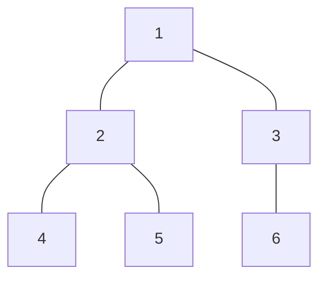

## 📚基础树算法：遍历、子树统计与路径性质

## 1. 什么是树

**树是连通、无环的无向图。**

对于有 `N` 个节点的简单无向图，下列条件可以用来刻画树：

1. 连通，并且没有环。
2. 连通，并且恰好有 `N-1` 条边。
3. 任意两个不同节点之间恰好有一条简单路径。

这里的“简单路径”指路径上的节点不重复。

**只有 `N-1` 条边还不够，必须同时检查连通性。** 例如，三个节点构成一个三角形，再加一个孤立点，共有 4 个点、3 条边，却不是树。

### 1.1 本讲统一使用的示例树



边集为：

```text
1 2
1 3
2 4
2 5
3 6
```

以 `1` 为根时：

| 节点 u | 父节点 parent[u] | 深度 depth[u] | 孩子 | 子树节点 |
| --- | --- | --- | --- | --- |
| 1 | 0，表示不存在 | 0 | 2、3 | 1、2、3、4、5、6 |
| 2 | 1 | 1 | 4、5 | 2、4、5 |
| 3 | 1 | 1 | 6 | 3、6 |
| 4 | 2 | 2 | 无 | 4 |
| 5 | 2 | 2 | 无 | 5 |
| 6 | 3 | 2 | 无 | 6 |

### 1.2 根、父节点、深度与子树

- **根节点**：人为选择的起点。换根会改变父子关系，但不会改变原树的边。
- **父节点**：除根以外，节点沿着通往根的路径遇到的第一个节点。
- **孩子**：以当前节点为父节点的节点。
- **深度**：根到当前节点的边数。本讲规定根深度为 `0`。
- **子树**：当前节点及其所有后代组成的部分，包含当前节点自己。
- **祖先**：从节点向根走所遇到的节点。约定“祖先”包含自己时，要在题目中明确说明。

**树不等于二叉树。** USACO 中一般树的一个节点可以有任意多个孩子，通常使用邻接表存储。

### 1.3 度数与叶子

`degree[u]` 表示与 `u` 相连的边数。

对于至少有两个节点的无向树，度数为 `1` 的节点是无向意义下的叶子。

选根之后，有根树中的叶子是“没有孩子的节点”。两种定义要区分：如果根的度数为 `1`，它仍然有一个孩子，不能按“无孩子”算叶子。

$$
children[u]=
\begin{cases}
degree[u], & u=root,\\
degree[u]-1, & u\ne root.
\end{cases}
$$

`N=1` 时，唯一节点没有孩子，度数为 `0`，应单独理解。

所有节点的度数之和：

$$
\sum_{u=1}^{N}degree[u]=2(N-1).
$$

原因：每条无向边在两个端点各贡献一次。

**课堂提问：**示例树中节点 `2` 的度数和孩子数分别是多少？

**答案：**度数 `3`，孩子数 `2`。

## 2. 邻接表：如何存储一棵树

### 2.1 无权树

以下为建图片段，假设已经读入 `n`：

```cpp
vector<vector<int>> adj(n + 1);
for (int i = 0; i < n - 1; i++) {
    int u, v;
    cin >> u >> v;
    adj[u].push_back(v);
    adj[v].push_back(u);  // 无向边需要存两次
}
```

`adj[u]` 存储的是所有邻居，**不只是孩子**。选根后遍历时，才区分父节点与孩子。

### 2.2 带权树

```cpp
vector<vector<pair<int, int>>> adj(n + 1);
for (int i = 0; i < n - 1; i++) {
    int u, v, w;
    cin >> u >> v >> w;
    adj[u].push_back({v, w});
    adj[v].push_back({u, w});
}
```

```cpp
for (auto [v, w] : adj[u]) {
    // v 是邻居，w 是边 (u,v) 的权值
}
```

邻接表存储整棵树的空间复杂度是 `O(N)`。

## 3. DFS：父节点与深度

### 3.1 为什么只需要跳过父节点

一般图存在环，通常需要 `visited` 数组。

**对于保证是树的无向图**，从 `u` 出发跳过父节点后，其余邻居都是孩子。不同孩子的子树之间没有边，否则会形成环。因此不会从其他路线再次回到已访问的节点。

```cpp
void dfs(int u, int p) {
    parent[u] = p;
    for (int v : adj[u]) {
        if (v == p) continue;
        depth[v] = depth[u] + 1;
        dfs(v, u);
    }
}
```

这段方法依赖输入是树，不能直接照搬到有环图。

### 3.2 先序与后序

```cpp
void dfs(int u, int p) {
    // 位置 A：刚进入 u，尚未处理孩子

    for (int v : adj[u]) {
        if (v == p) continue;

        // 位置 B：准备进入孩子 v
        dfs(v, u);
        // 位置 C：孩子 v 的整棵子树已经处理完
    }

    // 位置 D：u 的所有孩子都已处理完
}
```

| 要做的事 | 合适位置 | 原因 |
| --- | --- | --- |
| 记录 `parent[u]`、进入时间 | A | 进入时就能确定 |
| 设置 `depth[v]` | B | 父节点的深度已经知道 |
| 累加孩子的子树大小 | C | 必须等孩子统计结束 |
| 使用完整的 `sz[u]` | D | 所有孩子的信息都已汇总 |

**不是看到 DFS 就把所有计算放在递归之前。要看当前计算依赖谁。**

## 4. 子树大小与子树权值和

### 4.1 子树大小

定义：`sz[u]` 表示以 `u` 为根的子树节点数，包含 `u` 自己。

$$
sz[u]=1+\sum_{v\text{ 是 }u\text{ 的孩子}}sz[v].
$$

```cpp
void dfs(int u, int p) {
    sz[u] = 1;
    for (int v : adj[u]) {
        if (v == p) continue;
        dfs(v, u);
        sz[u] += sz[v];
    }
}
```

示例树的计算结果：

| 节点 | 4 | 5 | 2 | 6 | 3 | 1 |
| --- | --- | --- | --- | --- | --- | --- |
| 子树大小 | 1 | 1 | 3 | 1 | 2 | 6 |

以邻接表中先处理 `2` 再处理 `3` 为例，节点 `2` 需要先等 `4、5` 返回，才能得到 `sz[2]=1+1+1=3`。

**正确性：**叶子的子树只有自己，大小为 `1`。假设孩子的统计正确，当前节点的子树恰好由自己和互不重叠的孩子子树组成，因此求和得到正确答案。

### 4.2 子树权值和

若节点权值为 `weight[u]`，定义 `sum[u]` 为子树权值和：

$$
sum[u]=weight[u]+\sum_{v\text{ 是 }u\text{ 的孩子}}sum[v].
$$

处理方式与子树大小相同，只需将初始值 `1` 改成节点权值。

若有 `10^5` 个节点，每个权值可达 `10^9`，总和可达 `10^14`，应使用 `long long`。

### 4.3 完整递归模板：父节点、深度、子树大小、权值和

自编输入格式：先读 `n`，再读 `n` 个节点权值，最后读 `n-1` 条无向边。以 `1` 为根，按节点编号输出四项统计。

```cpp
#include <bits/stdc++.h>
using namespace std;
using ll = long long;

vector<vector<int>> adj;
vector<int> parent, depth, sz;
vector<ll> weight, sum;

void dfs(int u, int p) {
    parent[u] = p;
    sz[u] = 1;
    sum[u] = weight[u];

    for (int v : adj[u]) {
        if (v == p) continue;
        depth[v] = depth[u] + 1;
        dfs(v, u);
        sz[u] += sz[v];
        sum[u] += sum[v];
    }
}

int main() {
    ios::sync_with_stdio(false);
    cin.tie(nullptr);

    int n;
    cin >> n;
    adj.resize(n + 1);
    parent.assign(n + 1, 0);
    depth.assign(n + 1, 0);
    sz.assign(n + 1, 0);
    weight.resize(n + 1);
    sum.assign(n + 1, 0);

    for (int u = 1; u <= n; u++) cin >> weight[u];
    for (int i = 0; i < n - 1; i++) {
        int u, v;
        cin >> u >> v;
        adj[u].push_back(v);
        adj[v].push_back(u);
    }

    dfs(1, 0);
    for (int u = 1; u <= n; u++) {
        cout << parent[u] << ' ' << depth[u] << ' '
             << sz[u] << ' ' << sum[u] << '\n';
    }
}
```

时间复杂度 `O(N)`，包括邻接表、数组及最坏递归栈在内的空间复杂度 `O(N)`。链很长时，采用下一节的写法。

## 5. 非递归写法：先确定父子关系，再逆序汇总

递归后序的关键是：**孩子必须先于父节点完成统计。**

可以先生成一个“父节点在孩子之前”的遍历序列，再倒过来处理。下面用显式栈生成 DFS 先序；在树上跳过父节点即可。

以下为核心片段，假设已有 `n、adj、weight`，根为 `1`：

```cpp
vector<int> parent(n + 1, 0), depth(n + 1, 0);
vector<int> order;
stack<int> st;
st.push(1);

while (!st.empty()) {
    int u = st.top();
    st.pop();
    order.push_back(u);

    for (int v : adj[u]) {
        if (v == parent[u]) continue;
        parent[v] = u;
        depth[v] = depth[u] + 1;
        st.push(v);
    }
}

vector<int> sz(n + 1, 1);
vector<long long> sum = weight;

for (int i = (int)order.size() - 1; i >= 0; i--) {
    int u = order[i];
    if (parent[u] == 0) continue;
    int p = parent[u];
    sz[p] += sz[u];
    sum[p] += sum[u];
}
```

**为什么倒序有效？** 在 `order` 中父节点一定先于孩子出现，所以逆序时孩子一定先处理。处理到 `u` 时，它的所有后代已经把统计值沿父边汇总上来。

时间 `O(N)`，空间 `O(N)`，不会使用深度为 `N` 的递归调用栈。

注意：反向汇总时只应沿一条父边上交一次，不能既在孩子处上交，又在父节点处重复累加同一份信息。

## 6. 子树统计的两个直接应用

### 6.1 删除一条边

若 `v` 是 `u` 的孩子，删除边 `(u,v)` 后，两部分节点数为：

$$
\boxed{sz[v]\quad\text{和}\quad N-sz[v]}.
$$

示例树中删除 `(1,2)`，两部分分别是 `{2,4,5}` 与 `{1,3,6}`，大小都是 `3`。

**常见错误：**输入边 `(a,b)` 并不保证 `b` 是孩子，必须根据 `parent` 判断方向。

### 6.2 有多少条无序点对的路径经过某条边

删除一条边后两侧大小为 `s` 和 `N-s`。一条点对路径经过该边，当且仅当两个端点分处两侧，因此：

$$
\boxed{s(N-s)}.
$$

代码应写成：

```cpp
long long count = 1LL * sz[v] * (n - sz[v]);
```

不是先用 `int` 相乘，再赋值给 `long long`。

进一步，所有无序点对的距离总和为：

$$
\sum_{1\le a<b\le N}dist(a,b)
=\sum_{v\ne root}sz[v](N-sz[v]).
$$

因为无权树上一条路径的长度等于它经过的边数。对每条边统计它被多少条路径经过，再把贡献相加。

带权树的唯一路径权值和也有对应式：每条边再乘自己的权值。

***

## 真题 1：Milk Factory——方向与度数

- 比赛：**2019 US Open，Bronze，Problem 2**。
- [官方题目](https://usaco.org/index.php?page=viewproblem2&cpid=940)

### 题意

一棵树的每条边被指定一个方向，寻找能从所有节点到达的节点；不存在则输出 `-1`。`N≤100`。

### 先想暴力

枚举终点，将边反向后从终点搜索。如果能访问全部节点，原图中所有节点都能到达它。复杂度 `O(N²)`，本题可行。

```c++
#include <bits/stdc++.h>
using namespace std;
const int Nmax = 105;
int N;
vector<int> adj[Nmax];
bool reachable[Nmax][Nmax];
// 从 start 出发，当前到达 u
void dfs(int start, int u) {
    if (reachable[start][u]) return;
    reachable[start][u] = true;
    for (int v : adj[u]) {
        dfs(start, v);
    }
}

int main() {
    ios::sync_with_stdio(false);
    cin.tie(nullptr);
    // freopen("factory.in", "r", stdin);
    // freopen("factory.out", "w", stdout);
    cin >> N;
    for (int i = 0; i < N - 1; i++) {
        int a, b;
        cin >> a >> b;
        adj[a].push_back(b); // 单向边
    }
    // 每个站作为起点，分别搜索
    for (int start = 1; start <= N; start++) {
        dfs(start, start);
    }
    // 检查是否存在能被所有站到达的终点
    for (int target = 1; target <= N; target++) {
        bool allReach = true;

        for (int start = 1; start <= N; start++) {
            if (!reachable[start][target]) {
                allReach = false;
                break;
            }
        }
        if (allReach) {
            cout << target << '\n';
            return 0;
        }
    }
    cout << -1 << '\n';
    return 0;
}
```

### 利用树的性质优化

能够作为答案的节点必须出度为 `0`。否则从它的出边走向另一侧后，由于原图底层没有环，那一侧无法再沿有向路径回到它。

反过来，如果恰好只有一个出度为 `0` 的节点，从任意节点不断沿出边前进：不可能形成有向环，最终必然停在某个出度为 `0` 的节点，所以一定停在这个唯一节点。

因此只需判断出度为 `0` 的节点是否恰好有一个。

```cpp
#include <iostream>
#include <vector>
using namespace std;
int main()
{
    freopen("factory.in", "r", stdin);
    freopen("factory.out", "w", stdout);
    int n;
    cin>>n;
    vector<int>outDegree(n+1,0);
    for(int i=0;i<n-1;i++){
        int a,b;
        cin>>a>>b;
        outDegree[a]++;
    }
    int ans=-1,cnt=0;
    for(int i=1;i<=n;i++){
        if(outDegree[i]==0){
            ans=i;
            cnt++;
        }
    }
    cout<<(cnt==1?ans:-1)<<"\n";
    return 0;
}
```

时间复杂度`O(N)`，空间复杂度 `O(N)`。

**检查边界：**`N=1` 时，唯一节点出度为 `0`，答案为 `1`。

**课堂追问：**“唯一零出度点”能否直接用于一般有向图？不能，有向环可能永远到不了该点。

## 真题 2：Cowntagion——孩子数与局部贪心

- 比赛：**2020 December，Silver，Problem 1**。
- [官方题目](https://usaco.org/index.php?page=viewproblem2&cpid=1062)
- [官方题解](https://usaco.org/current/data/sol_prob1_silver_dec20.html)
- 数据：`N≤10^5`。

### 题意

起初只有农场 `1` 有一头感染牛。每天只能做一个操作：让某个农场的感染牛数量翻倍，或让一头感染牛沿一条边移动。求所有农场都有感染牛的最少天数。

### 从节点的孩子数入手

以 `1` 为根。设节点 `u` 有 `c` 个孩子。当它第一次收到一头感染牛后，要给每个孩子发送一头，同时自己保留至少一头，因此需要至少 `c+1` 头。

从 `1` 开始不断翻倍，找最小的 `t` 满足：

$$
2^t\ge c+1.
$$

用整数循环计算，避免浮点对数的边界问题：

```cpp
int cows = 1;
while (cows < children + 1) {
    cows *= 2;
    answer++;
}
```

### 为什么先翻倍再发送

先把一头牛送走，会减少本地牛数，使后续翻倍的收益变小。将翻倍提前到发送之前，不会减少可供后续使用的牛数。

还需解释为什么无需来回运输：若一头牛被送入已有感染牛的农场，可用在该农场翻倍替代；若某次发送让出发农场变空，可以提前在出发农场翻倍，并省掉之后一次重新送回的操作。这样可以把最优方案整理为“每个农场一旦感染就始终保留感染牛，每次移动感染一个新农场”。

因此恰好需要 `N-1` 次移动，剩余代价就是各节点需要的翻倍次数。

### 手算示例（自编）

在本讲的六节点示例树中：

- 节点 `1` 有 2 个孩子：`1→2→4`，翻倍 2 次。
- 节点 `2` 有 2 个孩子：翻倍 2 次。
- 节点 `3` 有 1 个孩子：翻倍 1 次。
- 叶子无需翻倍。
- 移动 5 次，总计 `2+2+1+5=10` 天。

### 参考代码

这里只需要孩子数量，而孩子数量能由度数直接得到，所以无需真正遍历。

```cpp
#include <bits/stdc++.h>
using namespace std;

int main() {
    ios::sync_with_stdio(false);
    cin.tie(nullptr);

    int n;
    cin >> n;
    vector<int> degree(n + 1, 0);
    for (int i = 0; i < n - 1; i++) {
        int u, v;
        cin >> u >> v;
        degree[u]++;
        degree[v]++;
    }

    long long answer = n - 1;
    for (int u = 1; u <= n; u++) {
        int children = degree[u] - (u != 1);
        int cows = 1;
        while (cows < children + 1) {
            cows *= 2;
            answer++;
        }
    }
    cout << answer << '\n';
}
```

复杂度：总时间 `O(N)`，空间 `O(N)`。每个有孩子的节点的翻倍次数不超过孩子数，而全树孩子数之和为 `N-1`，因此所有循环总次数为 `O(N)`。

**易错点：**需要 `children+1` 头，而不是 `children` 头；根不应减去一个不存在的父节点。

## 真题 3：Milk Visits——同色连通块代替逐条路径搜索

- 比赛：**2019 December，Silver，Problem 3**。
- [官方题目](https://usaco.org/index.php?page=viewproblem2&cpid=968)
- 数据：`N,M≤10^5`。
- 知识点：唯一路径、连通块、预处理。

### 题意

树上每个节点标记为 `G` 或 `H`。每次给出 `a、b、c`，判断从 `a` 到 `b` 的路径上是否存在颜色为 `c` 的节点。将所有询问结果连续输出为一个 01 字符串。

### 先想暴力

每次找出 `a→b` 的路径并检查颜色，最坏 `O(NM)`，只能通过测试点 2-5。

```c++
#include <bits/stdc++.h>
using namespace std;
const int Nmax = 100005;
int N, M;
string milk;
vector<int> adj[Nmax];
// has：从起点到当前节点 u 的路径上，是否有喜欢的牛奶
bool dfs(int u, int parent, int target, char wanted, bool has) {
    if (milk[u] == wanted) {
        has = true;
    }
    // 到达终点，判断这条路径是否符合要求
    if (u == target) {
        return has;
    }
    for (int v : adj[u]) {
        if (v == parent) continue;
        if (dfs(v, u, target, wanted, has)) {
            return true;
        }
    }
    return false;
}
int main() {
    ios::sync_with_stdio(false);
    cin.tie(nullptr);

    freopen("milkvisits.in", "r", stdin);
    freopen("milkvisits.out", "w", stdout);
    cin >> N >> M;
    cin >> milk;
    milk = " " + milk; // 编号从 1 开始
    for (int i = 1; i < N; i++) {
        int u, v;
        cin >> u >> v;
        adj[u].push_back(v);
        adj[v].push_back(u);
    }
    for (int i = 0; i < M; i++) {
        int a, b;
        char wanted;
        cin >> a >> b >> wanted;
        cout << (dfs(a, 0, b, wanted, false) ? '1' : '0');
    }
    cout << '\n';
    return 0;
}
```

### 观察：只有两种颜色

仅沿相同颜色的边搜索，将整棵树划分为若干同色连通块。记 `component[u]` 为节点所属连通块。

| 情况 | 路径特点 | 答案 |
| --- | --- | --- |
| `component[a]==component[b]` | 唯一路径完全在这个同色块内 | 检查 `type[a]==c` |
| `component[a]!=component[b]` | 路径一定经过至少一次颜色变化 | 两种颜色都出现，答案为 1 |

这里不仅要比较端点颜色：**两个端点颜色相同，也可能在不同连通块，中间经过另一种颜色。**

### 为什么同块时整条路径一定同色

同块意味着存在一条全同色路径连接 `a、b`。树上的简单路径唯一，所以询问路径必然就是这条同色路径。

### 手算示例（自编）

沿用六节点示例树，颜色字符串为 `HHGHGG`。

同色块分别为 `{1,2,4}`、`{3,6}`、`{5}`。

| 询问 | 实际路径 | 结果 |
| --- | --- | --- |
| `1 4 G` | 1(H)→2(H)→4(H) | 0 |
| `3 5 H` | 3(G)→1(H)→2(H)→5(G) | 1 |
| `3 6 H` | 3(G)→6(G) | 0 |
| `5 5 G` | 5(G) | 1 |

对应输出 `0101`。

```cpp
#include <bits/stdc++.h>
using namespace std;

int main() {
    ios::sync_with_stdio(false);
    cin.tie(nullptr);
    freopen("milkvisits.in", "r", stdin);
    freopen("milkvisits.out", "w", stdout);
  
    int n, m;
    cin >> n >> m;
    string type;
    cin >> type;
    type = " " + type;  // 节点编号从 1 开始
    vector<vector<int>> adj(n + 1);
    for (int i = 0; i < n - 1; i++) {
        int u, v;
        cin >> u >> v;
        adj[u].push_back(v);
        adj[v].push_back(u);
    }
    vector<int> component(n + 1, 0);
    int id = 0;
    for (int start = 1; start <= n; start++) {
        if (component[start] != 0) continue;
        id++;
        stack<int> st;
        st.push(start);
        component[start] = id;
        while (!st.empty()) {
            int u = st.top();
            st.pop();
            for (int v : adj[u]) {
                if (component[v] != 0 || type[v] != type[u]) continue;
                component[v] = id;  // 入栈时标记
                st.push(v);
            }
        }
    }
    string answer;
    while (m--) {
        int a, b;
        char c;
        cin >> a >> b >> c;
        bool ok = component[a] != component[b] || type[a] == c;
        answer += (ok ? '1' : '0');
    }
    cout << answer << '\n';
}
```

复杂度：预处理 `O(N)`，每次询问 `O(1)`，总时间 `O(N+M)`，空间 `O(N+M)`，其中包含输出字符串。

**课堂追问：**如果有三种颜色，不同连通块是否保证出现指定颜色？不保证。银组做法依赖“只有两种颜色”。同名金组题不能直接套这个结论。

## 真题 4：Clock Tree——深度奇偶与不变量

- 比赛：**2020 February，Silver，Problem 3**。
- [官方题目](https://usaco.org/index.php?page=viewproblem2&cpid=1016)
- [官方题解](https://usaco.org/current/data/sol_clocktree_silver_feb20.html)

### 题意

每个节点有一个 1 到 12 的时钟。每沿边进入一个节点，该节点时钟前进一格，12 之后回到 1。起点在最初不加一。问有多少个起点能通过一段行走，使所有时钟最终指向 12。

### **1. 把树分成两组**

任选一个点 DFS，按深度奇偶把节点分为 A、B 两组。树上每条边都连接不同组，所以走路时一定交替进入两组。

统计两组的节点数 `countA、countB`，以及初始钟面数字总和 `sumA、sumB`。

### **2. 考虑从 A 组出发**

令：
$$
D=(sumA-sumB)\bmod12
$$
起点的时钟最初不增加。之后：

- 第一步进入 B 组，`sumB` 加一，差值变为 \(D-1\)。
- 第二步进入 A 组，`sumA` 加一，差值恢复为 \(D\)。

因此，无论走多久，这个差值只会在 D 和 D-1 之间交替。

最终所有时钟都指向 12，两组的和模 12 都为 0，所以差值必须为 0。因此，从 A 组出发必要条件满足：
$$
D=0\quad\text{或}\quad D=1
$$

### 3. 证明是充分条件

先看两节点树：设起点读数为 `a`，另一个为 `b`。走偶数步时两者增加次数相同，可以同时归零当且仅当 `a-b≡0`；走奇数步时另一个节点多增加一次，可以同时归零当且仅当 `a-b≡1`。

对于更大的树，选一个不是起点的叶子 `x`，父节点为 `p`。每次走 `p→x→p` 都让两个端点各加一，不改变交替和。访问到 `p` 后，可以这样往返，直到 `x` 指向 `12`，再不进入 `x`。

这等价于从当前局面中消去一个叶子，余下仍是一棵树。沿起点到 `p` 的路径来到当前局面，只会让“以当前位置为起点的交替和”在 `0、1` 之间切换，因此归纳条件得以保持。递归消去叶子，归约到两节点情形，便可构造满足要求的行走。

### **4. 根据差值直接统计起点**

统一计算非负余数：

```
int D = ((sumA - sumB) % 12 + 12) % 12;
```

| `D`  | 合法起点   | 答案     |
| ---- | ---------- | -------- |
| 0    | 两组都可以 | `N`      |
| 1    | 只有 A 组  | `countA` |
| 11   | 只有 B 组  | `countB` |
| 其他 | 都不可以   | `0`      |

其中D=11时，所以从 B 组看，差值恰好是 1。

### 5. O(N²) 基础解法

枚举每个起点，做一次 DFS，按深度奇偶累加时钟。得到的交替和模 `12` 后为 `0` 或 `1`，该起点可行。

```cpp
#include <bits/stdc++.h>
using namespace std;

int main() {
    ios::sync_with_stdio(false);
    cin.tie(nullptr);

    int n;
    cin >> n;
    vector<int> a(n + 1);
    for (int u = 1; u <= n; u++) cin >> a[u];
    vector<vector<int>> adj(n + 1);
    for (int i = 0; i < n - 1; i++) {
        int u, v;
        cin >> u >> v;
        adj[u].push_back(v);
        adj[v].push_back(u);
    }

    int answer = 0;
    for (int root = 1; root <= n; root++) {
        stack<tuple<int, int, int>> st;  // 节点、父节点、正负号
        st.push({root, 0, 1});
        int q = 0;
        while (!st.empty()) {
            auto [u, p, sign] = st.top();
            st.pop();
            q += sign * a[u];
            for (int v : adj[u]) {
                if (v == p) continue;
                st.push({v, u, -sign});
            }
        }
        q = (q % 12 + 12) % 12;
        if (q == 0 || q == 1) answer++;
    }
    cout << answer << '\n';
}
```

复杂度：时间 `O(N²)`，空间 `O(N)`。

### 6. O(N) 优化：只需要一次染色

- **\(O(N^2)\)**：每个起点都重新遍历，计算交替和。
- **\(O(N)\)**：发现同组起点的交替和相同，另一组恰好取相反数，因此只计算一次。

固定一种二分染色，令两组读数和模 `12` 分别为 `S0、S1`，节点数为 `C0、C1`，设：

$$
d=(S0-S1+12)\bmod12.
$$

| d | 可行起点 | 答案 |
| --- | --- | --- |
| 0 | 两组都可行 | N |
| 1 | 只有 0 组可行 | C0 |
| 11 | 只有 1 组可行 | C1 |
| 其他 | 都不可行 | 0 |

原因：同组任意两点的距离为偶数，选其中哪个作为起点都不会改变正负分组；换到另一组则交替和取相反数。

```c++
#include <bits/stdc++.h>
using namespace std;

int main() {
    ios::sync_with_stdio(false);
    cin.tie(nullptr);
    int n;
    cin >> n;

    vector<int> a(n + 1);
    for (int u = 1; u <= n; u++) {
        cin >> a[u];
    }
    vector<vector<int>> adj(n + 1);
    for (int i = 0; i < n - 1; i++) {
        int u, v;
        cin >> u >> v;
        adj[u].push_back(v);
        adj[v].push_back(u);
    }
    int sumA = 0, sumB = 0;
    int countA = 0, countB = 0;
    // 节点、父节点、所属组（1 或 -1）
    stack<tuple<int, int, int>> st;
    st.push({1, 0, 1});
    while (!st.empty()) {
        auto [u, parent, sign] = st.top();
        st.pop();
        if (sign == 1) {
            sumA += a[u];
            countA++;
        } else {
            sumB += a[u];
            countB++;
        }
        for (int v : adj[u]) {
            if (v == parent) continue;
            st.push({v, u, -sign});
        }
    }
    int q = ((sumA - sumB) % 12 + 12) % 12;
    int answer = 0;
    if (q == 0) answer = n;
    else if (q == 1) answer = countA;
    else if (q == 11) answer = countB;
    cout << answer << '\n';
    return 0;
}
```

**手算官方样例：**以节点 `2` 所在组为 0 组，`S0=10`，`S1=(11+11+11)%12=9`，`d=1`，只有节点 `2` 可作为起点，答案 `1`。

**易错点：**起点初始不加一；C++ 的负数取模可能为负，使用 `(q%12+12)%12` 归一化。

## 真题 5：MooTube——路径条件变成边条件

- 比赛：**2018 January，Silver，Problem 3**。
- [官方题目](https://usaco.org/index.php?page=viewproblem2&cpid=788)
- 数据：`N,Q≤5000`。
- 知识点：带权邻接表、树的唯一路径、条件搜索。

### 题意

树上两点的相关度定义为它们之间路径上的最小边权。每次给出阈值 `k` 和起点 `v`，询问与 `v` 的相关度至少为 `k` 的其他节点有多少个。

### 思路推导

直接对每个目标节点单独找路径会重复计算。

路径上的最小边权至少是 `k`，等价于**路径上的每条边都至少是 `k`**。因此，从起点出发，只经过权值 `≥k` 的边，数能到达多少节点即可。

等价地，把所有权值 `<k` 的边暂时删掉，答案是起点所在连通块大小减 `1`。

### 参考代码

```cpp
#include <bits/stdc++.h>
using namespace std;

int main() {
    ios::sync_with_stdio(false);
    cin.tie(nullptr);

    int n, q;
    cin >> n >> q;
    vector<vector<pair<int, int>>> adj(n + 1);
    for (int i = 0; i < n - 1; i++) {
        int u, v, w;
        cin >> u >> v >> w;
        adj[u].push_back({v, w});
        adj[v].push_back({u, w});
    }

    while (q--) {
        int k, start;
        cin >> k >> start;
        stack<pair<int, int>> st;  // 当前节点、父节点
        st.push({start, 0});
        int answer = 0;

        while (!st.empty()) {
            auto [u, p] = st.top();
            st.pop();
            for (auto [v, w] : adj[u]) {
                if (v == p || w < k) continue;
                answer++;
                st.push({v, u});
            }
        }
        cout << answer << '\n';
    }
}
```

**正确性：**搜索到的节点，其起点路径上的所有边都满足阈值；任何符合条件的节点，其唯一路径上也没有被搜索跳过的边，所以一定会被访问。

复杂度：每次搜索 `O(N)`，总时间 `O(NQ)`，空间 `O(N)`。银组数据范围内可行；同名金组题的规模更大，不能直接沿用这一复杂度。

**易错点：**起点本身不计入答案；边权等于 `k` 时可以通过。

## BFS、树上距离与直径

### 1 无权树上的距离

固定起点 `s`，DFS 或 BFS 都可以计算到所有节点的距离。因为路径唯一，不存在另一条路径需要比较。

下面是函数模板，假设节点编号为 `1..N`，图是无权树：

```cpp
vector<int> getDist(int start, const vector<vector<int>>& adj) {
    vector<int> dist(adj.size(), -1);
    queue<int> q;
    dist[start] = 0;
    q.push(start);

    while (!q.empty()) {
        int u = q.front();
        q.pop();
        for (int v : adj[u]) {
            if (dist[v] != -1) continue;
            dist[v] = dist[u] + 1;
            q.push(v);
        }
    }
    return dist;
}
```

时间 `O(N)`，空间 `O(N)`。

**不要混淆：**`depth[u]` 是固定根到 `u` 的距离。一般不能直接用 `abs(depth[a]-depth[b])` 得到两点距离；只有一方是另一方祖先时才成立。

带权树可以沿唯一的路径累加边权，但一般带权图不能使用普通 BFS 求最短路。

### 2 树的直径

无权树的直径是最长简单路径的边数。

两次遍历：

1. 从任意节点 `s` 出发，找距离最远的节点 `A`。
2. 从 `A` 出发，找距离最远的节点 `B`。
3. `dist(A,B)` 就是直径长度。

以下片段与前面的 `getDist` 搭配使用：

```cpp
auto d1 = getDist(1, adj);
int a = 1;
for (int u = 1; u <= n; u++) {
    if (d1[u] > d1[a]) a = u;
}

auto da = getDist(a, adj);
int b = a;
for (int u = 1; u <= n; u++) {
    if (da[u] > da[b]) b = u;
}
cout << da[b] << '\n';
```

**为什么两次遍历有效：**无权树从任意点出发的最远点，一定可以作为某条直径的端点。可用路径交点论证：若存在一条比从 `A` 出发的最长路径还长的路径，将它与 `s→A` 的公共部分拆开，会得到一个比 `A` 离 `s` 更远的端点，与 `A` 最远矛盾。课堂可先在链、星形和分叉树上画图验证，再单独展开证明。

本节结论用于无权树；非负边权树也有对应结论。不要将“两次找最远点”直接套到任意带权或有环图。

示例树的一条直径是 `6→3→1→2→4`，长度为 `4` 条边。端点也可以选 `6` 和 `5`。注意直径长度按边数计算，这条路径包含 `5` 个节点。

## DFS 序：把子树变成连续区间

DFS 进入节点时给它分配一个编号，记为 `tin[u]`；完成整棵子树后，记录此时最后一个编号 `tout[u]`。

本讲使用**每个节点只在进入时编号一次**的写法：

```cpp
int timer = 0;
vector<int> tin(n + 1), tout(n + 1), euler(n + 1);

auto dfs = [&](auto&& self, int u, int p) -> void {
    tin[u] = ++timer;
    euler[timer] = u;
    for (int v : adj[u]) {
        if (v == p) continue;
        self(self, v, u);
    }
    tout[u] = timer;
};
dfs(dfs, 1, 0);
```

以上为递归教学片段，深链大数据仍需注意调用栈。

若示例树按孩子 `2→3`、`4→5` 的顺序访问，DFS 序为：

```text
1 2 4 5 3 6
```

| u | tin[u] | tout[u] | 对应子树区间 |
| --- | --- | --- | --- |
| 1 | 1 | 6 | [1,6] |
| 2 | 2 | 4 | [2,4] |
| 3 | 5 | 6 | [5,6] |
| 4 | 3 | 3 | [3,3] |
| 5 | 4 | 4 | [4,4] |
| 6 | 6 | 6 | [6,6] |

关键性质：

$$
\boxed{u\text{ 的子树对应 }[tin[u],tout[u]]}.
$$

**原因：**DFS 开始处理某个孩子后，会处理完该孩子的整棵子树才返回；在完成 `u` 的子树前，不会跳去处理子树外的节点。

因此：

$$
sz[u]=tout[u]-tin[u]+1.
$$

判断 `u` 是否为 `v` 的祖先或其本身：

```cpp
bool inside = tin[u] <= tin[v] && tin[v] <= tout[u];
```

将 `weight[euler[i]]` 排成数组并建立前缀和，即可在 `O(1)` 查询静态子树权值和。这也为后续“DFS 序＋树状数组／线段树”做准备。

**易错点：**有的教材使用进入、退出都计时的版本，区间长度公式不能混用。

## 自编基础练习

统一使用第 2 节的六节点树；未说明时，以 `1` 为根。

### A. 父节点与深度

输入 `N` 和 `N-1` 条边，输出每个节点的父节点和深度。

**示例答案：**

| u | 1 | 2 | 3 | 4 | 5 | 6 |
| --- | --- | --- | --- | --- | --- | --- |
| parent[u] | 0 | 1 | 1 | 2 | 2 | 3 |
| depth[u] | 0 | 1 | 1 | 2 | 2 | 2 |

**要求：**先写递归版本，再写非递归版本，并解释为什么只跳过父节点就足够。

### B. 子树大小与权值和

节点 `1..6` 的权值依次为 `1、2、3、4、5、6`。输出每个节点的子树大小和权值和。

| u | 1 | 2 | 3 | 4 | 5 | 6 |
| --- | --- | --- | --- | --- | --- | --- |
| sz[u] | 6 | 3 | 2 | 1 | 1 | 1 |
| sum[u] | 21 | 11 | 9 | 4 | 5 | 6 |

**追问：**若改以 `2` 为根，`sz[1]` 是多少？答案为 `3`，对应节点 `{1,3,6}`。

### C. 删除边与边的贡献

输出每条边删除后的两部分大小，以及经过该边的无序点对数量。

| 边 | 两部分大小 | 点对数量 |
| --- | --- | --- |
| (1,2) | 3、3 | 9 |
| (1,3) | 2、4 | 8 |
| (2,4) | 1、5 | 5 |
| (2,5) | 1、5 | 5 |
| (3,6) | 1、5 | 5 |

所有无序点对距离之和为 `9+8+5+5+5=32`。

**要求：**总时间 `O(N)`，并使用 `long long` 计算乘积。

### D. 直径与子树区间

1. 求示例树直径。答案：`4` 条边。
2. 写出以 `1` 为根、邻居按编号升序访问时的 DFS 序。答案：`1,2,4,5,3,6`。
3. 节点 `2` 的子树区间是什么？答案：`[2,4]`。
4. 节点 `3` 是节点 `6` 的祖先吗？是；节点 `2` 是节点 `6` 的祖先吗？不是。

## 练习题目

| 真题                                                         | 比赛                        | 考察知识点                                           | 课后完成要求                                                 |
| ------------------------------------------------------------ | --------------------------- | ---------------------------------------------------- | ------------------------------------------------------------ |
| [Clock Tree](https://usaco.org/index.php?page=viewproblem2&cpid=1016) | **2020 February Silver P3** | 树的遍历、深度奇偶、二分染色、模运算与不变量         | 先完成枚举起点的 `O(N²)` 解法；解释交替和为什么必须为 `0` 或 `1`，再尝试一次染色的 `O(N)` 优化。 |
| [Cowntagion](https://usaco.org/index.php?page=viewproblem2&cpid=1062) | **2020 December Silver P1** | 有根树、度数与孩子数、树上贪心                       | 区分根与其他节点的孩子数；解释为什么需要准备“孩子数＋1”头牛，以及为什么可以先翻倍再向孩子发送。 |
| [Barn Tree](https://usaco.org/index.php?page=viewproblem2&cpid=1254) | **2022 December Silver P1** | 子树大小、子树权值和、盈余与缺口、后序处理、操作构造 | 计算每棵子树需要流入或流出的草料数量；安排合法的运输顺序，并证明操作次数最少。 |
| [Potion Farming](https://usaco.org/index.php?page=viewproblem2&cpid=1375) | **2024 January Silver P2**  | 叶子计数、子树统计、后序汇总、贪心                   | 解释最少遍历次数为什么等于有根树的叶子数；只考虑对应次数内出现的药水，再处理药水与叶子的分配。 |
| [Vocabulary Quiz](https://usaco.org/index.php?page=viewproblem2&cpid=1495) | **2025 February Silver P2** | 父节点表示、深度、前缀树结构、叶子与动态删除         | 将单词前缀关系转化为树上的祖先关系；解释识别单词所需字符数与剩余单词之间的关系，再优化处理过程。 |
| [Ski Slope](https://usaco.org/index.php?page=viewproblem2&cpid=1520) | **2025 US Open Silver P3**  | 根路径统计、路径权值和、前若干大边权、排序与二分     | 利用 `c≤10`，维护路径上最大的若干个难度；将每条路径是否合法转化为阈值条件，再高效回答询问。 |


